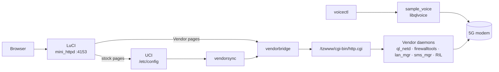

<div align="center">

# ZLT X28 OpenWrt

**A modern, cooler-running OpenWrt for the ZLT X28 / X28 PRO 5G CPE,
with local SMS and voice control for AI projects. No operator gateway in the middle.**

[](LICENSE)
-orange)


[](docs/WORKFLOW.md)

[Highlights](#highlights) •
[Status](#status) •
[Architecture](#architecture) •
[Quick start](#quick-start) •
[Recovery](#recovery-toolkit) •
[Roadmap](#roadmap) •
[Docs](#documentation) •
[Contributing](#contributing)

</div>

> [!WARNING]
> **Your device, your risk.** This project works on a live router that is usually also your
> internet connection. Everything assumes a unit you own, a verified flash backup and a tested
> way back to stock. Read [docs/RECOVERY.md](docs/RECOVERY.md) before writing anything to flash.
> Not affiliated with ZLT, Tozed, MediaTek or Quectel.

## Highlights

- 🖥️ **LuCI on stock firmware.** Real LuCI on port `4153`, persistent root SSH (key-only, port `2222`).
- 🔌 **Vendor bridge.** LuCI pages for LAN/DHCP, Wi-Fi, port forwarding, DMZ, SMS, USSD and voice,
  driving the vendor daemons through their own JSON API.
- 💬 **Local SMS.** Send and receive on the device, no cloud service.
- 🛟 **Recovery first.** Full 51-partition NAND backup with hashes, plus scripts that reach the MediaTek
  preloader over USB. [Details](docs/RECOVERY.md).
- 🌡️ **Heat-aware.** A reboot-surviving temperature and uptime logger to separate heat from other causes.
- 🎯 **The goal.** Our own OpenWrt image on the vendor kernel and modem blobs, flashed to the inactive
  A/B slot with stock kept as the fallback.

## Status

| Area | State |
|---|---|
| Root SSH (key-only, port 2222) and LuCI on `:4153` | ✅ Working, persistent across reboots |
| Vendor bridge (LuCI → `http.cgi`) | ✅ Working |
| Vendor menu: LAN/DHCP, Wi-Fi, port forwarding, DMZ, SMS, USSD, voice | ✅ Pages load; not every save path exercised |
| SMS send / receive | ✅ Working |
| Voice calls | ⛔ Blocked: SIM has no VoLTE/IMS and no CS fallback on this network |
| Stock LuCI Network/Firewall pages changing the router | 🚧 `vendorsync` adapter in progress |
| Full NAND backup (51 partitions, hash-verified) | ✅ Done |
| USB recovery (preloader + download agent) | ✅ All 51 partitions read over USB; every static one matches the backup. 🚧 Restore not yet tested |
| Custom firmware image | 🗓️ Planned: needs a proven USB restore and UART first |

## Architecture



The vendor daemons own the real network state today. The plan is to replace them one by one with
native netifd, fw4 and dnsmasq. See the [project plan](docs/PROJECT-PLAN.md).

## Quick start

For a unit that already has root SSH:

```sh
ssh -p 2222 root@192.168.70.1                      # key auth only
# LuCI: http://192.168.70.1:4153/cgi-bin/luci      (no trailing slash)
```

Deploy files from this repo. Never use plain `tar` on macOS: it adds `._*` files and your uid.

```sh
cd router && COPYFILE_DISABLE=1 tar --uid 0 --gid 0 -cf - usr etc | ssh router 'cd / && tar xf -'
ssh router 'rm -rf /tmp/luci-modulecache /tmp/luci-indexcache'
```

The bridge needs the vendor login in `/etc/vendor-ui.cred` on the router (line 1 user, line 2
password, mode 600). Change the default passwords before exposing anything.

## Recovery toolkit

One script per step in [`tools/recovery/`](tools/recovery). Every script only reads from the device.

| # | Step | Command |
|---|---|---|
| 1 | Back up every NAND partition over SSH | `python3 tools/recovery/dump_partitions.py` |
| 2 | Verify and unpack the backup | `python3 tools/recovery/verify_backup.py private/backups/<date>` |
| 3 | Catch the USB recovery port at power-on | `python3 tools/recovery/usb_watch.py` |
| 4 | Install pinned, patched mtkclient | `python3.14 tools/recovery/setup_mtkclient.py` |
| 5 | Read boot security (SBC/SLA/DAA) | `python3 tools/recovery/target_config.py` |
| 6 | Read a partition over USB, compare hashes | `python3 tools/recovery/read_verify.py lk_b` |
| 6b | Read all 51 partitions over USB, compare each | `python3 tools/recovery/read_all.py` |

> [!TIP]
> Use a **USB-A to USB-C** cable. With USB-C to USB-C the Mac never sees the modem.

Backups, probe logs and the mtkclient install live in the git-ignored `private/` folder.
They contain the unit's identity and calibration: never publish them.

## Roadmap

| Phase | Goal | State |
|---|---|---|
| 0. Safety | Verified dumps, UART boot log, tested way back to stock | 🚧 Dumps done; USB reads proven; restore and UART pending |
| 1. Stabilise and cool | Measure heat, cap CPU, retire debug daemons | 🚧 Logger done |
| 2. Stock options working | `vendorsync` adapter so stock LuCI changes the router | 🚧 In progress |
| 3. SMS and voice | SMS API; call control and an audio path to software | 🚧 SMS works, voice blocked |
| 4. Source and toolchain | GPL source request, blob inventory, rebuilt rootfs | 🗓️ |
| 5. Modern OpenWrt image | netifd, fw4, dnsmasq, LuCI; boots from slot B | 🗓️ |
| 6. Release | Reproducible builds, versioned images, recovery guide | 🗓️ |

Work is tracked as [GitHub issues](https://github.com/mralinp/zlt-x28-openwrt/issues) with priority,
type and area labels.

## Repository layout

| Path | What |
|---|---|
| [`router/`](router) | Overlay copied to the router: bridge, LuCI controller and views, adapter, init scripts |
| [`tools/recovery/`](tools/recovery) | Backup, verify and USB recovery scripts |
| [`scripts/`](scripts) | `install.sh` (deploy LuCI fixes) and helpers |
| [`patches/`](patches) | Patches against stock files (`dispatcher.lua`) |
| [`docs/`](docs) | Plans, recovery guide, vendor API map, notes |
| [`.claude/agents/`](.claude/agents) | Claude Code agents: planner, safety auditor, reviewer, researcher |

Not in the repo on purpose: the vendor web UI, firmware dumps, USB probe logs, SSH keys and credentials.

## Documentation

| Document | What it covers |
|---|---|
| [Recovery](docs/RECOVERY.md) | Backup, USB recovery procedure, device facts, open questions |
| [Project plan](docs/PROJECT-PLAN.md) | Measured facts, strategy, phases, risks |
| [Workflow](docs/WORKFLOW.md) | Issues, branches, commits and PRs |
| [Vendor command map](docs/vendor-command-map.md) | The vendor `http.cgi` JSON commands |
| [LuCI on stock firmware](docs/luci-on-stock.md) | How LuCI runs next to the vendor UI |
| [LuCI fix notes](docs/luci-fix-notes.md) | Dispatcher and session fixes |

## Contributing

Issues are the unit of work; every change is a branch and a pull request. Read
[docs/WORKFLOW.md](docs/WORKFLOW.md): GitFlow with **no `develop` branch until the first release**,
Conventional Commits, squash merges. Any change that touches the hardware needs a safety note
and a rollback in the PR.

## Credits

Builds on [EngineerMazeed/ZLT-X28](https://github.com/EngineerMazeed/ZLT-X28), which got LuCI onto the
device. USB recovery uses [bkerler/mtkclient](https://github.com/bkerler/mtkclient). OpenWrt and LuCI
belong to their respective projects.

## License

[MIT](LICENSE) for the code in this repository. OpenWrt, LuCI, mtkclient and vendor components keep
their own licenses.
