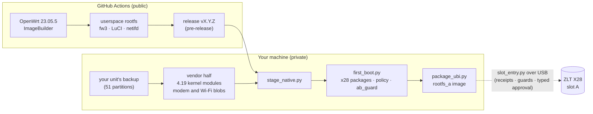

<div align="center">

<picture>
  <source media="(prefers-color-scheme: dark)" srcset="docs/assets/logo-dark.svg">
  
</picture>

# X28 OpenWrt

**A native OpenWrt 23.05 for the ZLT X28 5G CPE, with WireGuard, OpenVPN, L2TP, PPTP and Passwall2 built in and a signed `opkg` package feed built for its kernel: recovery-first, built in the open, running on a real unit.**

[](https://github.com/mralinp/zlt-x28-openwrt/releases)
[](https://github.com/mralinp/zlt-x28-openwrt/actions/workflows/release.yml)
[](https://github.com/mralinp/zlt-x28-openwrt/actions/workflows/ci.yml)
-orange)


[](LICENSE)

[Status](#status) · [Quick start](#quick-start) · [VPN and Passwall2](#vpn-and-passwall2) · [Package feed](#package-feed-opkg) · [Roadmap](docs/ROADMAP.md) · [How it works](#how-it-works) · [Changelog](CHANGELOG.md) · [Tests](docs/TESTING.md) · [Docs](docs/README.md) · [Contributing](#contributing)

</div>

> [!WARNING]
> **Your device, your risk.** The X28 is usually someone's only internet connection. Installing the native image
> writes its NAND over the MediaTek download agent. It has been done on **two tested units** (one X28, one X28 PRO).
> **Use the [x28-flasher](https://github.com/mralinp/x28-flasher) application for everything:** backup, root access,
> flashing and the change of boot order to slot A. Do not flash, edit `misc` or change the boot order by hand.
> The flasher has the guards that stop a wrong write from breaking the device. The manual steps in these docs are
> reference for how it works, not instructions to follow.
> The flasher takes a full backup of all 51 partitions and checks its hashes before it flashes anything.
> Read [docs/RECOVERY.md](docs/RECOVERY.md) to understand the risks.
> Not affiliated with ZLT, Tozed, MediaTek or Quectel.

> [!NOTE]
> **Stock firmware.** To boot slot A you must change the boot order, which needs SSH on the stock system.
> SSH was gained on stock `1.5` and on `8.6.8`. It is reported valid up to `8.6.28`
> (X28, X28 Pro, X28 V-Pro, X28 Pro (Ooredoo)); the flasher text says `8.6.26`. `TODO(verify)`: the exact ceiling and the V-Pro and Ooredoo models.
> The flasher is **not public yet** (the repo is private while it is finished). Until it is released, do not flash by hand: wait for the flasher.

## Summary

This project puts a normal OpenWrt 23.05.5 on the ZLT X28 5G CPE (MediaTek MT6890, Quectel RG500L modem). The
userspace is standard OpenWrt: LuCI, UCI, netifd, dnsmasq and the fw3 firewall. It runs on the vendor 4.19.205 kernel
and keeps the vendor modem stack only as a hardware backend. It ships WireGuard, OpenVPN, L2TP, PPTP and Passwall2,
and a signed `opkg` feed built for this kernel. The OpenWrt image goes on **slot A**; the stock firmware stays on **slot B** as the fallback.
Current release: **v0.68.0** (a pre-release; the badge above shows the newest).

## Terms used in these docs

| Term | Meaning |
|---|---|
| **Native image** | OpenWrt 23.05.5 userspace on the vendor kernel, flashed to slot A. This is the current product. |
| **Stage 1 overlay** | The old, deprecated approach: scripts added on top of the stock firmware. Not supported; kept only as history in `docs/`. |
| **Slot A / slot B** | The two A/B copies of kernel, rootfs and modem firmware in NAND. A runs OpenWrt, B keeps stock. |
| **Vendor half** | The closed parts (kernel, modem stack, `mt_wifi` driver). They come from your own unit's backup, never from this repo. |

## Status

Two units have run the native image: one X28 and one X28 PRO. Detail and evidence: [docs/STATUS.md](docs/STATUS.md) and [docs/TESTING.md](docs/TESTING.md). The hardware, module by module: [docs/MODULES.md](docs/MODULES.md).

| Feature | State | X28 | X28 PRO |
|---|---|---|---|
| Full NAND backup (51 partitions, hash-checked) | working | tested | not separately recorded `TODO(verify)` |
| USB recovery (preloader + download agent), guarded flash of slot A | working | tested | tested ([flash-other-units](docs/research/flash-other-units.md)) |
| Native image boots from slot A | working | tested | tested |
| 5G data as a netifd interface (`x28_mipc`), Carrier tab in LuCI | working | tested | untested |
| HTTPS LuCI (self-signed), LAN bridge, DHCP/DNS, IPv6 on LAN, firewall, NAT | working | tested | DHCP at boot tested, needs `x28-dhcp` ([TESTING 43](docs/TESTING.md)) |
| Wi-Fi (MT7915 dual band, WPA2) | partial: no throughput tests yet | tested | 5 GHz tested ([TESTING 44](docs/TESTING.md)) |
| WireGuard, OpenVPN | working | tested | untested |
| Passwall2 (xray, TPROXY) | working | tested | untested |
| L2TP, PPTP clients | untested against a server | installed | installed |
| Front panel LEDs, boot counter, settings kept over reboot | working | tested | untested |
| `opkg` and LuCI Software with the signed feed | working | tested | packaged image on two units ([TESTING 49](docs/TESTING.md)) |
| Boot slot switch (A and B) | working | tested | tested ([TESTING 42](docs/TESTING.md)) |
| SMS and voice | not working on the native image (worked on the stage 1 overlay) | not ported | not ported |
| `sysupgrade`, one-command upgrade (`x28-upgrade`, LuCI notice) | built, not yet run on a unit ([Upgrading](#upgrading)) | untested | untested |
| Fan control, own kernel | not available | planned | planned |

Notes:

- Slot A is deliberately **not** marked successful. This keeps the preloader fall-back to stock slot B ([BOOT-FLOW](docs/BOOT-FLOW.md)).
- Idle SoC temperature is about 40 °C (stock: 65 °C without a fan).
- The vendor modem stack is closed and not redistributable. This repository publishes the **build tooling and the packages**, not a ready-to-flash image. The image is assembled locally from your own unit's backup.
- One SIM, one carrier were tested. IPv6 on the 5G WAN: `TODO(verify)` beyond the first unit. The 2.5G WAN port is not covered by a test note: `TODO(verify)`.

## Quick start

You need the **x28-flasher** application. It does the whole install in one place: backup, root access on the stock
system, building the image for your unit, flashing slot A and switching the boot order to slot A. There is no other supported way.

1. Get the [x28-flasher](https://github.com/mralinp/x28-flasher) when it is released.
2. Connect the unit with a **USB-A to USB-C** cable (C to C does not work).
3. In the flasher, run the steps in order: Connect, Backup, Root access, Build image, Flash OpenWrt, Boot order. Keep the backup safe, with a second copy offline.
4. After the first boot, open `https://192.168.70.1/cgi-bin/luci` (self-signed certificate). Root has an empty password: set one. SSH is on port 22, LAN only.

The flasher downloads the newest `x28-assembly-*` bundle from the [releases](https://github.com/mralinp/zlt-x28-openwrt/releases) itself.
What each step does is in [The flasher app](#the-flasher-app) below. A UART is not needed to flash. It is only for development and debugging.

## Upgrading

Every release with a signed `x28-sysupgrade-<version>.tar` can be installed from the running image; the router checks the signature
itself (`ucert`), writes the A/B slot it is **not** running, verifies it, and only then boots it. The running slot stays as the fall-back.

- **LuCI**: Status > Overview shows *Firmware update* when a newer signed image is out (checked at most every 6 h, cached in `/tmp`).
  *Upgrade now* asks for confirmation, then downloads, checks and flashes; the unit reboots.
- **SSH**: `x28-upgrade` only checks; `x28-upgrade -y` downloads the image to `/tmp`, checks its `.sha256`, runs `sysupgrade -T` and then
  `sysupgrade -n` (settings are not kept). It refuses when the running slot still counts boot tries or `/tmp` is too small.
- **By hand**: download the signed tarball from the [releases](https://github.com/mralinp/zlt-x28-openwrt/releases) and upload it in
  System > Backup / Flash Firmware.

Nothing upgrades on its own. Images up to v0.75.0 have no `x28-upgrade` and their `sysupgrade` writes the **running** slot unless
`/etc/x28-native-b` and `/tmp/x28-write-b-ok` name B; upgrade those by hand once (design: [sysupgrade-design](docs/research/sysupgrade-design.md)).

## VPN and Passwall2

These were the main reasons to replace the stock firmware. **Every image ships all of them preinstalled, ready to
configure on a clean flash**, before any of your settings: the build refuses to make an image without the WireGuard and TPROXY modules
and `ipset`. Configure them from
stock LuCI pages:

| | How it runs on the vendor 4.19.205 kernel |
|---|---|
| **WireGuard** | The kernel has none. We build `wireguard-linux-compat` against the kernel tree ([`package/x28-kmods`](package/x28-kmods/README.md)) and load it after a good boot, with a crash guard ([#227](https://github.com/mralinp/zlt-x28-openwrt/issues/227)) |
| **OpenVPN** | `openvpn-openssl` and `luci-app-openvpn`, `tun` from the stock kernel |
| **L2TP, PPTP** | `xl2tpd` and `ppp-mod-pptp` as LuCI interfaces |
| **Passwall2** | xray on the iptables path (no nftables here), with TPROXY and socket modules we build, plus a small shim for two symbols the kernel never exported ([PASSWALL2](docs/PASSWALL2.md)) |


What the X28 can carry with this firmware, measured on the unit on 2026-11-02 ([TESTING 37](docs/TESTING.md#37-vpn-speed-and-cpu-limits-on-the-router-2026-11-02),
[PASSWALL2](docs/PASSWALL2.md#what-the-device-can-carry)). WireGuard and OpenVPN ran `iperf3` between the router and a LAN
peer, so the carrier and the far server are out of the picture:

| Tunnel | Router sends | Router receives | CPU (4 cores) | What limits it |
|---|---|---|---|---|
| None (reference) | 856 Mbit/s | 363 Mbit/s | 9–36% | the test laptop's path |
| WireGuard, 4 streams | 715 Mbit/s | 330 Mbit/s | 55–58% | not reached |
| OpenVPN AES-128-GCM (mbed TLS) | 102 Mbit/s | 58 Mbit/s | 24–27% | one core |
| OpenVPN AES-256-GCM (OpenSSL, the shipped build) | 74 Mbit/s | 84 Mbit/s | 25–27% | one core |
| Passwall2 / xray, LAN client | 40 Mbit/s | 206 Mbit/s measured, about 400 estimated | 56% peak, xray 1.1 cores | the link, not the router |

**Pushing it further** ([details](docs/PASSWALL2.md#pushing-it-further)):

- **WireGuard** for raw speed: it runs in the kernel on all four cores and had headroom at 715 Mbit/s.
- **OpenVPN** is single-threaded at about 100 Mbit/s per tunnel: use UDP and AES-GCM, or split traffic across tunnels.
- **Passwall2** scales with streams and cores: pick a light transport (fewer layers than XHTTP over TLS), keep logs at
  `warn`, and try packet steering, since `cpu0` takes all network interrupts.
- **Heat** is not the limit so far: the SoC idles about 40 °C on this firmware and stayed under 48 °C in these tests.
  A fan or the `performance` CPU governor buys more for sustained loads.

Not yet measured: LAN clients forwarded through each tunnel, L2TP and PPTP against a server, the Passwall2 ceiling
itself, the tuning ideas, and WireGuard over hours.

## Package feed (opkg)

The vendor kernel is 4.19.205 and the official OpenWrt kernel modules (`kmod-*`) are built for 5.15, so on this device they can never load. This project publishes a **signed `opkg` feed built for this kernel**, so `opkg`, LuCI's *Software* page and the packages that depend on kernel modules behave:

```text
src/gz x28 https://github.com/mralinp/zlt-x28-openwrt/releases/latest/download
```

Images built with the current flasher already have this line and the signing key (`7fec994ab0d15b97`). On a running unit, replace the `x28` line in `/etc/opkg/customfeeds.conf` and run `opkg update`. The feed holds 224 packages in total (the kernel packages below plus our own `x28-*` packages).

- **What installs:** 208 of the 976 official kernel-module packages: 180 stubs for modules the kernel already has, and 28 packages that carry modules we built for it. That covers WireGuard and the TPROXY/socket modules (preinstalled in the image, reinstallable and updatable from the feed), SQM with `sch_cake`, `tc-full` and traffic-control actions and filters, `veth`, `macvlan`, `bonding`, `nbd`, `ss`, the `iptables` hashlimit and IPsec matches, the IPv6 raw table and ChaCha20-Poly1305 for strongSwan. Built modules are loaded at boot by `x28-kmods`, which is itself a feed package (`opkg install x28-kmods` once on an older image).
- **Our own packages:** the 5G WAN, LAN DHCP guard, Wi-Fi, LEDs, boot counter, overlay and module loader are feed packages too, protected by the `x28-base` package, so `opkg upgrade` updates them and a removed one comes back with `opkg install`. Boot-critical ones take effect after a reboot. Passwall2 stays on its own feed. The model, update policy and rollback: [docs/PACKAGE-FEED.md](docs/PACKAGE-FEED.md#package-model-and-updates).
- **What is refused:** anything that needs a kernel the vendor image does not have (`nftables`/`firewall4`, `ksmbd`, Bluetooth, the Wi-Fi stack and similar) fails with a clear error instead of installing something that cannot load. LuCI itself is not affected.
- **Trust:** the index is signed; `opkg` checks it. Tested with the image's own `opkg` against the published URL (148 checks) and on a unit, including a reboot.
- **Scope:** valid for **the ZLT X28 line only** (MT6890, vendor kernel 4.19.205, OpenWrt 23.05.5 userspace), not for other devices or kernels.

Contents, signing, coverage, limits, how a release is made and what is not tested: **[docs/PACKAGE-FEED.md](docs/PACKAGE-FEED.md)**; the evidence is in [TESTING](docs/TESTING.md#45-x28-feed-3-with-opkg-and-on-the-unit-2026-11-08).

## How it works



- **Open half in CI.** Official 23.05.5 packages, assembled with ImageBuilder. The firewall is fw3 because the
  stock kernel has no `nf_tables`.
- **Vendor half stays local.** The stock kernel modules and vendor binaries are proprietary and specific to a
  firmware build, so they are taken from **your own unit's backup** and never enter this public repo or CI.
- **Our packages** (`package/`): `x28-mipc` (cellular netifd protocol) with its LuCI page, `x28-modem` (starts the
  vendor modem stack), `x28-wifi`, `x28-leds`, `x28-bootok` (A/B boot counter) and `x28-kmods` (WireGuard and TPROXY
  modules for the vendor kernel: sources here, built locally against the kernel tree, loaded after a good boot).
- **Guarded flashing.** The tools in [mralinp/x28-flasher](https://github.com/mralinp/x28-flasher) (`tools/recovery/` there) write only the targets they were built for, check the other
  slot and neighbouring partitions before and after every write, and need a typed phrase from the owner.

## The flasher app

[x28-flasher](https://github.com/mralinp/x28-flasher) is the companion app that gets this firmware onto a unit: one window for backup, building the image
and flashing, with every guard and typed confirmation of the recovery procedure built in. It is private until it is ready, then public.


| Step | What it is for |
|---|---|
| Connect | Finds the modem over USB and reads what it is. One connection serves every step: no power cycle between them. |
| Backup | Saves every partition to your computer, hash-checked. Always first. |
| Root access | Once on a fresh unit: key-only SSH on the stock firmware (slot B), from a fresh read of it. |
| Build image | Assembles the image for your own unit from a release's `x28-assembly-*` bundle and your backup. |
| Flash OpenWrt | Writes slot A behind a rehearsal and a phrase you type yourself. Slot B (stock) is left as the fallback. |
| Boot order | A switch between slot A (OpenWrt) and slot B (stock), over SSH on the running modem. |
| Read & verify | Reads a partition back and compares it with your backup. |

It runs as a native window on macOS (Apple silicon), and as installers for Linux and Windows built by its CI. The screenshot hides the unit's
identifiers. Read [Build and flash](#build-and-flash) and the recovery docs before you use it.

Note: This flasher enables SSH with root access on firmware versions up to 8.6.26. I haven't been able to find newer versions to test, so if you have one, please let me know by opening an issue.

> **Note:** Gaining root access also makes it possible to unlock carrier-locked units. The device stores its carrier-lock settings in a configuration file. Simply set all unlock-code fields to 0 and clear the carrier list to allow SIM cards from any carrier. Ez pz! 😎

## Build and flash

Backup, root access, image assembly, flashing and the boot order all belong to the
[x28-flasher](https://github.com/mralinp/x28-flasher) (private for now). Use it; do not run the steps by hand.
It builds the image locally from a release's `x28-assembly-*` bundle and **your own unit's backup**, because the vendor half
cannot be published. How the pieces work, for readers and reviewers: [docs/BUILD.md](docs/BUILD.md),
[docs/RECOVERY.md](docs/RECOVERY.md) and [docs/research/rootfs-a-write-plan.md](docs/research/rootfs-a-write-plan.md).

## Documentation

Start with [docs/TESTING.md](docs/TESTING.md) for evidence and [docs/STATUS.md](docs/STATUS.md) for the current state.
[docs/README.md](docs/README.md) is the full index and code map; the main ones:
[PROJECT-PLAN](docs/PROJECT-PLAN.md), [BUILD](docs/BUILD.md), [RECOVERY](docs/RECOVERY.md), [BOOT-FLOW](docs/BOOT-FLOW.md),
[NATIVE-CELLULAR](docs/NATIVE-CELLULAR.md), [PACKAGE-FEED](docs/PACKAGE-FEED.md), [PASSWALL2](docs/PASSWALL2.md), [THERMAL](docs/THERMAL.md),
[WORKFLOW](docs/WORKFLOW.md), the [kmod gap analysis](docs/research/kmod-gap.md) (what it takes to carry every official package) and the [CHANGELOG](CHANGELOG.md).

## Releases

A merge to `main` that changes shippable files is released automatically (docs-only and CI-only merges are not). The version comes from the PR title (Conventional Commits:
`feat` → minor, `type!` → major, otherwise patch); 0.x releases are pre-releases. Each release publishes one
`x28-assembly-vX.Y.Z.tar.gz` bundle (userspace, package files, kernel modules, extra packages). A release alone does not boot the X28 (the vendor half is
added locally); see [docs/BUILD.md](docs/BUILD.md). What changed, release by release: [CHANGELOG.md](CHANGELOG.md).

## Contributing

Issues are the unit of work; every change is a branch (`feature|fix|docs|chore|research/<issue>-slug`) and a
squash-merged PR with a Conventional Commit title. Changes that touch the device need a safety note and a
rollback. Read [docs/WORKFLOW.md](docs/WORKFLOW.md); the project's rules for AI agents are in [CLAUDE.md](CLAUDE.md).
Owners of the same box, or its rebrands (MT6890 + MT7915 + MT7531), are very welcome: compare notes in an issue.

## Credits

[EngineerMazeed/ZLT-X28](https://github.com/EngineerMazeed/ZLT-X28) got LuCI onto the stock firmware.
[mt6890-cpe-recovery](https://github.com/mt6890-cpe-recovery/mt6890-cpe-recovery) published the X28 SP Flash
Tool package with Quectel's download agent. [bkerler/mtkclient](https://github.com/bkerler/mtkclient) does the
USB work. [gaglians/zlt-x28-openwrt2305](https://github.com/gaglians/zlt-x28-openwrt2305) explored 23.05 on the
vendor kernel. OpenWrt and LuCI belong to their projects.

## Support

Made with ❤️ by mralinp. If this project helps you, please give it a star on GitHub, and donations are welcome on any EVM chain: `0x6743d8fe71f18b3101f3086e8d9f8d272d0f7618`


## License

Copyright (C) 2026 Ali Naderi Parizi. The code in this repository is free software under the [GNU GPL v3](LICENSE) (or any later version): anyone may use, modify and redistribute it, but any distributed derivative must be released under the same licence with its complete source, and must keep this copyright notice and credit the original project. OpenWrt, LuCI, mtkclient and vendor components keep their own
licences. Vendor firmware is never distributed here.
