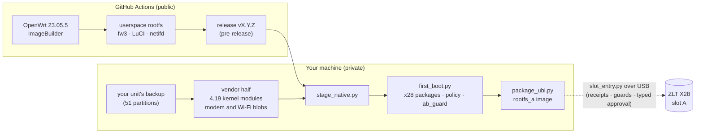

<div align="center">

<picture>
  <source media="(prefers-color-scheme: dark)" srcset="docs/assets/logo-dark.svg">
  
</picture>

# X28 OpenWrt

**A native OpenWrt 23.05 for the ZLT X28 5G CPE: recovery-first, built in the open, running on a real unit.**

[](https://github.com/mralinp/zlt-x28-openwrt/releases)
[](https://github.com/mralinp/zlt-x28-openwrt/actions/workflows/release.yml)
[](https://github.com/mralinp/zlt-x28-openwrt/actions/workflows/ci.yml)
-orange)


[](LICENSE)

[Status](#status) · [Roadmap](#roadmap-to-a-stable-release) · [How it works](#how-it-works) · [Build](#build-and-flash-overview) · [Changelog](CHANGELOG.md) · [Tests](docs/TESTING.md) · [Docs](docs/README.md) · [Contributing](#contributing)

</div>

> [!WARNING]
> **Your device, your risk.** The X28 is usually someone's only internet connection, and flashing it means
> writing its NAND over the MediaTek download agent. The native image has been flashed to slot A and boots on
> **one tested unit**; the procedure is guarded and owner-approved step by step, and needs a verified backup and a
> UART. It is not a consumer installer. Read [docs/RECOVERY.md](docs/RECOVERY.md) before touching anything.
> Not affiliated with ZLT, Tozed, MediaTek or Quectel.

## Why

The ZLT X28 (MediaTek MT6890/T750, Quectel RG500L modem) ships a locked-down OpenWrt 19.07 with a vendor web
UI. This project puts a **normal OpenWrt** on it: stock LuCI and UCI, netifd, standard DHCP and firewall, a
cooler box, and local SMS/voice for AI projects, **without losing the ability to recover the unit**. So it goes
recovery first: back up everything, prove a way back, then build and flash.

## Status

Last updated 2026-10-29 (release `v0.22.0`). One unit, one SIM, one carrier.

| Area | State |
|---|---|
| Full NAND backup (51 partitions, hash-verified) | ✅ done |
| USB recovery: preloader + download agent | ✅ all 51 partitions read over USB; `rootfs_a` and `rootfs_sig_a` written and restored with guarded tools |
| Native OpenWrt 23.05.5 on slot A (vendor 4.19.205 kernel, fw3 + iptables-legacy) | ✅ boots; stock slot B untouched |
| 5G data as a normal netifd interface (`x28_mipc`: IPv4, IPv6, IPv4v6, APN from the SIM) | ✅ works, with its own LuCI protocol page |
| LuCI, LAN bridge (4 sockets), DHCP/DNS, IPv6 on the LAN, firewall and NAT | ✅ works; root has an empty password until you set one |
| Wi-Fi (MT7915 dual band, vendor `mt_wifi` through a netifd handler) | 🟡 both radios come up with WPA2; client and throughput tests pending |
| Front panel LEDs (radio, signal, WAN) | ✅ works |
| Everything at boot, settings surviving reboots, SSH key-only on port 22 | ✅ works |
| A/B boot counter | ✅ the preloader adds a try per boot; `x28-bootok` resets it after a good boot, like stock |
| Slot A marked successful | ❌ deliberately not: success stays 0 so the fall-back to stock B remains (see [BOOT-FLOW](docs/BOOT-FLOW.md)) |
| Temperature | ✅ about 40 °C idle on the SoC (stock 65 °C idle without a fan, 46 °C with the 12 V fan) |
| SMS and voice | 🗓️ worked on the stock-firmware overlay (voice blocked by the SIM); not yet on the native image |
| Recovery slot, sysupgrade, fan control, own kernel | 🗓️ planned, see the roadmap |

Every ✅ links to evidence and a reproduce command in **[docs/TESTING.md](docs/TESTING.md)**. The vendor modem
stack is closed-source and not redistributable, so what this repository publishes is the **build tooling and the
packages**, not a ready-to-flash image: the image is assembled locally from your own unit's backup.

## Roadmap to a stable release

The target layout is simpler than today's two full firmwares:

- **Slot A: stable OpenWrt**, the thing you run.
- **Slot B: a recovery slot**, a small kernel and recovery path that can rescue the box and install or reinstall
  OpenWrt on slot A, and put the stock firmware back if you want it. This frees the flash that now holds a second
  full firmware and removes the need for the download agent and a UART in everyday recovery.

Steps, roughly in order ([docs/PROJECT-PLAN.md](docs/PROJECT-PLAN.md) has the detail):

1. Soak and test the slot-A image: 48 h without unexplained reboots, Wi-Fi client and throughput tests, more LED
   states, the idle CPU and RAM baseline.
2. Design and build the recovery slot, including the way back to stock.
3. `sysupgrade` for the new layout.
4. A tagged stable release, the device page for the OpenWrt wiki, and build documentation for other owners.
5. Later: fan control from LuCI ([#47](https://github.com/mralinp/zlt-x28-openwrt/issues/47)), local SMS and voice
   on the native image, and a 4.19 kernel plus kmod feed built from a sibling-device SDK
   ([#130](https://github.com/mralinp/zlt-x28-openwrt/issues/130)).

## How it works



- **Open half in CI.** Official 23.05.5 packages, assembled with ImageBuilder. The firewall is fw3 because the
  stock kernel has no `nf_tables`.
- **Vendor half stays local.** The stock kernel modules and vendor binaries are proprietary and specific to a
  firmware build, so they are taken from **your own unit's backup** and never enter this public repo or CI.
- **Our packages** (`package/`): `x28-mipc` (cellular netifd protocol) with its LuCI page, `x28-modem` (starts the
  vendor modem stack), `x28-wifi`, `x28-leds` and `x28-bootok` (A/B boot counter).
- **Guarded flashing.** The tools in `tools/recovery/` write only the targets they were built for, check the other
  slot and neighbouring partitions before and after every write, and need a typed phrase from the owner.

## Build and flash overview

Everything is detailed, with expected output, in [docs/BUILD.md](docs/BUILD.md) and
[docs/TESTING.md](docs/TESTING.md). Hardware: a ZLT X28, a **USB-A-to-USB-C** cable (C-to-C does not work), a UART
adapter, and a second internet path while the X28 is offline. Tools: Python 3.10+, Docker, `gh`, Homebrew `libusb`
on macOS.

```bash
# 1. Back up and verify every NAND partition (router reachable as `ssh router`)
python3 tools/recovery/dump_partitions.py
python3 tools/recovery/verify_backup.py private/backups/<date>

# 2. Install the pinned mtkclient and read the unit over USB (modem unpowered at start)
/opt/homebrew/bin/python3.14 tools/recovery/setup_mtkclient.py
python3 tools/recovery/read_all.py

# 3. Build the open userspace (Linux x86_64; or take the CI release)
tools/build/userspace.sh out

# 4. Assemble the native image from your backup (details and flags in docs/BUILD.md)
python3 tools/build/stage_native.py   --stock <stock rootfs.tar.gz> --modern <userspace rootfs.tar.gz> ... --output private/build/native-stage-N
python3 tools/build/first_boot.py     --stage private/build/native-stage-N --public-key ~/.ssh/router.pub --stock <stock rootfs.tar.gz> --output private/build/native-management-N
docker run ... x28-firmware-tools:ubi python3 /tools/build/package_ubi.py --profile /profile --output /out/native-ubi-N

# 5. Flash slot A with the guarded session tool (dry run first; --write needs approval, UART and a second backup copy)
python3 tools/recovery/slot_entry.py rootfs_a write --candidate-dir private/build/native-ubi-N ...
```

The flash step, its gates and the typed approvals are described in
[docs/research/rootfs-a-write-plan.md](docs/research/rootfs-a-write-plan.md) and
[docs/RECOVERY.md](docs/RECOVERY.md). Read both first.

## Documentation

| Doc | What |
|---|---|
| [CHANGELOG.md](CHANGELOG.md) | Milestones and every release |
| [docs/STATUS.md](docs/STATUS.md) | Where the project stands today |
| [docs/TESTING.md](docs/TESTING.md) | **Start here for evidence.** Every test: result, commands, what is not proven |
| [docs/PROJECT-PLAN.md](docs/PROJECT-PLAN.md) | Goal, strategy, phases, roadmap and risks |
| [docs/BUILD.md](docs/BUILD.md) | Building the native image: open half in CI, vendor half locally |
| [docs/RECOVERY.md](docs/RECOVERY.md) | Backup, USB recovery, flash sessions, UART |
| [docs/BOOT-FLOW.md](docs/BOOT-FLOW.md) | A/B slots, the preloader boot counter, the rootfs signature check |
| [docs/NATIVE-CELLULAR.md](docs/NATIVE-CELLULAR.md) | The `x28_mipc` cellular protocol |
| [docs/THERMAL.md](docs/THERMAL.md) | Heat baseline, the 12 V fan, current readings |
| [docs/FIRMWARE-INVENTORY.md](docs/FIRMWARE-INVENTORY.md) | Kernel, modules, vendor packages, runtime deps |
| [docs/WORKFLOW.md](docs/WORKFLOW.md) | Issues, branches, commits, automatic releases |
| [docs/README.md](docs/README.md) | Full documentation tree and code map |

## Releases

Every merge to `main` is released automatically. The version comes from the PR title (Conventional Commits:
`feat` → minor, `type!` → major, otherwise patch); 0.x releases are pre-releases. Assets are the open
userspace rootfs, its package manifest and `SHA256SUMS`. A release alone does not boot the X28 (the vendor half is
added locally); see [docs/BUILD.md](docs/BUILD.md). What changed, release by release: [CHANGELOG.md](CHANGELOG.md).

## Contributing

Issues are the unit of work; every change is a branch (`feature|fix|docs|chore|research/<issue>-slug`) and a
squash-merged PR with a Conventional Commit title. Changes that touch the device need a safety note and a
rollback. Read [docs/WORKFLOW.md](docs/WORKFLOW.md); the project's rules for AI agents are in [CLAUDE.md](CLAUDE.md).
Owners of the same box, or its rebrands (MT6890 + MT7915 + MT7531), are very welcome: compare notes in an issue.

## Credits

[EngineerMazeed/ZLT-X28](https://github.com/EngineerMazeed/ZLT-X28) got LuCI onto the stock firmware.
[mt6890-cpe-recovery](https://github.com/mt6890-cpe-recovery/mt6890-cpe-recovery) published the X28 SP Flash
Tool package with Quectel's download agent. [bkerler/mtkclient](https://github.com/bkerler/mtkclient) does the
USB work. [gaglians/zlt-x28-openwrt2305](https://github.com/gaglians/zlt-x28-openwrt2305) explored 23.05 on the
vendor kernel. OpenWrt and LuCI belong to their projects.

## License

[MIT](LICENSE) for the code in this repository. OpenWrt, LuCI, mtkclient and vendor components keep their own
licences. Vendor firmware is never distributed here.
