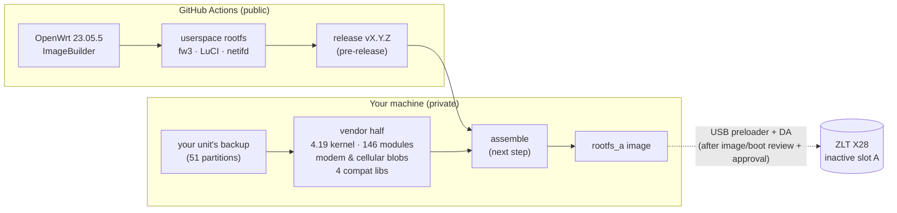

<div align="center">

<picture>
  <source media="(prefers-color-scheme: dark)" srcset="docs/assets/logo-dark.svg">
  
</picture>

# X28 OpenWrt

**A modern OpenWrt for the ZLT X28 5G CPE: recovery-first, built in the open, tested on a real unit.**

[](https://github.com/mralinp/zlt-x28-openwrt/releases)
[](https://github.com/mralinp/zlt-x28-openwrt/actions/workflows/release.yml)
[](https://github.com/mralinp/zlt-x28-openwrt/actions/workflows/ci.yml)
-orange)


[](LICENSE)

[Status](#status) · [How it works](#how-it-works) · [Reproduce](#reproduce-the-results) · [Tests](docs/TESTING.md) · [Docs](docs/README.md) · [Contributing](#contributing)

</div>

> [!WARNING]
> **Your device, your risk.** The X28 is usually someone's only internet connection, and the project works on
> its flash. A bounded inactive-slot changed-page restore test has passed; arbitrary recovery and a custom-image
boot remain unproven. Read
> [docs/RECOVERY.md](docs/RECOVERY.md) before touching anything. Not affiliated with ZLT, Tozed, MediaTek or Quectel.

## Why

The ZLT X28 (MediaTek MT6890/T750, Quectel RG500L modem) ships a locked-down OpenWrt 19.07 with a vendor web
UI. This project wants a **modern OpenWrt** on it, with stock LuCI, cooler operation and local SMS/voice for AI
projects, **without losing the ability to recover the unit**. So it goes recovery first: back up everything,
prove a way back, then build.

## Status

| Area | State |
|---|---|
| Full NAND backup (51 partitions, hash-verified) | ✅ done |
| USB recovery: preloader + download agent | ✅ **all 51 partitions read over USB**; every static one matches the backup |
| Boot security | ✅ secure boot, SLA, DAA **off** (preloader report) |
| Firmware inventory (kernel config, modules, vendor packages, runtime deps) | ✅ done |
| OpenWrt 23.05.5 userspace (fw3 + iptables-legacy, LuCI) | ✅ builds in CI; released as `v0.1.0` (pre-release) |
| Vendor modem/cellular binaries on that userspace | ✅ link with musl's loader (static + runtime link test) |
| Restore a partition over USB | ✅ exact changed-padding page restored and stock B returned; [scope and limits](docs/research/changed-page-restore-result.md) |
| UART console | ✅ shifted RX at 921600; boot and recovery logs captured |
| Bootable native image | 🗓️ [input/boot audit complete](docs/research/native-image-readiness.md); local assembly and first-A boot plan next |
| Stage 1 overlay on stock firmware (LuCI on `:4153`, vendor bridge, SMS) | ✅ working; voice blocked by the SIM |

Every ✅ links to evidence and a reproduce command in **[docs/TESTING.md](docs/TESTING.md)**.

## How it works



- **Open half in CI.** Official 23.05.5 packages, assembled with ImageBuilder. The firewall is fw3 because the
  stock kernel has no `nf_tables`.
- **Vendor half stays local.** The stock kernel, modules and vendor binaries are proprietary and specific to a
  firmware build, so they are taken from **your own unit's backup** and never enter this public repo or CI.
- **Recovery path.** Preloader USB download (USB-A-to-C cable) with Quectel's T750 download agent and a
  pinned, patched mtkclient. It reads the whole flash; the tested two-write page restore keeps its explicit scope and guards.
  A custom-image write still needs its own reviewed artifact and approval.

## Reproduce the results

Everything below is detailed, with expected output, in [docs/TESTING.md](docs/TESTING.md).

```bash
# 1. Back up and verify every NAND partition (router reachable as `ssh router`)
python3 tools/recovery/dump_partitions.py
python3 tools/recovery/verify_backup.py private/backups/<date>

# 2. USB recovery: install the pinned mtkclient, then read and compare (modem unpowered at start)
/opt/homebrew/bin/python3.14 tools/recovery/setup_mtkclient.py
python3 tools/recovery/target_config.py
python3 tools/recovery/read_verify.py lk_b
python3 tools/recovery/read_all.py

# 3. Build the open userspace (Linux x86_64; or run in CI)
tools/build/userspace.sh out

# 4. Check the vendor stack against a release (arm64 Linux / Docker, see TESTING.md §14)
python3 tools/build/link_check.py --old-rootfs <stock rootfs> --userspace <release rootfs.tar.gz> --ipk <...>
```

Hardware: a ZLT X28, a **USB-A-to-USB-C** cable (C-to-C does not work), and a second internet path while the
X28 is offline. Tools: Python 3.10+, Docker, `gh`, Homebrew `libusb` on macOS.

## Documentation

| Doc | What |
|---|---|
| [docs/TESTING.md](docs/TESTING.md) | **Start here.** Every test: result, exact commands, what is not proven |
| [docs/RECOVERY.md](docs/RECOVERY.md) | Backup, USB recovery, full reads, restore plan, UART |
| [docs/FIRMWARE-INVENTORY.md](docs/FIRMWARE-INVENTORY.md) | Kernel, modules, vendor packages, runtime deps, fw3 fit, ABI |
| [docs/BUILD.md](docs/BUILD.md) | Open userspace in CI vs vendor half locally |
| [docs/PROJECT-PLAN.md](docs/PROJECT-PLAN.md) | Goal, strategy, phases 0–6, risks |
| [docs/WORKFLOW.md](docs/WORKFLOW.md) | Issues, branches, commits, automatic releases |
| [docs/README.md](docs/README.md) | Full documentation tree and code map |

## Releases

Every merge to `main` is released automatically. The version comes from the PR title (Conventional Commits:
`feat` → minor, `type!` → major, otherwise patch); 0.x releases are pre-releases. Assets are the open
userspace rootfs, its package manifest and `SHA256SUMS`. A release alone does not boot the X28: see
[docs/BUILD.md](docs/BUILD.md).

## Contributing

Issues are the unit of work; every change is a branch (`feature|fix|docs|chore|research/<issue>-slug`) and a
squash-merged PR with a Conventional Commit title. Changes that touch the device need a safety note and a
rollback. Read [docs/WORKFLOW.md](docs/WORKFLOW.md); the project's rules for AI agents are in [CLAUDE.md](CLAUDE.md).

## Credits

[EngineerMazeed/ZLT-X28](https://github.com/EngineerMazeed/ZLT-X28) got LuCI onto the stock firmware.
[mt6890-cpe-recovery](https://github.com/mt6890-cpe-recovery/mt6890-cpe-recovery) published the X28 SP Flash
Tool package with Quectel's download agent. [bkerler/mtkclient](https://github.com/bkerler/mtkclient) does the
USB work. [gaglians/zlt-x28-openwrt2305](https://github.com/gaglians/zlt-x28-openwrt2305) explored 23.05 on the
vendor kernel. OpenWrt and LuCI belong to their projects.

## License

[MIT](LICENSE) for the code in this repository. OpenWrt, LuCI, mtkclient and vendor components keep their own
licences. Vendor firmware is never distributed here.
