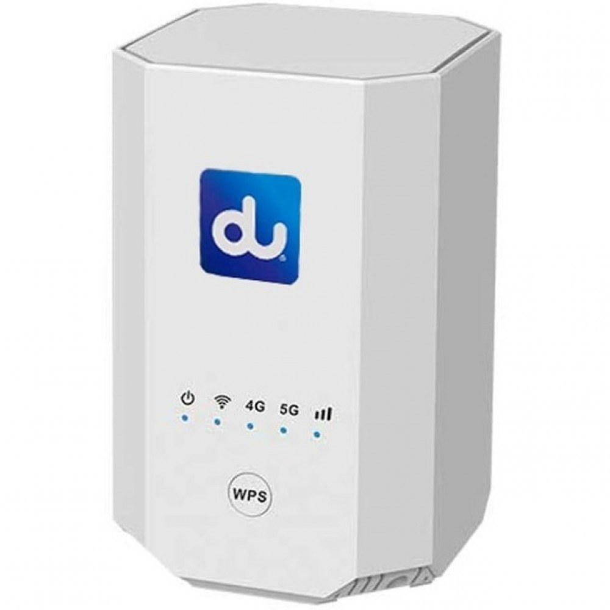
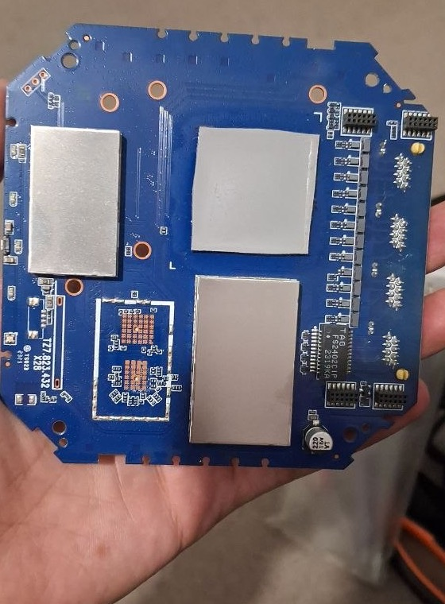
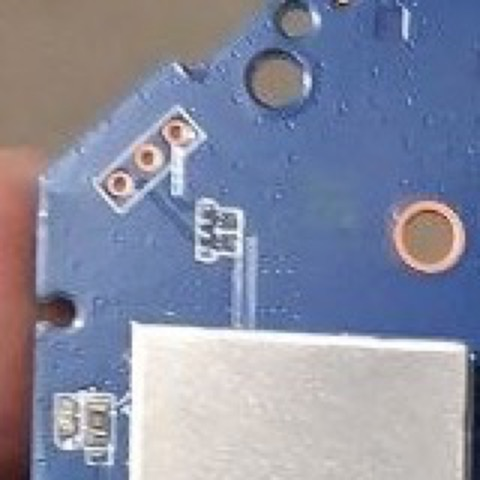
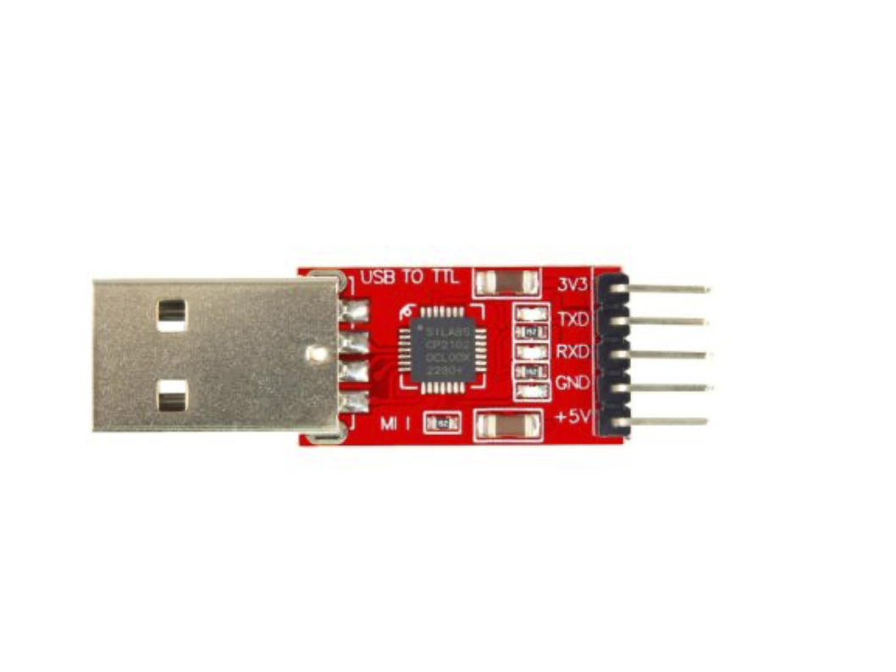
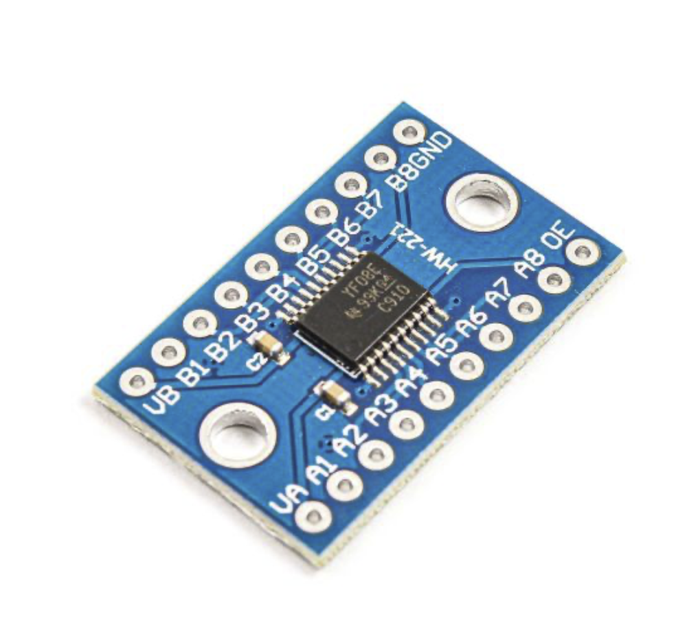
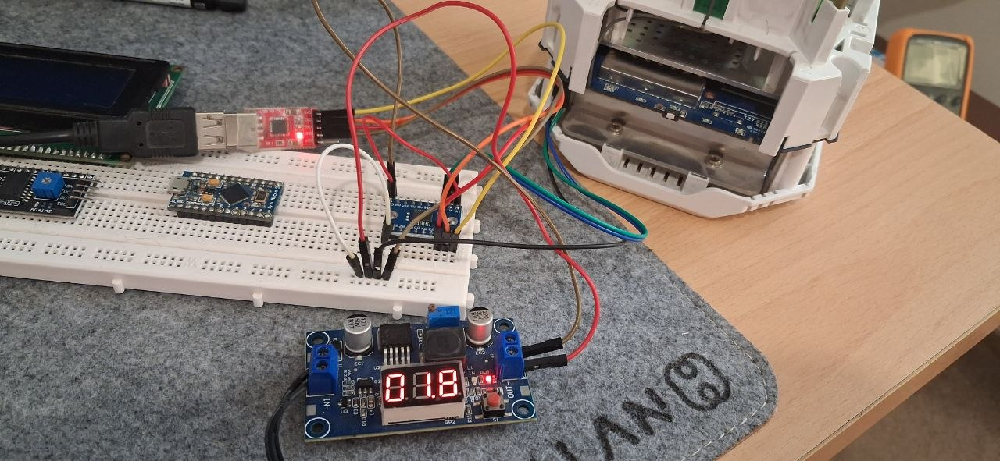

<h1 dir="rtl" align="right">مهندسی معکوس مودم 5G مدل ZLT X28</h1>

<h2 dir="rtl" align="right">قسمت اول: از بررسی سخت‌افزار تا دسترسی به سیستم</h2>

**نویسنده: علی نادری پریزی**

این روزها دیگه برای استفاده از 5G توی ایران لازم نیست فقط سراغ گوشی بریم. اگه محل زندگی یا کارمون پوشش داشته باشه، یه مودم 5G هم می‌تونه اینترنت خونه یا محل کار رو تأمین کنه. البته هنوز همه‌جا پوشش یکسانی نداره؛ قبل از خرید باید ببینیم توی محل استفاده چه وضعی داریم. [نقشه اندازه‌گیری کاربران nPerf](https://www.nperf.com/fa/map/IR/-/1795.IranCell/signal) یکی از راه‌های دیدن پوشش ثبت‌شده شبکه هست.

اگه توی بازار ایران دنبال مودم 5G گشته باشید، احتمالاً اسم **ZLT X28** رو زیاد دیدید؛ یکی از مدل‌های شناخته‌شده و پرطرفدار این بازاره. خیلی جاها با عنوان استوک عرضه می‌شه و نمونه‌های اپراتوری آنلاک‌شده‌ش هم توی بازار هست. [مقایسه X28 با GT525](https://doornegar.com/مقایسه-zlt-x28-و-grayten-gt525؛-کدام-مودم-5g-ارزش-خرید-بیشت/) هم به رواج X28 در بازار مودم‌های استوک اشاره داره. X28 یه CPE هست؛ یعنی همون دستگاهی که سمت ما قرار می‌گیره، اینترنت رو از شبکه سلولی می‌گیره و با Wi-Fi و کابل شبکه به دستگاه‌های خونه یا محل کار می‌رسونه.

ولی چیزی که من رو کنجکاو کرد فقط 5G نبود. زیر قاب این مودم یه پردازنده چهارهسته‌ای ARM داریم، مقداری حافظه و یه سیستم‌عامل لینوکسی. خب با این سخت‌افزار چرا فقط به امکانات پنل سازنده محدود باشیم؟ می‌شه روی خودش WireGuard یا OpenVPN راه انداخت؟ می‌شه OpenWrt معمولی داشته باشیم و اینترنت سیم‌کارت رو هم از دست ندیم؟ پروژه من از همین سؤال‌ها شروع شد.

مودم من اینترنت می‌داد، ولی اون تنظیمات و ابزارهایی که از یه روتر لینوکسی می‌خواستم توی دسترسم نبود. می‌خواستم LuCI و UCI معمول OpenWrt رو داشته باشم، شبکه رو خودم مدیریت کنم و VPN راه بندازم. فقط یه شرط مهم داشتم: اینترنت سلولی و اطلاعات اختصاصی برد باید سالم می‌موند. از دسترسی به سیستم و راه‌انداختن پنل وب شروع کردم؛ جلوتر که رفتم، پای NAND، زنجیره بوت و ارتباط لینوکس با مودم هم وسط اومد.

توی این مجموعه، مسیر کارم روی [پروژه ZLT X28 OpenWrt](https://github.com/mralinp/zlt-x28-openwrt) رو تعریف می‌کنم. تا اینجا همه تست‌ها روی **یه دستگاه، یه سیم‌کارت و یه اپراتور** انجام شده؛ پس هر چیزی که روی مودم من جواب داده، لزوماً روی همه X28ها جواب نمی‌ده. دستگاه از قبل SIM-unlock بود؛ دسترسی Linux که در ادامه توضیح می‌دم، فرایندی جدا از بازکردن قفل سیم‌کارت هست.

<h2 dir="rtl" align="right">چرا نصب LuCI پایان کار نبود؟</h2>

اولین نکته جالب این بود که فریمور کارخانه خودش بر پایه OpenWrt 19.07 بود و Kernel نسخه 4.19.205 داشت. ولی دیدن اسم OpenWrt توی فایل‌ها به این معنی نبود که همه‌چیز مثل یه OpenWrt معمولی کار می‌کنه. در بررسی اولیه، باینری `netifd` وجود داشت، اما در فهرست پردازش‌های نمونه‌برداری‌شده اجرا نمی‌شد. در عوض `lan_mgr`، `wan_mgr` و چند سرویس سازنده شبکه رو مدیریت می‌کردن. حتی آدرس LAN ثبت‌شده در UCI با آدرس واقعی رابط زنده تفاوت داشت.

اینجا یه دردسر مهم داشتیم: صفحه Interfaces ممکنه تنظیمی رو نشون بده که مالک واقعی رابط از اون استفاده نمی‌کنه. فشردن Save & Apply هم می‌تونه سرویس دیگه‌ای رو با همون تنظیمات قدیمی فعال و دسترسی رو قطع کنه. برای همین قبل از درست‌کردن ظاهر صفحه، باید می‌فهمیدم چه برنامه‌ای واقعاً LAN، WAN، DHCP و فایروال رو کنترل می‌کنه.

در مرحله اول، روی همون فریمور کارخانه LuCI رو تعمیر کردم. فایل‌های قالب و منو ناقص بودن، بعضی صفحات خطای 404 داشتند و محدودیت ACL باعث می‌شد Overview منتظر بمونه. اصلاح مسیر انتهایی URL هم لازم بود، چون `mini_httpd` با `/cgi-bin/luci/` مانند `uhttpd` رفتار نمی‌کرد. در اون دوره LuCI روی پورت 4153 و SSH روی 2222 بود؛ رابط وب سازنده روی پورت‌های 80 و 443 باقی ماند.

اما نمایش پروتکل یا صفحه فایروال، شاهد کنترل واقعی شبکه نیست. مستند [بررسی اولیه دستگاه](../../docs/DEVICE-AUDIT.md) همین مرز رو ثبت می‌کنه. تصمیم بعدی این بود که RootFS مستقلی بسازم: مدیریت شبکه با netifd و سرویس‌های استاندارد باشه، و از لایه سازنده فقط وابستگی‌های لازم سخت‌افزار باقی بمونه.

<h2 dir="rtl" align="right">واقعاً چه سخت‌افزاری داریم؟</h2>

برای شناخت برد، نام تجاری کافی نیست. مشخصات زیر از [گزارش سخت‌افزار](../../docs/HARDWARE.md)، [تحلیل معماری](../../docs/research/x28-hardware-architecture.md)، Device Tree و مشاهدات دستگاه گرفته شدن.

| بخش | مشخصات این نمونه | مرز شواهد |
| ---: | ---: | ---: |
| SoC | MediaTek MT6890، خانواده T750 | شناسه نرم‌افزاری، Device Tree و شناسایی USB |
| پردازنده لینوکس | چهار Cortex-A55، معماری aarch64 | بازه فرکانس ثبت‌شده ۵۰۰ تا ۲۰۰۰ MHz |
| پلتفرم سلولی | Quectel RG500L-EU | شناسایی فریمور و USB؛ نوشته زیر شیلد بررسی نشده |
| Wi-Fi | MediaTek MT7915، دو باند | شناسه PCI برابر `14c3:7915` و درایور زنده |
| سوییچ | MT7531AE | خروجی `swconfig list` |
| RAM | ۱ GiB؛ سهم قابل مشاهده Linux حدود ۶۲۸ MiB | مقدار کل از نقشه حافظه؛ بخشی برای مودم رزرو شده |
| فلش | NAND، با ۵۱ پارتیشن | مجموع پارتیشن‌ها ۱۰۲۲٫۵ MiB؛ ظرفیت ۱ GiB استنباط می‌شه |
| Kernel کارخانه و تصویر فعلی | 4.19.205 | کرنل سازنده حفظ شده |

این مشخصات رو برای همین برد در نظر بگیرید؛ هنوز همه نسخه‌های بازار رو بررسی نکردم. حتی نمونه‌های دیگه‌ای از X28 با تاریخ ساخت متفاوت Kernel گزارش شدن. یکسان بودن عدد 4.19.205 هم برای جابه‌جایی ماژول‌ها کافی نیست؛ تنظیمات، patchها و ABI باید مطابق باشن.

<h3 dir="rtl" align="right">چرا لینوکس تمام RAM رو نمی‌بینه؟</h3>

در این پلتفرم، مودم سلولی از حافظه سیستم استفاده می‌کنه. خلاصه ظرفیت در گزارش سخت‌افزار شامل حدود ۲۵۶ MiB برای تصویر و حافظه کاری مودم، حدود ۱۰۹ MiB حافظه مشترک و بخش‌های رزروشده دیگه برای firmwareهاست. این نواحی قبل از آغاز Linux کنار گذاشته می‌شن. بیکار بودن مودم اون‌ها رو خودکار به حافظه آزاد Linux تبدیل نمی‌کنه.

در Device Tree هم دو توصیف حافظه با اندازه‌های متفاوت دیده شده و نقشه مؤثر به اصلاحات Bootloader وابسته‌ست. برای همین حذف یه `reserved-memory` برای زیادکردن RAM، آزمایش بی‌خطری نیست. ممکنه لینوکس و Baseband روی یه ناحیه بنویسند. برای استفاده روزمره، `MemAvailable` شاخص مناسب‌تری از `MemFree` هست؛ برای تغییر Kernel باید کل قرارداد حافظه هنگام بوت روشن بشه.

<h2 dir="rtl" align="right">عکس برد چه می‌گه و چه نمی‌گه؟</h2>

*تصویر ۱ — نمای پشت برد آزمایش‌شده؛ مسیر فایل توی مخزن: `docs/images/x28-board-back.jpg`.* شیلدهای فلزی محل بخش‌های پوشیده برد رو نشون می‌دن و footprint سه‌سوراخ در گوشه بالای چپ، نقطه ورود ما به کنسول هست. این عکس مدرک شناسایی قطعات زیر شیلد نیست؛ برای اون‌ها به شواهد نرم‌افزاری تکیه کرده‌ام.

شماره چاپ‌شده روی برد، `TZ7.823.432 X28`، در تطبیق نمونه اهمیت داره. قبل از هر سیم‌کشی باید مطمئن شویم همون سمت و جهت عکس رو می‌بینیم. چرخاندن برد، تعبیر «چپ» و «راست» رو عوض می‌کنه؛ نام سیگنال و اندازه‌گیری مهم‌تر از حافظه تصویری ماست.

اولش فقط حدس می‌زدیم این footprint مربوط به UART باشه. یه بررسی پیوستگی در ۲۰۲۶-۱۰-۲۳ حتی به نتیجه نادرست درباره زمین رسید. بعداً سیم‌کشی و دریافت موفق روی خود دستگاه، pinout رو تأیید کرد. این اشتباه رو هم نگه داشتم، چون نتیجه اولین اندازه‌گیری همیشه جواب آخر نیست. حتی اسم فایلی مثل `uart-candidate` هم وضعیت کنونی شواهد رو تعیین نمی‌کنه.

<h2 dir="rtl" align="right">UART؛ کنسولی که باید اول فقط شنید</h2>

UART رابط سریال ناهم‌زمان هست. برای شنیدن خروجی Bootloader و Kernel به TX برد، RX مبدل و زمین مشترک نیاز داریم. در اولین capture، TX مبدل وصل نبود؛ برای همین چیزی به دستگاه ارسال نمی‌شد. این روش اجازه داد زنجیره بوت رو قبل از دستکاری تنظیمات کنسول ببینم.

*تصویر ۲ — نمای نزدیک محل UART؛ مسیر مخزن: `docs/images/x28-uart-candidate.jpg`.* تصویر برای پیداکردن footprint مفید هست. نام‌گذاری سیگنال‌ها از آزمون ثبت‌شده در [راهنمای Recovery](../../docs/RECOVERY.md) میاد، نه از حدس شکل پدها. قبل از اتصال، جهت رو با نمای کامل برد تطبیق دهید.

| محل طبق جهت مرجع راهنمای Recovery | سیگنال برد | اتصال |
| ---: | ---: | ---: |
| سوراخ سمت راست | TX، سطح بیکار ۱٫۸ V | به RX مبدل از مسیر تبدیل سطح |
| سوراخ وسط | GND | زمین مشترک برد، مبدل و تبدیل‌کننده |
| سوراخ سمت چپ | RX، منطق ۱٫۸ V | برای capture اولیه قطع؛ برای ارسال از تبدیل سطح |

> **هشدار الکتریکی:** این footprint پایه VCC نداره. خروجی تغذیه ۳٫۳ یا ۵ ولت مبدل رو به اون وصل نکنید. TX یه مبدل ۳٫۳ ولتی نباید مستقیم به RX برد وصل بشه. مدار تبدیل سطح باید برای منطق ۱٫۸ ولت مناسب باشه. تغذیه برد از مسیر اصلی خودش تأمین می‌شه.

صرف خواندن TX هم همیشه با یه مبدل ۳٫۳ ولتی جواب نمی‌ده؛ آستانه تشخیص High می‌تونه بالاتر از ۱٫۸ ولت باشه. در تجربه ثبت‌شده، خواندن مستقیم نویز تولید می‌کرد. زمین قطع یا بد هم در همه baudها بایت‌های تصادفی یا `0xFF` می‌داد؛ چشمک‌زدن LED مبدل، دریافت درست رو ثابت نمی‌کنه.

*تصویر ۳ — نمونه مبدل USB به TTL.* پایه‌های TXD و RXD برای ارسال و دریافت داده هستن؛ وجود پایه 3V3 روی ماژول به معنی سازگاری مستقیم سیگنال‌ها با UART یک‌وهشت‌ولتی X28 نیست. پایه‌های تغذیه این مبدل رو به footprint سه‌سوراخ مودم وصل نمی‌کنیم.

سرعت این نمونه **921600، هشت بیت داده، بدون parity و یه stop bit** هست؛ همون 8N1. عدد از `console=ttyS0,921600n1` و دریافت متن خوانا تأیید شد. گزارش 115200 برای نمونه‌ای دیگه وجود داره، اما اون رو جایگزین اندازه‌گیری این برد نکردم. برای تبدیل سطح، از ماژول **TXS0108E** استفاده کردم و ولتاژ ۱٫۸ ولت مورد نیاز رو با یه رگولاتور تأمین کردم. عکس چیدمان واقعی رو پایین می‌بینید.

<h3 dir="rtl" align="right">تبدیل سطح با TXS0108E و رگولاتور ۱٫۸ ولت</h3>

*تصویر ۴ — نمونه ماژول TXS0108E برای تبدیل سطح سیگنال.* روی این تصویر، تغذیه سمت A با VA و سمت B با VB مشخص شده؛ نوشته روی ماژول من برای تغذیه سمت A، V1 بود. اسم پایه‌ها رو با ماژول خودتون تطبیق بدید، نه فقط جای اون‌ها در عکس.

برای این اتصال، فقط پایین‌آوردن ولتاژ تغذیه کافی نبود؛ خود سیگنال‌های UART هم باید بین منطق ۳٫۳ ولت مبدل و ۱٫۸ ولت برد جابه‌جا می‌شدن. تبدیل سطح سیگنال رو TXS0108E انجام می‌داد. خروجی ۱٫۸ ولت رگولاتور رو به **V1 سمت A** و **OE** ماژول وصل کردم: V1 تغذیه سمت کم‌ولتاژ رو می‌گرفت و OE با همین سطح High، ماژول رو فعال می‌کرد. رگولاتور رو به‌جای level shifter توی مسیر TX یا RX نمی‌ذاریم.

*تصویر ۵ — عکس چیدمان مدار خودم؛ مسیر فایل از ریشه مخزن: `docs/images/uart-circut.jpeg`.* ماژول تبدیل سطح روی بردبورد، رگولاتور در جلوی عکس و مودم بازشده سمت راست دیده می‌شن. این عکس روش استفاده‌شده رو مستند می‌کنه؛ برای تشخیص تک‌تک سیم‌ها و شماره کانال‌ها باید pinout رو هم داشته باشیم، نه اینکه از رنگ سیم‌ها حدس بزنیم.

طبق [مشخصات TXS0108E در سایت TI](https://www.ti.com/product/TXS0108E)، این قطعه دو تغذیه جدا داره و باید `VCCA ≤ VCCB` باشه. برای تبدیل سطح اینجا، سمت A مربوط به منطق `1.8 V` برد و سمت B مربوط به منطق `3.3 V` مبدله؛ یعنی `VCCA=1.8 V` و `VCCB=3.3 V`. زمین برد، مبدل، ماژول و رگولاتور هم باید مشترک باشه. روی ماژولی که من استفاده کردم، پایه تغذیه سمت A با نام **V1** مشخص شده بود؛ توی دیتاشیت خود تراشه، اسم این تغذیه **VCCA** هست. OE هم به همون خروجی ۱٫۸ ولت رگولاتور وصل بود. موقع استفاده از ماژول دیگه، نوشته‌های روی برد و دیتاشیت رو تطبیق بدید؛ شماره کانال‌ها رو از روی رنگ سیم‌های عکس حدس نزنید.

نکته مهم همون قبلیه: این ۱٫۸ ولت برای سمت کم‌ولتاژ مبدل سطحه، نه برای تغذیه مودم از پدهای UART. مودم همچنان از ورودی تغذیه خودش روشن می‌شه. برای شنیدن لاگ، فقط مسیر TX برد به RX مبدل لازمه؛ TX مبدل رو تا وقتی نیاز به ارسال نداریم، قطع نگه می‌داریم.

<h3 dir="rtl" align="right">یه دام نرم‌افزاری در macOS</h3>

در این آزمایش، اجرای جداگانه `stty` و سپس `cat` سرعت رو حفظ نکرد؛ تنظیمات با بسته‌شدن descriptor برگشت. نتیجه ظاهراً شبیه baud اشتباه بود. راه درست این بود که پورت یه بار باز و روی همون descriptor تنظیم بشه. سند Recovery از طرفی محدودیت ابزار `screen` در این نرخ رو ثبت کرده؛ انتخاب تصادفی ابزار ترمینال جای بررسی تنظیم واقعی پورت رو نمی‌گیره.

برای بازتولید capture، نمونه Python ثبت‌شده در [گزارش UART](../../docs/research/uart-boot-log.md) رو ببینید. پورت با `O_RDONLY` باز می‌شه و TX مبدل هم فیزیکی قطع هست. فایل خام رو خصوصی نگه دارید: لاگ بوت می‌تونه MAC، شماره سریال و شناسه‌های سلولی داشته باشه. در مقاله فقط گزیده پالایش‌شده رو میارم.

<h2 dir="rtl" align="right">ترتیب واقعی دسترسی؛ SSH قبل از پوسته UART بود</h2>

<h3 dir="rtl" align="right">از CGI احرازهویت‌شده به Telnet موقت</h3>

ماجرا در واقع قبل از ساخته‌شدن مخزن شروع شده بود. در بررسی firmware نسخه 1.5.13، اتصال به پورت‌های 22،‏ 23 و 4153 رد می‌شد، اما پنل سازنده در دسترس بود. برای بررسی این مسیر روی دستگاه خودتون، اول با حساب **Super Admin** وارد پنل سازنده بشید؛ اینجا منظور حساب پنل وب هست، نه root لینوکس. بعد ابزار توسعه‌دهنده مرورگر رو باز کنید، به بخش **Network** برید و صفحه DMZ رو باز کنید. درخواست مربوط به `/cgi-bin/http.cgi` رو پیدا و با **Copy as cURL** کپی کنید. برای پیدا کردن ساختار درخواست هم می‌تونید فایل JavaScript همین صفحه رو در بخش Sources بررسی کنید.

درخواست رو باید با اطلاعات نشست معتبر خودتون بفرستید؛ **کوکی نشست (session cookie)** رو از درخواست مرورگر نگه دارید، اگر پنل اون رو ارسال می‌کنه. فقط کپی‌کردن URL کافی نیست: در JavaScript نسخه بررسی‌شده، مقدارهای `sessionId` و برای عملیات نوشتن `token` هم از `sessionStorage` به بدنه درخواست اضافه می‌شن. پس نباید فرض کنیم کوکی به‌تنهایی برای احراز هویت کافیه. نام و مقدار کوکی و این فیلدها رو از درخواست واقعی همون نسخه بردارید؛ هیچ‌کدوم رو در مقاله، اسکرین‌شات یا پیام عمومی منتشر نکنید.

نمونه زیر فقط **وضعیت DMZ رو می‌خونه** و تنظیمی رو تغییر نمی‌ده. آدرس و مقدارهای نمونه رو با اطلاعات دستگاه و نشست خودتون جایگزین کنید؛ اگر درخواست واقعی کوکی نداره، خط `--cookie` رو حذف کنید. برای اینکه اطلاعات نشست در تاریخچه shell نمونه ذخیره نشن، فرمان شامل مقدار واقعی رو در ترمینال paste نکنید؛ درخواست رو در یه فایل محلی با دسترسی محدود نگه دارید و بعد از کار پاک کنید.

<pre dir="ltr" align="left"><code dir="ltr" class="language-sh">curl 'http://192.168.70.1/cgi-bin/http.cgi' \
  --cookie 'SESSION_COOKIE_NAME=SESSION_COOKIE_VALUE' \
  --header 'Content-Type: application/json' \
  --data-raw '{"cmd":172,"method":"GET","subcmd":6,"sessionId":"YOUR_SESSION_ID","language":"EN"}'</code></pre>

دقت کنید که HTTP این نمونه به‌خاطر `--data-raw` از نوع POST هست، ولی فیلد `method` داخل JSON برابر `GET` هست و خواندن وضعیت رو درخواست می‌کنه. در مقابل، درخواست **تغییر تنظیم DMZ** با `cmd=172`،‏ `method=POST` و `subcmd=6` در بدنه JSON ارسال می‌شد و فیلدهای `enabled`،‏ `ip` و `token` هم داشت. نمونه بالا فرمان بازکردن Telnet نیست؛ مرحله بعد روایت استفاده من از مسیر آسیب‌پذیر همون firmware هست.

مسیر آسیب‌پذیر، مقدار فیلد `ip` رو به اجرای فرمان shell می‌رسونه. با یه نشست معتبر پنل، مقدار IP حاوی جداکننده `;` ارسال شد تا بعد از بخش اول، `telnetd` اجرا بشه. بخش فرمان **واقعاً اجراشده** این‌جور بود؛ این یه شرح تاریخی هست، نه درخواست HTTP کامل یا توصیه اجرای دوباره روی gateway:

<pre dir="ltr" align="left"><code dir="ltr" class="language-sh">telnetd -b 192.168.70.1 -p 2323</code></pre>

پورت 2323 اول بسته بود و چند ثانیه بعد باز شد. درخواست غیرفعال‌کردن DMZ هم بلافاصله ارسال شد. در ادامه، دسترس‌پذیری پنل و وضعیت سرویس بررسی شد؛ اینجا فهمیدم نباید فقط به جواب موفق API اعتماد کنم، چون در تلاش‌های بعدی بعضی درخواست‌ها success برمی‌گردوندن ولی marker مورد انتظار ساخته نمی‌شد.

> **اثر عملیاتی این مرحله:** تنظیم DMZ تغییر می‌کنه و یه سرویس ورود بدون رمزنگاری روی LAN باز می‌شه. این روش فقط با احراز هویت مالک و روی نمونه بررسی‌شده اجرا شد؛ session token و credential در مقاله نمیان. قبل از هر بازتولید، تنظیم اولیه DMZ، مسیر مدیریت مستقل و روش بستن listener باید مشخص باشن. این کار فلش firmware نیست، اما می‌تونه امنیت و ارتباط gateway زنده رو تغییر بده.

<h3 dir="rtl" align="right">BusyBox shell داشتیم، اما هنوز root نبودیم</h3>

ورود به Telnet با حساب Linux از نوع `admin` موفق شد. banner،‏ `BusyBox v1.30.1` و shell داخلی `ash` رو نشون می‌داد. خروجی واقعی `id` این بود:

<pre dir="ltr" align="left"><code dir="ltr" class="language-text">uid=1000(admin) gid=1000(admin) groups=1000(admin)</code></pre>

پس BusyBox مرحله ارتقای دسترسی نبود؛ ابزارها و shell محیط بود. پردازش `telnetd` با root اجرا شده بود، ولی login کاربر رو به UID 1000 می‌بره. حساب پنل وب هم با حساب root در Linux یکی نبود. تلاش ورود root و `su`، shell ریشه تأییدشده ندادند. روش دومِ Telnet مستقیم و بدون login هم در اون مرحله قبل از اجرا متوقف شد؛ اون رو جزو مسیر موفق حساب نمی‌کنم.

برای root SSH از همون مسیر CGI دارای دسترسی بالاتر استفاده کردم تا فایل مجاز root و سرویس SSH رو آماده کنم. خواندن فایل‌ها و انتقال موقت کلید عمومی از Telnet ممکن بود، ولی کپی به مسیر محافظت‌شده با فرمان privileged انجام شد. برای همین ترتیب دقیق «Telnet و سپس خودکار root» نبود: Telnet محیط بررسی رو فراهم کرد و CGI هنوز برای عملیات ریشه لازم بود.

<h3 dir="rtl" align="right">کلید عمومی، Dropbear و یه مسیر اشتباه</h3>

روی Mac کلید اختصاصی اتصال ساخته شد و **فقط کلید عمومی** به دستگاه رفت؛ کلید خصوصی روی میزبان ماند. Dropbear موجود در firmware با host key موقت و bind به `192.168.70.1:2222` راه افتاد. فایل محلی `dropbear-start-original.py` فرمان تاریخی زیر رو حفظ کرده؛ این فرمان سرویس باز می‌کنه و نباید فقط برای مشاهده وضعیت اجرا بشه:

<pre dir="ltr" align="left"><code dir="ltr" class="language-sh">dropbear -r /tmp/zlt_root_hostkey -p 192.168.70.1:2222 \
  -P /tmp/zlt_root_dropbear.pid -s -j -k -T 3 -I 300</code></pre>

گزینه `-s` ورود با password رو می‌بنده. بازبودن پورت هنوز ورود موفق نبود. کلید اول در `/root/.ssh/authorized_keys` قرار گرفت و login با public key رد شد. بعد از تلاش اولیه Ed25519، کلید RSA هم امتحان شد؛ چون مسیر مجوز کلید هنوز اشتباه بود، از اون شکست‌ها نمی‌شه به‌تنهایی ناسازگاری قطعی Ed25519 رو نتیجه گرفت.

آخرش مشکل از مسیر کلید بود. باید کلید رو جایی می‌گذاشتم که Dropbear این OpenWrt ازش می‌خونه. بخش عملیاتی ثبت‌شده در فایل محلی `recovery-original.py` این‌جور هست؛ قبل از بازنویسی این‌جور فایلی در دستگاه دیگه باید کلیدهای قبلی رو حفظ کرد:

<pre dir="ltr" align="left"><code dir="ltr" class="language-sh">cp /tmp/zlt_root.pub /etc/dropbear/authorized_keys &amp;&amp; chmod 600 /etc/dropbear/authorized_keys</code></pre>

فایل موقت فقط **کلید عمومی** بود. این بار اتصال با RSA جواب داد و بالاخره خروجی‌ای رو گرفتم که دنبالش بودم:

<pre dir="ltr" align="left"><code dir="ltr" class="language-text">uid=0(root) gid=0(root)</code></pre>

اسکریپت اتصال باقی‌مانده در `you-are-a-senior-embedded-linux/outputs/router-root-ssh/connect.sh` از کلید مشخص، `IdentitiesOnly=yes`،‏ known_hosts اختصاصی و `StrictHostKeyChecking=yes` استفاده می‌کنه. برای host key قدیمی، `HostKeyAlgorithms=+ssh-rsa` و برای کلید کاربر `PubkeyAcceptedAlgorithms=+ssh-rsa` فقط در همون اتصال اومدن؛ policy عمومی SSH میزبان شل نشده. فرمان خلاصه اتصال، بعد از آماده‌بودن همین تنظیمات، این‌جور بود:

<pre dir="ltr" align="left"><code dir="ltr" class="language-sh">ssh -p 2222 root@192.168.70.1</code></pre>

بعد از تأیید root SSH، خاموش‌بودن DMZ و bind سرویس بررسی شد، listener موقت Telnet بسته شد و بسته‌بودن پورت اون تأیید شد. فایل‌های موقت کلید عمومی و markerهای setup هم پاک شدن. host key اون مرحله در `/tmp` بود؛ دوام سرویس بعد از reboot، کار جداگانه بعدی بود و از موفقیت اولین login نتیجه نمی‌شه. alias با نام `router` در ادامه، تنظیمات اتصال مالک رو خلاصه می‌کنه؛ تصویر native کنونی SSH روی پورت 22 داره.

<h3 dir="rtl" align="right">UART بعد از این دسترسی تکمیل شد</h3>

دریافت کنسول هم با داشتن shell فرق داشت. فریمور کارخانه خروجی رو چاپ می‌کرد، ولی getty در `inittab` کامنت بود. Enter فقط echo می‌شد و `login:` نمی‌اومد. بعد از داشتن دسترسی مدیریتی موجود، تنظیم getty تغییر کرد. این مرحله روی overlay می‌نوشت و در سند [Recovery](../../docs/RECOVERY.md) همراه با نسخه پشتیبان و مسیر برگشت ثبت شده؛ راه به‌دست‌آوردن root اولیه نبود.

توی تصویر native، پیکربندی کنسول بعداً به `askfirst` برای ash تغییر کرد. این تفاوت امنیتی مهمه: وضعیت کنسول کارخانه رو نباید به تصویر جدید تعمیم داد. دسترسی فیزیکی به UART تصویر native می‌تونه shell ریشه بدهد؛ حفاظت از دستگاه فقط محدودکردن پورت شبکه نیست.

<h2 dir="rtl" align="right">اولین بررسی‌ها؛ بدون راه‌اندازی سرویس‌های ناشناخته</h2>

برای شروع، اطلاعات موجود رو می‌خوندم. نمونه‌های زیر در مستندات پروژه اومدن و سیستم رو reconfigure نمی‌کنن:

<pre dir="ltr" align="left"><code dir="ltr" class="language-sh">ssh router 'uname -a; cat /proc/cmdline; cat /proc/mtd'
ssh router 'cat /etc/quectel-project-version; lsmod'
ssh router 'cat /proc/mounts'</code></pre>

از این سه مشاهده، سه لایه روشن می‌شه: نسخه و معماری Kernel، منبع RootFS و slot، و فایل‌سیستم‌ها و ماژول‌های فعال. خروجی کامل باید قبل از انتشار از شناسه‌های اختصاصی پاک بشه. عمداً به‌جای یه خروجی ساختگی برای دستگاه خواننده، معنی شواهد نمونه آزمایش رو توضیح می‌دم.

یه بار هم سر یه فرض به‌ظاهر ساده به دردسر خوردم: اجرای `sms_mgr -h` کمک چاپ نکرد و به فعالیت مودم و reboot منتهی شد. برنامه اختصاصی الزاماً قرارداد متداول خط فرمان رو رعایت نمی‌کنه. برای شناخت اون باید اول فایل، رشته‌ها، callerها و اسکریپت راه‌انداز رو بررسی کرد. گزینه‌ای که برای ابزار لینوکس بی‌خطر به نظر می‌رسه، برای یه ابزار vendor ممکنه فرمان عملیاتی باشه.

<h2 dir="rtl" align="right">Linux میزبان و Baseband یه چیز نیستن</h2>

روی پردازنده کاربردی یا AP، Linux اجرا می‌شه؛ Baseband پردازنده و firmware مسئول شبکه رادیویی هست. در X28 بررسی‌شده، مسیر فعال میان این دو داخلی هست. فرمان‌های کنترلی از MIPC و پورت‌های CCCI می‌گذرن و بسته‌های IP از CCMNI و DPMAIF عبور می‌کنن. برای همین با یه روتر مجزا و مودم USB که فقط QMI یا MBIM رو فعال کنیم روبه‌رو نیستیم.

دیده‌شدن Quectel در USB هم این معماری رو نقض نمی‌کنه. Linux می‌تونه خودش یه USB gadget به کامپیوتر ارائه کنه. اون درگاه بیرونی با رابط داخلی AP و Baseband یکی نیست. این تمایز در قسمت سوم تعیین می‌کنه چرا `x28_mipc` نوشتم و چرا نصب یه بسته عمومی USB-modem کافی نبود.

<h2 dir="rtl" align="right">لاگ بوت چه چیزی رو روشن کرد؟</h2>

capture مورخ ۲۰۲۶-۱۰-۲۶ نشون داد Preloader، LK و سپس Kernel اجرا می‌شن. گزیده زیر عین خطوط منتشرشده و پالایش‌شده [گزارش بوت](../../docs/research/uart-boot-log.md) هست؛ خطوط میانی حذف شدن:

<pre dir="ltr" align="left"><code dir="ltr" class="language-text">[QL_AB] metadata.slots[0].priority:14,metadata.slots[1].priority:15.
[AB] ab_suffix: _b, ab_retry: 0, ab_boot_success: 1
[SBC] cert verify, part = lk_b, img = lk...ok
[SBC] image mt6890 auth pass
[SBC] ROOTFS_SIG_VFY Success</code></pre>

همراه با `bootslot=b` و `ubi.mtd=42`، این خروجی slot B رو برای اون capture مشخص می‌کنه. از طرفی وجود بررسی امضا در زنجیره رو نشون می‌ده. اما یه بوت موفق با فایل‌های اصلی ثابت نمی‌کنه که فایل تغییرکرده هم پذیرفته می‌شه یا شکست بررسی حتماً به slot دیگه می‌ره. برای پاسخ به اون سؤال‌ها، تحلیل مسیر خطا و آزمایش مستقل لازم بود.

در همین نقطه، تصویر کلی دستگاه به‌دست آمد: NAND با بخش‌های مشترک و جفت‌های A/B، Kernel مستقل از RootFS، و firmwareهای مودم که باید دست‌نخورده بمونن. هدف بعدی دیگه «فایل رو کجا کپی کنم؟» نبود؛ باید می‌فهمیدم دقیقاً چه چیزی رو می‌خونم و اگر نوشتن شکست خورد، چطور برمی‌گردم.

<h2 dir="rtl" align="right">نتیجه و ادامه مسیر</h2>

تا این مرحله مشخصات اصلی نمونه، کنسول ۱٫۸ ولتی و ترتیب قابل مشاهده بوت روشن شده بود. دسترسی مدیریتی موجود رو به ابزار ثبت شواهد تبدیل کردم و محدودیت LuCI روی فریمور کارخانه رو شناختم. مهم‌تر اینکه هنوز هیچ نتیجه‌ای درباره recovery عمومی یا سازگاری تمام نسخه‌های X28 نگرفته بودم.

در [قسمت دوم](02-firmware-nand-and-bootloader.md)، از این دسترسی برای backup پارتیشن‌ها، بررسی NAND، شناخت A/B و آزمودن راه برگشت استفاده می‌کنم.

<h2 dir="rtl" align="right">منابع و لینک‌های بیشتر</h2>

- [سخت‌افزار X28](../../docs/HARDWARE.md)
- [بررسی اولیه دستگاه](../../docs/DEVICE-AUDIT.md)
- [یادداشت تعمیر LuCI](../../docs/luci-fix-notes.md)
- [راهنمای Recovery](../../docs/RECOVERY.md)
- [مشخصات و دیتاشیت TXS0108E — Texas Instruments](https://www.ti.com/product/TXS0108E)
- [معماری سخت‌افزار و مودم](../../docs/research/x28-hardware-architecture.md)
- [مخزن پروژه و تاریخچه کد](https://github.com/mralinp/zlt-x28-openwrt)

