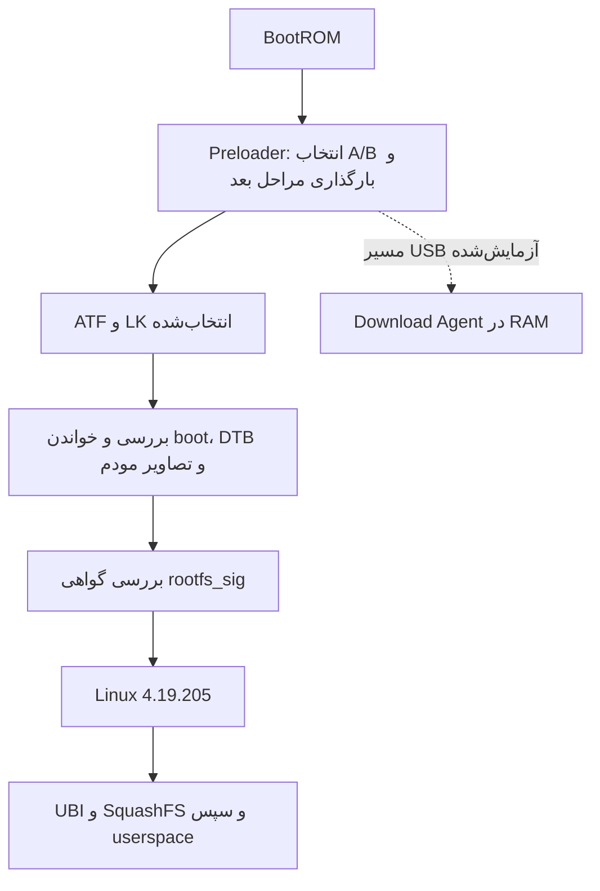
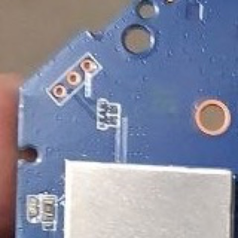

<h1 dir="rtl" align="right">مهندسی معکوس مودم 5G مدل ZLT X28</h1>

<h2 dir="rtl" align="right">قسمت دوم: استخراج فریمور، بررسی NAND و معماری بوت دوگانه</h2>

**نویسنده: علی نادری پاریزی**

قبل از اینکه سراغ ساخت فریمور برم، یه سؤال داشتم: اگه مودم دیگه Linux رو بالا نیاره، چطوری backup رو برگردونم؟ اینکه چند تا فایل bin روی لپ‌تاپ داشته باشم کافی نبود. باید می‌فهمیدم دقیقاً چی از NAND ذخیره شده، ابزار USB واقعاً می‌تونه اون رو بخونه و بنویسه یا نه، و اصلاً کدوم بخش موقع بوت تصمیم می‌گیره از کدوم slot استفاده کنه.

در [قسمت قبل](01-hardware-and-initial-access.md) سخت‌افزار و UART رو شناختیم. اینجا با backup همون دستگاه، اسکریپت‌های `tools/recovery/` و گزارش‌های هر مرحله جلو می‌ریم. آخرش به یه مسیر بازیابی **محدود و آزمایش‌شده** رسیدم. یعنی همون کاری که امتحان کردم جواب داده؛ هنوز نمی‌تونم بگم مودم رو بعد از هر نوع خرابی نجات می‌ده. مبنای مجموعه commit `b9c1a96` از [مخزن پروژه](https://github.com/mralinp/zlt-x28-openwrt) هست.

<h2 dir="rtl" align="right">NAND با یه دیسک معمولی فرق داره</h2>

Linux حافظه فلش رو به‌شکل دستگاه‌های MTD نشون می‌ده. توی این نمونه، صفحه داده ۴۰۹۶ بایت، OOB برابر ۶۴ بایت و eraseblock برابر ۲۶۲۱۴۴ بایت هست. OOB فضای جانبی صفحه هست که بسته به پیاده‌سازی برای ECC و metadata استفاده می‌شه. نوشتن NAND، محدودیت پاک‌کردن بلوک و مدیریت bad block داره؛ یه کپی خطی فایل، خودش به‌تنهایی روش درست restore رو تعیین نمی‌کنه.

روی NAND، UBI مدیریت بلوک‌ها رو بر عهده داره و UBIFS فایل‌سیستم قابل نوشتن فراهم می‌کنه. RootFS فقط‌خواندنی این دستگاه SquashFS هست و از یه volume در UBI به کمک ubiblock در دسترس قرار می‌گیره. برای همین سه اندازه متفاوت داریم: اندازه پارتیشن، ظرفیت volume و طول واقعی SquashFS. در بررسی امضا، اشتباه‌گرفتن همین سه عدد نتیجه hash رو عوض می‌کنه.

برای دیدن وضعیت، از این دستور استفاده کردم:

<pre dir="ltr" align="left"><code dir="ltr" class="language-sh">ssh router 'cat /proc/mtd; ubinfo -a; df -h'</code></pre>

این فرمان فقط می‌خونه، اما خروجی اون باید با نمونه خودتون بررسی بشه. اندازه یکسان RootFS هم مجوز فلش‌کردن فایل دستگاه دیگه نیست؛ ممکنه اطلاعات کالیبراسیون، ساخت Kernel یا هندسه متفاوت باشه.

<h2 dir="rtl" align="right">نقشه واقعی ۵۱ پارتیشن</h2>

جدول زیر نام، شماره MTD و اندازه تمام پارتیشن‌های backup این نمونه رو پوشش می‌ده. جفت‌های A/B برای خوانایی در یه ردیف اومدن؛ هر نام یه پارتیشن مستقل هست. منبع، `mtd.txt` backup و تطبیق اون با [Recovery](../../docs/RECOVERY.md) و مشخصات ثابت `slot_session.py` هست.

| MTD | نام | اندازه هر پارتیشن، MiB | نقش |
| ---: | ---: | ---: | ---: |
| 0 / 1 | `preloader` / `preloader_backup` | 4 / 2 | مراحل آغازین بوت و نسخه پشتیبان |
| 2 | `proinfo` | 1 | اطلاعات دستگاه؛ خصوصی |
| 3 | `misc` | 1 | رکوردهای کنترل A/B |
| 4 | `para` | 1 | پارامترهای سازنده؛ معنای کامل بررسی نشده |
| 5 | `expdb` | 20 | داده‌های خطا و crash |
| 6 / 7 | `nvcfg` / `nvdata` | 32 / 32 | تنظیمات و داده‌های NV |
| 8 / 9 | `protect1` / `protect2` | 8 / 8 | اطلاعات اختصاصی مودم و کالیبراسیون |
| 10 / 11 / 12 / 13 | `mcf1_a` / `mcf2_a` / `mcf1_b` / `mcf2_b` | 8 | پیکربندی اپراتوری مودم |
| 14 | `seccfg` | 1 | پیکربندی امنیتی |
| 15 | `boot_para` | 2 | پارامترهای بوت؛ داده شبیه کالیبراسیون DRAM |
| 16 | `nvram` | 32 | NV اختصاصی دستگاه |
| 17 / 30 | `md1img_a` / `md1img_b` | 80 | تصویر مودم |
| 18 / 31 | `md1dsp_a` / `md1dsp_b` | 10 | firmware پردازش سیگنال مودم |
| 19 / 32 | `spmfw_a` / `spmfw_b` | 1 | firmware کمکی پلتفرم |
| 20 / 33 | `pi_img_a` / `pi_img_b` | 1 | تصویر کمکی؛ نقش جزئی بررسی نشده |
| 21 / 34 | `dpm_a` / `dpm_b` | 1 | firmware کمکی پلتفرم |
| 22 / 35 | `medmcu_a` / `medmcu_b` | 1 | firmware MEDMCU |
| 23 / 36 | `sspm_a` / `sspm_b` | 2 | firmware SSPM |
| 24 / 37 | `mcupm_a` / `mcupm_b` | 2 | firmware MCUPM |
| 25 / 38 | `lk_a` / `lk_b` | 2 | Bootloader نوع LK |
| 26 / 39 | `tee_a` / `tee_b` | 1 | در لاگ این نمونه، تصویر ATF |
| 27 / 40 | `boot_a` / `boot_b` | 32 | Android boot container؛ Kernel و DTB |
| 28 / 41 | `rootfs_sig_a` / `rootfs_sig_b` | 1 | گواهی‌ها و metadata امضاشده RootFS |
| 29 / 42 | `rootfs_a` / `rootfs_b` | 64 | UBI مربوط به RootFS |
| 43 / 44 | `loader_ext_a` / `loader_ext_b` | 1 | افزونه loader |
| 45 / 46 | `raw1` / `raw2` | 2 | در backup خالی؛ نقش کامل روشن نیست |
| 47 | `qraw` | 3 | رکوردهای اختصاصی Quectel، شامل شناسه‌ها |
| 48 | `user_config` | 10 | تنظیمات قابل نوشتن |
| 49 | `productinfo` | 4 | اطلاعات اختصاصی محصول |
| 50 | `user_data` | 427.5 | داده مشترک و volumeهای UBI |

مجموع برابر **۱٬۰۷۲٬۱۶۸٬۹۶۰ بایت** یا ۱۰۲۲٫۵ MiB هست. از این span، NAND یه GiB استنباط می‌شه؛ این عدد حاصل خواندن marking همه تراشه‌ها نیست. ناحیه `user_data` بین دو slot مشترک هست؛ داشتن A و B به معنی دو دستگاه کاملاً مستقل با داده‌های جدا نیست.

چند محدوده مهم برای تطبیق ابزار USB چنین‌اند: `lk_a` در `0x11200000`، `boot_a` در `0x11500000`، `rootfs_sig_a` در `0x13500000` و `rootfs_a` در `0x13600000`. `lk_b` در `0x1d800000` و `rootfs_b` در `0x1fc00000` قرار دارن. این آدرس‌ها مربوط به همین نمونه‌ان؛ قرار نیست اون‌ها رو بدون تطبیق برد و backup، دستی توی یه flasher عمومی وارد کنیم.

<h2 dir="rtl" align="right">backup قبل از آزمایش نوشتن</h2>

در ۲۰۲۶-۱۰-۲۰ همه پارتیشن‌ها از SSH خوانده شدن. ابزار پروژه خروجی `nanddump` رو به gzip می‌فرسته و هم‌زمان SHA-256 داده بازشده رو حساب می‌کنه. خروجی ناقص با پسوند `.partial` نگه‌داری می‌شه و تنها بعد از بررسی اندازه و کد خروج، نام نهایی می‌گیره.

<pre dir="ltr" align="left"><code dir="ltr" class="language-sh"># خواندن از دستگاه؛ نوشتن فایل فقط روی میزبان
python3 tools/recovery/dump_partitions.py

# بررسی و بازکردن backup روی میزبان؛ تاریخ را با پوشه واقعی جایگزین کنید
python3 tools/recovery/verify_backup.py private/backups/YYYYMMDD</code></pre>

فرمان استفاده‌شده برای هر پارتیشن `nanddump --bb=padbad -q /dev/mtdN` بود: داده اصلی با ECC، جایگزینی bad block با `FF` و **بدون OOB**. پس backup، clone فیزیکی کامل تراشه نیست. این تمایز برای YAFFS2 هم اهمیت داره؛ جای tags و سازگاری restore همه فایل‌سیستم‌های قابل نوشتن اثبات نشده.

پارتیشن‌های فعال هم بدون freeze و به‌ترتیب خوانده شدن. hash ثابت می‌کنه همون بایت‌های ثبت‌شده حفظ شدن، اما سازگاری لحظه‌ای همه فایل‌های در حال تغییر رو تضمین نمی‌کنه. نسخه دوم باید روی رسانه جدا نگه‌داری بشه؛ در یکی از آزمایش‌های تاریخی، کپی دوم روی همون Mac بود و این محدودیت صریحاً ثبت شد.

> **خصوصی بمونه:** backup شامل هویت دستگاه، اطلاعات سیم‌کارت، credential و calibration هست. نه اون رو منتشر کنید و نه NV دستگاه دیگه‌ای رو جایگزین کنید. در این مجموعه هیچ dump یا firmware اختصاصی توزیع نمی‌شه.

<h2 dir="rtl" align="right">استخراج فایل‌سیستم، بدون اجرای فریمور</h2>

بعد از بررسی hash، روی کپی تحلیل کار کردم. در ۲۰۲۶-۱۰-۲۱،‏ UBI Reader نسخه 0.8.16 volumeهای RootFS رو بازسازی کرد و `unsquashfs` نسخه 4.6.1 فایل‌های سیستم رو استخراج کرد. نتیجه ثبت‌شده ۴۳۳۳ فایل معمولی، ۲۸۶ پوشه و ۳۹۰ symlink بود؛ `/dev` و xattrها جزو اون استخراج نبودند. از طرفی ۹۰ ورودی init و ۱۴۶ فایل ماژول پیدا شد. اینا موجودی فایل‌اند، نه تأیید اجرای همه سرویس‌ها.

محیط Linux داخل container، بدون شبکه و با ورودی فقط‌خواندنی بود. tree مرجع در Docker volume با نام `x28-rootfs-b-analysis-20261021` باقی ماند و archive خصوصی `rootfs-b-system.tar.gz` تفاوت حروف نام فایل‌ها رو حفظ کرد. payload کرنل هم جدا و decompress شد، اما استخراج کامل tree قابل نوشتن UBIFS و همه پارتیشن‌های دیگه در اون checkpoint انجام نشده بود.

برای مرحله بررسی فایل‌های استخراج‌شده، فرمان واقعی inventory در مستند پروژه این‌جور هست؛ volume و image ابزار باید از قبل آماده باشن و گزارش خصوصی بمونه:

<pre dir="ltr" align="left"><code dir="ltr" class="language-sh">docker run --rm --network none \
  -v x28-rootfs-b-analysis-20261021:/r:ro \
  -v "$PWD/tools/firmware:/t:ro" \
  x28-firmware-tools:local python3 /t/inventory.py rootfs /r/rootfs \
  &gt; private/firmware/inventory-rootfs_b.json</code></pre>

از این مرحله می‌شه owner بسته، وابستگی ELF و initهای مرتبط رو شناخت. اما داشتن فایل‌های نصب‌شده، source متناظر یا امکان rebuild Kernel رو فراهم نمی‌کنه. فرمان خط‌به‌خط استخراج اولیه در سند عمومی کامل نیست؛ به‌جای نسبت‌دادن یه دستور حدسی به اون روز، نسخه ابزار، محیط و خروجی تأییدشده رو حفظ کرده‌ام.

<h2 dir="rtl" align="right">زنجیره بوت و انتخاب slot</h2>

نمودار زیر بازسازی منطقی مسیر هست، نه عکس ابزار اندازه‌گیری. BootROM مرحله داخلی تراشه هست؛ مسیر USB اثبات‌شده پروژه از **Preloader** آغاز می‌شه و ورود مستقیم BROM بعد از خرابی Preloader هنوز تأیید نشده.

رکورد ۱۶ بایتی A/B در چهار eraseblock پارتیشن `misc`، در offsetهای `0x800`، `0x40800`، `0x80800` و `0xc0800` دیده شد. حالت اولیه منتشرشده این‌جور بود:

<pre dir="ltr" align="left"><code dir="ltr" class="language-text">00414230 ffffffff | A: 0e 00 01 00 | B: 0f 00 01 00</code></pre>

با لاگ UART و اسکریپت‌های vendor، فیلدهای priority، tries، success و up-type تفسیر شدن. اینجا اسم tries یه کم گمراهم کرد: مشاهده زنده بعدی نشون داد Preloader شمارنده A رو در هر بوت **زیاد** می‌کنه؛ نباید اون رو بدون بررسی «تعداد تلاش باقی‌مانده» خواند.

اسکریپت به‌روزرسانی کارخانه، تصاویر رو در slot مقابل می‌نویسه و metadata رو عوض می‌کنه. اما `zmtk_boot_done` در برخی شرایط بخش‌های دو slot رو همگام می‌کنه. در نتیجه، bootشدن B می‌تونه A آزمایشی رو با نسخه کارخانه جایگزین کنه. fallback خودکار در تمام خطاها آزمایش نشده و عبارت «B دست‌نخورده داریم» به‌تنهایی ضمانت recovery نیست.

<h2 dir="rtl" align="right">امضا دقیقاً از چه چیزی حفاظت می‌کنه؟</h2>

تحلیل [محتوای امضاشده](../../docs/research/rootfs-signed-content.md) نشون داد `rootfs_sig` دو گواهی داره. کنترل مستقل میزبان، امضاهای RSA-2048/PSS با SHA-256،‏ MGF1-SHA256 و salt برابر ۳۲ بایت رو تأیید کرد. گواهی دوم digest و طول **۳۱٬۲۷۴٬۴۱۰ بایت** از SquashFS اصلی رو در پیام امضاشده داره.

این digest مربوط به کل ۶۴ MiB پارتیشن UBI یا overlay نیست. طول از `bytes_used` در superblock گرفته شد و hash دقیق همون prefix با مقدار گواهی برابر بود. LK بخش‌های metadata رو هم در `/chosen` به Kernel می‌ده. اما برابر بودن hash فریمور اصلی ثابت نمی‌کنه که هنگام بوت، یه مصرف‌کننده حتماً اون رو روی محتوای تغییرکرده محاسبه می‌کنه.

مسیر خطای LK جداگانه تحلیل شد: برگشت خطا از verifier به assertion، قطع interrupt و حلقه توقف می‌رسه. این مسیر fallback فوری نداره؛ رفتار watchdog و انتخاب slot در reset بعدی سؤال دیگه‌ای هست. از طرفی `sbc_en = 0` به‌تنهایی خاموش‌بودن همه policyهای احراز اصالت رو ثابت نمی‌کنه.

مشاهده تعیین‌کننده بعدی این بود که RootFS جدید روی A بوت شد، در حالی که hash Preloader، LK، boot و signatureها با backup اصلی یکسان بود. پس در **پیکربندی آزمایش‌شده** تغییر RootFS با گواهی معتبر قبلی پذیرفته شد. این نتیجه به معنای پذیرش Kernel دلخواه، گواهی خراب یا LK تغییرکرده نیست.

<h3 dir="rtl" align="right">patch موجود، آزمایش محلی هست</h3>

در [پیش‌نمایش Ghidra](../../docs/research/lk-boot-auth-preview.md)، دو شاخه احراز اصالت boot/recovery در پایگاه داده محلی تغییر کردند:

| offset در فایل LK اصلی | دستور اصلی | پیش‌نمایش |
| ---: | ---: | ---: |
| `0xeedc` | `17 d0`، شاخه شرطی BEQ | `17 e0`، شاخه بی‌قید B |
| `0xef72` | `07 d0`، شاخه شرطی BEQ | `07 e0`، شاخه بی‌قید B |

دو بایت در `0xeedd` و `0xef73` عوض می‌شن. این تغییر NOP نیست و بررسی جداگانه گواهی RootFS رو حذف نمی‌کنه. **هیچ firmware خروجی گرفته، فلش یا اجرا نشده.** پذیرش LK تغییرکرده توسط Preloader، پوشش امضای container و مسیر LK دوم به نام `aee_lk` حل نشدن. این patch علت موفقیت تصویر کنونی OpenWrt نبوده هست.

<h2 dir="rtl" align="right">USB Recovery؛ هم کابل مهم بود، هم نسخه ابزار</h2>

*پیش‌نیاز مشاهده Recovery — همون footprint واقعی UART؛ مسیر مخزن: `docs/images/x28-uart-candidate.jpg`.* هنگام عملیات USB، این کنسول امکان ثبت مستقل رفتار Preloader و بازگشت بوت رو می‌ده. عکس، پورت USB یا نقطه ورود BROM نیست؛ اتصال باید طبق pinout و تبدیل سطح ۱٫۸ ولتی قسمت اول انجام بشه.

دو بار آزمایش USB-C به USB-C روی Mac هیچ attach جدیدی نداد. با کابل USB-A به USB-C،‏ `0e8d:2000` برای حدود ۱٫۱۵ ثانیه ظاهر شد؛ سپس در مرحله Linux، gadget با `2c7c:7003` دیده شد. نبود مقاومت CC یه توضیح احتمالی هست و اندازه‌گیری نشده؛ چیزی که واقعاً آزمایش شد، کارکرد مسیر A-to-C بود.

<pre dir="ltr" align="left"><code dir="ltr" class="language-sh">python3 tools/recovery/usb_watch.py</code></pre>

این watcher مخصوص macOS هست. اون رو قبل از قطع‌و‌وصل تغذیه اجرا می‌کردم. پنجره Preloader کوتاه بود و ابزار باید از قبل منتظر می‌مونه. بعد از عملیات mtkclient دستگاه در Preloader یا DA می‌مونه و تا power-cycle اینترنت برنمی‌گرده؛ خواندن فلش مخرب نیست، ولی از نظر دسترس‌پذیری بی‌اثر هم نیست.

Download Agent برنامه‌ای هست که در RAM اجرا می‌شه و پروتکل دسترسی فلش رو فراهم می‌کنه. DA همراه mtkclient برای این نمونه پاسخ مناسب نمی‌داد. DA کوییکتل هم با نسخه قدیمی ابزار شکست خورد. بعداً روشن شد نسخه `v2.1.4.1` پیام‌های ناخواسته `DT_MESSAGE` رو درست مدیریت نمی‌کرد و تبادل XML از ترتیب می‌افتاد. commit پین‌شده `7cb40e7` با اصلاحات محلی، خواندن رو ممکن کرد.

<pre dir="ltr" align="left"><code dir="ltr" class="language-sh"># آماده‌سازی میزبان macOS؛ اتصال به دستگاه نیست
brew install libusb
/opt/homebrew/bin/python3.14 tools/recovery/setup_mtkclient.py

# نشست خواندن دستگاه؛ DA خصوصی و backup معتبر لازم است
python3 tools/recovery/read_verify.py lk_b</code></pre>

DA توی مخزن توزیع نمی‌شه و باید با هویت مورد انتظار ابزار تطبیق داشته باشه. منشأ بسته اجتماعی حاوی اون هم محدودیت داشت؛ تصاویر RootFS همون بسته تغییرکرده بودن و نباید به‌عنوان فریمور مناسب دستگاه پذیرفته می‌شدن.

خروجی واقعی ثبت‌شده برای خواندن LK، بدون شناسه دستگاه:

<pre dir="ltr" align="left"><code dir="ltr" class="language-text">CMD:READ-FLASH NAND-WHOLE 0x1d800000 0x200000 -&gt; OK
read     0ad94f065ebcfeefd157640d179b1b52779829a85179d07d38dd818b79007156
backup   0ad94f065ebcfeefd157640d179b1b52779829a85179d07d38dd818b79007156
MATCH</code></pre>

<h2 dir="rtl" align="right">خوندن جواب داد؛ حالا نوشتن چی؟</h2>

دو نوبت خواندن همه ۵۱ پارتیشن، ۴۴ تطابق و ۷ اختلاف داد. اختلاف‌ها در `nvdata`،‏ `protect1/2`،‏ `rootfs_b` فعال، `user_config`،‏ `productinfo` و `user_data` بودن؛ نواحی‌ای که در زمان اجرا تغییر می‌کنن. پس دیدن این اختلاف‌ها دلیل نمی‌شد NV قدیمی رو بی‌بررسی برگردونم. تلاش یک‌جای خواندن یه GiB هم بعد از ۲۳۶ MiB با خطای USB متوقف شد؛ خواندن پارتیشن‌به‌پارتیشن امکان ادامه رو فراهم کرد.

در ۲۰۲۶-۱۰-۲۸، بازنویسی بایت‌های یکسان `rootfs_sig_a` اول با ACK اضافی میزبان مشکل پیدا کرد. ابزار اصلاح شد و آزمون تکراری با تأیید نوشتن و readback همون نشست گذشت. سپس در ۲۰۲۶-۱۰-۲۹، فقط یه صفحه ۴ KiB از padding همون پارتیشن به الگوی `aa 55` تغییر و به `FF` اصلی برگردانده شد. هر درخواست، کل پارتیشن یه MiB رو می‌نوشت؛ اندازه تغییر رو نباید با اندازه عملیات یکی دانست.

در آزمون دوم، ۱۸ خواندن هدف و guard، اندازه و hash صحیح داشتند و بازگشت به stock B با UART و SSH تأیید شد. این شاهد restore همون تغییر محدوده؛ رفتار قطع برق، bad block و خرابی Preloader رو اثبات نمی‌کنه. UART هم ابزار مشاهده هست، نه به‌تنهایی روش نوشتن NAND.

> **مرز عملیات مخرب:** در این مقاله فرمان آماده `--write` ارائه نمی‌کنم. برای نوشتن باید backup کامل و کپی دوم، هویت firmware و DA، layout واقعی، UART زنده، تصویر hash‌شده، هدف دقیق و برنامه restore بررسی بشن. ابزارهای guarded عمداً receipt و عبارت تأیید وابسته به همون نشست می‌خوان. شکست ACK با یه hash ظاهراً درست به موفقیت تبدیل نمی‌شه.

نوشتن بلوکی `misc` از DA هم دو بار تأیید نشد؛ ابزار وجود داره، اما این مسیر اثبات‌شده نیست. روش زنده `dd-nand` با تغییر بایت و مقایسه کامل پارتیشن جداگانه آزمایش شد. تبدیل اون به یه دستور عمومی انتخاب A/B، بدون توجه به وضعیت شمارنده‌ها، می‌تونه هم مسیر بوت و هم تصویر آزمایشی رو از بین ببرد.

<h2 dir="rtl" align="right">نتیجه و ادامه مسیر</h2>

حالا می‌دونستم backup دقیقاً چی رو نگه داشته و کجاها محدودیت داره. مسیر USB تا DA و خوندن NAND جواب داده بود و یه restore محدود رو هم واقعاً انجام داده بودم. با همین نتیجه‌ها رفتم سراغ ساخت RootFS؛ هنوز ریسک‌های بوت و ذخیره‌سازی سر جاشون بودن.

در [قسمت سوم](03-openwrt-installation-and-5g.md) می‌بینیم چرا Kernel سازنده رو نگه داشتم، RootFS چطور ساخته شد و `x28_mipc` چطور اینترنت سلولی رو به netifd سپرد. عکس مستقلی از نشست فلش توی مخزن نیست؛ نمودار بوت این قسمت تألیفی هست.

<h2 dir="rtl" align="right">منابع و لینک‌های بیشتر</h2>

- [پشتیبان‌گیری از پارتیشن‌ها](../../docs/RECOVERY-BACKUP.md)
- [راهنمای Recovery](../../docs/RECOVERY.md)
- [زنجیره بوت و A/B](../../docs/BOOT-FLOW.md)
- [استخراج فریمور](../../docs/FIRMWARE-EXTRACTION.md)
- [نتیجه آزمون restore](../../docs/research/changed-page-restore-result.md)
- [ثبت آزمون‌ها](../../docs/TESTING.md)
- [مخزن پروژه](https://github.com/mralinp/zlt-x28-openwrt)

