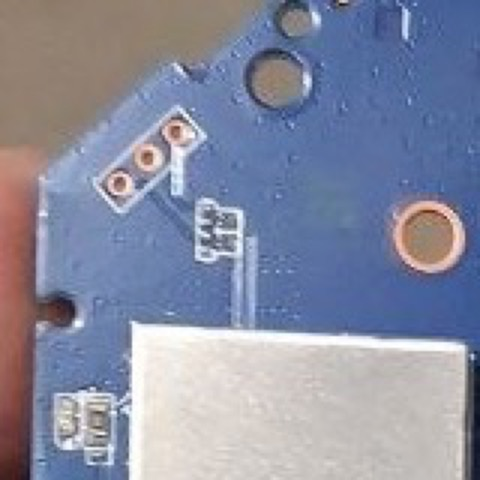

<h1 dir="rtl" align="right" style="direction:rtl;text-align:right">مهندسی معکوس مودم‌های 5G مدل ZLT X28 و X28 PRO</h1>

<h2 dir="rtl" align="right" style="direction:rtl;text-align:right">قسمت دوم: قبل از اولین write؛ NAND رو بخونیم و راه برگشت رو بشناسیم</h2>

**نویسنده: علی نادری پاریزی**

> **جای این قسمت در مجموعه:** این قسمت همه چیزی رو پوشش می‌ده که باید **قبل از تغییر هر چیزی** در حافظه فلش بدونید: هندسه NAND، پشتیبان‌گیری با شاهد، استخراج فایل‌سیستم و آزمون مسیر USB Recovery. برای شرح کامل زنجیره بوت — BootROM، Preloader، LK و Device Tree — قسمت سوم رو ببینید.

تو [قسمت قبل](01-hardware-and-initial-access.md) به دستگاه دسترسی گرفتیم، boot log داریم و می‌دونیم روی چه سخت‌افزاری کار می‌کنیم. اما سؤال اصلی اینه: اگه firmware خودمون بالا نیومد، چی برای برگشت داریم؟

داشتن چند فایل `.bin` روی لپ‌تاپ کافی نیست. باید می‌دونستم دقیقاً چی از NAND خوندیم، ابزار USB واقعاً می‌تونه اون رو بازنویسی کنه یا نه، و اصلاً کدوم قسمت روش نوشتن رو تضمین می‌کنه. این سؤال‌ها مجبورم کرد قبل از هر تغییری، یه مرحله کامل فقط بخونم و بفهمم.

<h2 dir="rtl" align="right" style="direction:rtl;text-align:right">‏NAND با یه دیسک معمولی فرق داره</h2>

وقتی Linux حافظه فلش رو نشون می‌ده، به‌شکل دستگاه‌های MTD (Memory Technology Device) ظاهر می‌شه. ساختار هر صفحه NAND این‌جوریه: یه ناحیه اصلی داده (در این نمونه ۴۰۹۶ بایت) و یه ناحیه جانبی به اسم OOB یا out-of-band (۶۴ بایت). OOB برای ذخیره metadata، اطلاعات ECC (تصحیح خطا) و bad block marker استفاده می‌شه.

نوشتن روی NAND مثل نوشتن روی هارددیسک نیست. هر eraseblock — در این دستگاه ۲۶۲۱۴۴ بایت — باید قبل از نوشتن کاملاً پاک بشه. تراشه همه‌جا یکسان پاک نمی‌شه و bad blockها به‌تدریج ایجاد می‌شن. یه کپی خطی فایل، به‌تنهایی روش درست restore رو تعیین نمی‌کنه.

روی NAND این دستگاه، لایه‌بندی اینه:

- ‏**UBI** (Unsorted Block Images): مستقیم روی MTD می‌نشینه، bad block management می‌کنه و volumeها رو مدیریت می‌کنه
- ‏**UBIFS**: فایل‌سیستم قابل نوشتن، داخل یه UBI volume
- ‏**SquashFS**: فایل‌سیستم فقط‌خواندنی RootFS، از طریق ubiblock از یه volume دیگه در دسترسه

برای همین سه اندازه متفاوت داریم: اندازه پارتیشن MTD، ظرفیت UBI volume و طول واقعی SquashFS. اشتباه‌گرفتن این سه عدد، محاسبه hash رو اشتباه می‌کنه.

<pre dir="ltr" align="left"><code dir="ltr" class="language-sh">ssh x28 'cat /proc/mtd; ubinfo -a; df -h'</code></pre>

این فرمان فقط می‌خونه، اما خروجیش باید با نمونه خودتون تطبیق داده بشه. اندازه یکسان RootFS روی دو دستگاه مجوز فلش‌کردن فایل دستگاه دیگه‌ای نیست؛ ممکنه اطلاعات کالیبراسیون، ساخت Kernel یا هندسه متفاوت باشه.

<h2 dir="rtl" align="right" style="direction:rtl;text-align:right">‏slot A و slot B چیه و چرا خیلی چیزها دوتا هستن؟</h2>

تو جدول پارتیشن‌ها اسم‌هایی مثل `lk_a` و `lk_b` یا `rootfs_a` و `rootfs_b` می‌بینید. این پسوندها به **دو slot** اشاره می‌کنن: دو کپی کامل از چیزهایی که برای بوت‌شدن لازمه، یعنی LK، `boot` (Kernel)، `rootfs`، `rootfs_sig`، image مودم و چند firmware کمکی.

**ایده از کجا اومده؟** این طراحی از دنیای Android میاد و اسمش **A/B update**ـه. مسئله اینه که آپدیت firmware یعنی نوشتن روی همون حافظه‌ای که دستگاه ازش بوت می‌شه. اگه وسط نوشتن برق بره یا فایل خراب باشه، دستگاه دیگه بالا نمیاد و تو میدون، پیش مشتری یا اپراتور، «آجر» می‌شه. راه‌حل اینه که همیشه **روی slot غیرفعال بنویسی**:

1. دستگاه از slot A بوت شده و کار می‌کنه.
2. آپدیت تو slot B نوشته می‌شه؛ slot A دست‌نخورده می‌مونه.
3. بعد از نوشتن و بررسی، رکورد کنترل طوری عوض می‌شه که بوت بعدی از B باشه.
4. اگه B بالا نیومد، دستگاه می‌تونه به A برگرده، چون A هنوز سالمه.

‏**LK چیه و تو این ماجرا چه نقشی داره؟** LK (Little Kernel) بوت‌لودر مرحله دومه. اول Preloader اجرا می‌شه و RAM رو آماده می‌کنه، بعد LK رو از `lk_a` یا `lk_b` بالا میاره. کار LK اینه که Kernel رو از `boot_a` یا `boot_b` بخونه، خط فرمان Kernel رو بسازه و کنترل رو بهش بده. روی این دستگاه، LK گواهی‌های `rootfs_sig` رو هم چک می‌کنه (تو log بوت: `ROOTFS_SIG_VFY Success`). نکته مهم اینه که **LK slot رو انتخاب نمی‌کنه و تلاش‌ها رو نمی‌شمره**؛ فقط پسوند slot رو تحویل می‌گیره و تو خط فرمان می‌ذاره: `bootslot=a` یا `bootslot=b` و مسیر UBI مربوطه (`ubi.mtd=28` یا `ubi.mtd=42`). تو رشته‌های LK هیچ اسمی از priority یا retry نیست و به درخواست «slot فعال رو عوض کن» اندروید جواب `not supported!` می‌ده.

‏**پس انتخاب slot دست کیه؟** Preloader، قبل از اینکه LK اصلاً اجرا بشه. تو پارتیشن `misc` (یک MiB) یه رکورد کوچیک هست که با magic به اسم `"\0AB0"` شروع می‌شه و چهار بار پشت‌سر‌هم، هر بار تو یه erase block، ذخیره شده. بعد از magic، برای هر slot یه ورودی ۴ بایتی هست: **اولویت (priority)، تعداد تلاش (tries)، علامت موفقیت (success) و یه فیلد چهارم**. Preloader اولین کپی‌ای رو که magic درست داشته باشه می‌خونه (checksum‌ای در کار نیست)، و **slot با اولویت بالاتر رو انتخاب می‌کنه؛ اگه مساوی بودن، A**. تو نمونه ما A اولویت ۱۴ و B اولویت ۱۵ داشت، پس B انتخاب می‌شد؛ log سریالی هم همین رو چاپ کرد: `slots[0].priority:14, slots[1].priority:15` و `ab_suffix: _b`. اگه magic تو هر چهار کپی خراب باشه، Preloader یه رکورد پیش‌فرض می‌نویسه که A رو انتخاب می‌کنه. این منطق رو از کد Preloader خوندم و روی دستگاه اجراش نکردم.

‏**شمارنده تلاش چی می‌کنه؟** Preloader **تو هر بوت**، ‏`tries` همون slot انتخاب‌شده رو یکی زیاد می‌کنه و رکورد رو دوباره می‌نویسه؛ این کار قبل از بالا اومدن Kernel انجام می‌شه. اگه سیستم بالا بیاد، سرویس `x28-bootok` (تو firmware اصلی هم اسکریپتی معادل اون بود) شمارنده رو صفر می‌کنه. اگه سیستم بالا نیاد، شمارنده با هر بوت بالاتر می‌ره. **وقتی `tries` به ۶ برسه**، Preloader slot دیگه رو با اولویت ۱۵ جایگزین می‌کنه (اون که ۱۵ داشت به ۱۴ میاد) و دستگاه ریست می‌شه، پس بوت بعدی از slot دیگه‌ست. عدد ۶ از کد خونده شده و هیچ‌وقت دیده نشده؛ بیشترین مقدار تو log‌هام ۵ بود، و بوت با مقدارهای ۰، ۱، ۳، ۴ و ۵ همه موفق بودن.

‏**جای نگران‌کننده، firmware اصلی روی slot دیگه‌ست.** اسکریپت اصلی سازنده وقتی ببینه `tries` از ۳ بالاتره، slot سالم رو روی slot خراب کپی می‌کنه تا «تعمیرش» کنه. یعنی اگه image ما روی A بالا نیاد و تلاش‌ها به ۶ برسن، B اصلی بوت می‌شه و **image ما رو از روی A پاک می‌کنه**. این هم راه برگشته، هم خطر پاک‌شدن کار ماست. اینکه Kernel خراب بعد از mount‌نشدن RootFS خودش panic و ریست می‌کنه یا تا watchdog قفل می‌مونه رو ندیدم؛ خط فرمان `panic=` نداره. و مسیر «۶ تلاش و سوییچ» رو هم روی دستگاه امتحان نکردم.

**چیزی که برای ما مهمه:**

- **راه برگشت** همین slot دومه. اگه image خودمون رو روی یه slot بنویسم و بالا نیاد، slot دیگه (با firmware اصلی) هنوز می‌تونه بوت بشه، به شرطی که رکورد `misc` و شمارنده تلاش‌ها اجازه بدن. این شرط بی‌اهمیت نیست: شمارنده تلاش بوت بالا بره، ممکنه فقط یه slot رو «تعمیر» کنه، یعنی پاک کنه.
- **همه‌چیز دوتا نیست.** `preloader` یه نسخه backup جدا داره، ولی `nvdata`، `protect1/2` (کالیبراسیون مودم) و `user_data` فقط یکی هستن و بین دو slot مشترکن. پس A/B جلوی خراب‌شدن اون داده‌ها رو نمی‌گیره.
- **دو slot، دو دستگاه مستقل نیست.** اگه چیزی که مشترکه خراب بشه، هر دو slot آسیب می‌بینن.

برای همین قاعده این پروژه اینه که **فقط slot غیرفعال** نوشته بشه و `misc` بدون backup و بدون کامل‌بودن شواهد دست زده نشه. اینکه چرا `misc` این‌قدر حساسه، تو بخش آزمایش نوشتن می‌گم.

<h2 dir="rtl" align="right" style="direction:rtl;text-align:right">نقشه واقعی ۵۱ پارتیشن</h2>

جدول زیر نام، شماره MTD و اندازه همه پارتیشن‌های backup این نمونه رو پوشش می‌ده. جفت‌های A/B برای خوانایی در یه ردیف اومدن؛ هر نام یه پارتیشن مستقله. منبع، `mtd.txt` backup و تطبیق اون با [Recovery](../../docs/RECOVERY.md) و مشخصات ثابت `slot_session.py` هست.

| ‏MTD | نام | اندازه (MiB) | نقش |
| ---: | ---: | ---: | ---: |
| 0 / 1 | ‏`preloader` / `preloader_backup` | 4 / 2 | مراحل آغازین بوت و نسخه پشتیبان |
| 2 | ‏`proinfo` | 1 | اطلاعات دستگاه؛ خصوصی |
| 3 | ‏`misc` | 1 | رکوردهای کنترل A/B slot |
| 4 | ‏`para` | 1 | پارامترهای سازنده؛ معنای کامل بررسی نشده |
| 5 | ‏`expdb` | 20 | داده‌های خطا و crash |
| 6 / 7 | ‏`nvcfg` / `nvdata` | 32 / 32 | تنظیمات و داده‌های NV |
| 8 / 9 | ‏`protect1` / `protect2` | 8 / 8 | اطلاعات اختصاصی مودم و کالیبراسیون |
| 10–13 | ‏`mcf1_a` / `mcf2_a` / `mcf1_b` / `mcf2_b` | 8 | پیکربندی اپراتوری مودم |
| 14 | ‏`seccfg` | 1 | پیکربندی امنیتی |
| 15 | ‏`boot_para` | 2 | پارامترهای بوت؛ داده شبیه کالیبراسیون DRAM |
| 16 | ‏`nvram` | 32 | ‏NV اختصاصی دستگاه |
| 17 / 30 | ‏`md1img_a` / `md1img_b` | 80 | ‏image مودم |
| 18 / 31 | ‏`md1dsp_a` / `md1dsp_b` | 10 | ‏firmware پردازش سیگنال مودم |
| 19–24 / 32–37 | (جفت‌های firmware کمکی) | 1–2 | ‏spmfw، pi_img، dpm، medmcu، sspm، mcupm |
| 25 / 38 | ‏`lk_a` / `lk_b` | 2 | ‏Bootloader نوع LK |
| 26 / 39 | ‏`tee_a` / `tee_b` | 1 | ‏image ATF |
| 27 / 40 | ‏`boot_a` / `boot_b` | 32 | ‏Android boot container؛ Kernel و DTB |
| 28 / 41 | ‏`rootfs_sig_a` / `rootfs_sig_b` | 1 | گواهی‌ها و metadata امضاشده RootFS |
| 29 / 42 | ‏`rootfs_a` / `rootfs_b` | 64 | ‏UBI مربوط به RootFS |
| 43 / 44 | ‏`loader_ext_a` / `loader_ext_b` | 1 | افزونه loader |
| 45 / 46 | ‏`raw1` / `raw2` | 2 | در backup خالی؛ نقش کامل روشن نیست |
| 47 | ‏`qraw` | 3 | رکوردهای اختصاصی Quectel |
| 48 | ‏`user_config` | 10 | تنظیمات قابل نوشتن |
| 49 | ‏`productinfo` | 4 | اطلاعات اختصاصی محصول |
| 50 | ‏`user_data` | 427.5 | داده مشترک و volumeهای UBI |

مجموع برابر **۱٬۰۷۲٬۱۶۸٬۹۶۰ بایت** یا ۱۰۲۲٫۵ MiB هست. از این span، NAND یه GiB استنباط می‌شه؛ این عدد حاصل خواندن marking همه تراشه‌ها نیست.

یه نکته مهم: ناحیه `user_data` بین دو slot مشترکه. داشتن A و B به معنی دو دستگاه کاملاً مستقل با داده‌های جدا نیست.

چند آدرس مهم برای تطبیق ابزار USB: `lk_a` در `0x11200000`، `boot_a` در `0x11500000`، `rootfs_sig_a` در `0x13500000` و `rootfs_a` در `0x13600000`. `lk_b` در `0x1d800000` و `rootfs_b` در `0x1fc00000`. این آدرس‌ها مربوط به همین نمونه‌اند؛ قرار نیست بدون تطبیق برد و backup، دستی توی flasher عمومی وارد بشن.

<h2 dir="rtl" align="right" style="direction:rtl;text-align:right">‏backup قبل از آزمایش نوشتن</h2>

همه پارتیشن‌ها رو از طریق SSH خوندم. ابزار پروژه خروجی `nanddump` رو به gzip می‌فرسته و هم‌زمان SHA-256 داده بازشده رو حساب می‌کنه. خروجی ناقص با پسوند `.partial` نگه‌داری می‌شه و تنها بعد از بررسی اندازه و کد خروج، نام نهایی می‌گیره.

<pre dir="ltr" align="left"><code dir="ltr" class="language-sh"># خواندن از دستگاه؛ نوشتن فایل فقط روی میزبان
python3 tools/recovery/dump_partitions.py

# بررسی backup روی میزبان؛ تاریخ را با پوشه واقعی جایگزین کنید
python3 tools/recovery/verify_backup.py private/backups/<backup-dir></code></pre>

فرمان استفاده‌شده برای هر پارتیشن `nanddump --bb=padbad -q /dev/mtdN` بود: داده اصلی با ECC، جایگزینی bad block با `FF` و **بدون OOB**. پس backup، clone فیزیکی کامل تراشه نیست. این تمایز برای YAFFS2 هم اهمیت داره؛ جای tags و سازگاری restore همه فایل‌سیستم‌های قابل نوشتن اثبات نشده.

پارتیشن‌های فعال هم بدون freeze و به‌ترتیب خوانده شدن. hash ثابت می‌کنه همون بایت‌های ثبت‌شده حفظ شدن، اما سازگاری لحظه‌ای همه فایل‌های در حال تغییر رو تضمین نمی‌کنه. نسخه دوم باید روی رسانه جدا نگه‌داری بشه؛ در یکی از آزمایش‌های تاریخی، کپی دوم روی همون Mac بود و این محدودیت صریحاً ثبت شد.

> **خصوصی بمونه:** backup شامل هویت دستگاه، اطلاعات سیم‌کارت، credential و calibration هست. نه اون رو منتشر کنید و نه NV دستگاه دیگه‌ای رو جایگزین کنید.

<h2 dir="rtl" align="right" style="direction:rtl;text-align:right">استخراج فایل‌سیستم، بدون اجرای firmware</h2>

بعد از بررسی hash، روی **کپی** تحلیل کار کردم — نه روی backup اصلی. با UBI Reader نسخه 0.8.16 volumeهای RootFS رو بازسازی کردم و با `unsquashfs` نسخه 4.6.1 فایل‌های سیستم رو بیرون کشیدم. نتیجه ثبت‌شده ۴۳۳۳ فایل معمولی، ۲۸۶ پوشه و ۳۹۰ symlink بود؛ `/dev` و xattrها جزو اون استخراج نبودند. ۹۰ ورودی init و ۱۴۶ فایل ماژول هم پیدا شد. اینا موجودی فایل‌اند، نه تأیید اجرای همه سرویس‌ها.

محیط Linux داخل container بود، بدون شبکه، با ورودی فقط‌خواندنی. فایل‌های استخراجی خصوصی موندن.

<pre dir="ltr" align="left"><code dir="ltr" class="language-sh">docker run --rm --network none \
  -v x28-rootfs-b-analysis:/r:ro \
  -v "$PWD/tools/firmware:/t:ro" \
  x28-firmware-tools:local python3 /t/inventory.py rootfs /r/rootfs \
  &gt; private/firmware/inventory-rootfs_b.json</code></pre>

از این مرحله می‌شه owner بسته، وابستگی ELF و initهای مرتبط رو شناخت. اما داشتن فایل‌های نصب‌شده، source متناظر یا امکان rebuild Kernel رو فراهم نمی‌کنه.

<h2 dir="rtl" align="right" style="direction:rtl;text-align:right">‏RootFS و rootfs_sig؛ چرا RootFS دستکاری‌شده ممکنه بوت نشه؟</h2>

‏**RootFS چیه؟** Linux بعد از بالا اومدن باید یه فایل‌سیستم اصلی (root filesystem) mount کنه. همه چیزی که ما به‌عنوان «سیستم‌عامل» می‌بینیم اونجاست: `/bin`، `/etc`، `/lib`، سرویس‌ها و اسکریپت‌های init. Kernel فقط مدیریت سخت‌افزار و پردازش‌ها رو انجام می‌ده؛ بدون RootFS هیچ برنامه‌ای برای اجرا نداره. روی این دستگاه، RootFS یه SquashFS فقط‌خواندنیه که روی UBI نشسته، و تنظیمات قابل‌نوشتن جداگونه توی یه overlay نگه‌داری می‌شن. اصلاً به همین خاطر ما می‌تونیم RootFS رو عوض کنیم و Kernel سازنده رو نگه داریم؛ ادامه مجموعه روی همین ایده بنا شده.

‏**rootfs_sig چیه؟** تو جدول پارتیشن‌ها یه پارتیشن به اسم `rootfs_sig_a` و `rootfs_sig_b` دیدید. این‌ها کنار هر RootFS یه «مهر تأیید» نگه می‌دارن. ایده کلی توی سیستم‌های embedded اینه که **زنجیره اعتماد (chain of trust)** داشته باشن: هر مرحله بوت، قبل از اینکه کنترل رو به مرحله بعد بده، اون رو بررسی می‌کنه. هدف از این کار اینه که کسی نتونه یه سیستم‌عامل دست‌کاری‌شده رو روی دستگاه اپراتور بذاره و دستگاه بی‌خبر ازش بوت کنه.

برای فهمیدن اینکه امضا چطور کار می‌کنه، سه مفهوم رو لازم داریم:

- ‏**hash:** یه اثر انگشت ثابت‌طول از داده. اگه حتی یه بیت داده عوض بشه، hash کاملاً فرق می‌کنه.
- **امضا (signature):** hash با کلید خصوصی سازنده رمز می‌شه. هر کسی با کلید عمومی می‌تونه بفهمه امضا واقعاً از صاحب کلید اومده یا نه، ولی نمی‌تونه امضای جدید بسازه.
- **گواهی (certificate):** یه بسته داده که یه کلید عمومی و اطلاعات مرتبط رو با امضای صاحبش به هم می‌بنده.

**توی این دستگاه دقیقاً چی هست؟** `rootfs_sig` دو گواهی داره. گواهی اول کلید عمومی رو معرفی می‌کنه و گواهی دوم، SHA-256 و **طول** SquashFS اصلی (۳۱٬۲۷۴٬۴۱۰ بایت) رو داخل پیام امضاشده‌ش داره. امضاها RSA-2048 با padding از نوع PSS هستن و با ابزار مستقل روی میزبان هم اعتبارسنجی شدن. بعد از بررسی، LK قطعه‌های گواهی رو داخل Device Tree به Kernel می‌ده (نودهایی مثل `rootfs,pubk` و `rootfs,sigval` زیر `/chosen`). نتیجه رو هم توی لاگ UART می‌بینیم: `ROOTFS_SIG_VFY Success`.

دو چیز برای فهمیدن این بخش مهمه:

۱. ‏hash داخل گواهی به **همون مقدار SHA-256 از SquashFS اصلی** می‌رسه. وقتی دقیقاً اون ۳۱٬۲۷۴٬۴۱۰ بایت اول volume رو hash کردم، عدد با گواهی یکی شد. hash کل پارتیشن ۶۴ MiB یا کل volume، عدد دیگه‌ای می‌ده؛ برای همین باید طول واقعی SquashFS رو از superblock بخونیم، نه اندازه پارتیشن رو.

۲. **امضای معتبر روی گواهی، ثابت نمی‌کنه کسی محتوای RootFS رو با اون مقایسه می‌کنه.** تو مسیر LK فقط خوندن و تأیید گواهی‌ها رو دیدیم؛ کدی که UBI یا SquashFS رو بخونه و hash کنه پیدا نکردیم. Kernel هم بدون dm-verity ساخته شده و IMA یا امضای integrity هم توش خاموشه.

**پس چرا یه RootFS دستکاری‌شده ممکنه کار نکنه؟** سه دلیل جداگانه وجود داره، و باید از هم تفکیکشون کرد:

| دلیل | وقتی پیش میاد | چطور تشخیص می‌دیم |
| ---: | ---: | ---: |
| گواهی خراب یا تغییرکرده | ‏`rootfs_sig` یا LK عوض بشه | مسیر خطای LK به assertion و توقف می‌رسه؛ بوت اصلاً به Kernel نمی‌رسه |
| مصرف‌کننده‌ای که hash رو مقایسه کنه | اگه جایی (مثلاً secure world) digest رو با RootFS واقعی بسنجه | ‏RootFS با گواهی معتبر ولی digest متفاوت بوت نشه و `ROOTFS_SIG_VFY Fail` یا توقف قبل از Kernel ببینیم |
| خود RootFS ناسازگار باشه | ‏ABI کتابخانه‌ها، `/dev/console`، مسیر init و ... با Kernel نخونه | ‏Kernel بالا میاد ولی panic یا init شکست می‌خوره؛ مشکل از خود RootFS ـه، نه امضا |

این جدول دلیل اصلی احتیاط ماست. تو آزمایش، RootFS جدید رو روی slot A نوشتم و `rootfs_sig_a` رو دست نزدم. پس گواهی معتبر قبلی سر جاش بود، ولی محتوای SquashFS با digest داخلش فرق داشت. نتیجه: تو **همین پیکربندی**، دستگاه با Preloader، LK، boot و گواهی‌های اصلی، RootFS جدید رو mount کرد و بوت شد. یعنی دلیل دوم برای این نمونه پیش نیومد.

این نتیجه حدش مشخصه. ثابت نمی‌کنه Kernel یا LK دلخواه پذیرفته می‌شن، ثابت نمی‌کنه گواهی خراب مشکلی نداره (برعکس، اون مسیر توقف داره) و ثابت نمی‌کنه secure world هیچ بررسی‌ای نداره؛ ما فقط نتیجه یه بوت واقعی رو دیدیم. اگه می‌خواید روی یه برد دیگه همین رو بسنجید، اول ببینید کدوم مرحله امضا رو **می‌خونه** و کدوم مرحله واقعاً محتوا رو **مقایسه می‌کنه**؛ این دو تا یکی نیستن.

شرح کامل اینکه این بررسی کجای زنجیره بوت اتفاق می‌افته (BootROM، Preloader، LK و Device Tree) در [قسمت سوم](03-openwrt-installation-and-5g.md) میاد.

<h2 dir="rtl" align="right" style="direction:rtl;text-align:right">مسیر USB Recovery؛ ابزار mtkclient و Download Agent</h2>

*پیش‌نیاز مشاهده Recovery — footprint واقعی UART. هنگام عملیات USB، این کنسول امکان ثبت مستقل رفتار Preloader و بازگشت بوت رو می‌ده. اتصال باید طبق pinout و تبدیل سطح ۱٫۸ ولتی قسمت اول انجام بشه.*

**ابزار USB چیه و چطور کار می‌کنه؟**

تراشه‌های MediaTek یه پروتکل استاندارد دارن که بهش SP Flash Tool Protocol گفته می‌شه. [mtkclient](https://github.com/bkerler/mtkclient) یه ابزار متن‌باز هست که این پروتکل رو روی میزبان پیاده‌سازی می‌کنه. اما mtkclient به‌تنهایی نمی‌تونه با فلش کار کنه؛ به یه **Download Agent (DA)** نیاز داره.

این DA یه باینری ARM هست که توسط Preloader از طریق USB به RAM دستگاه بارگذاری و اجرا می‌شه. بعد از اجرا، DA نقش واسط رو بازی می‌کنه: دستوراتی مثل READ-FLASH و WRITE-FLASH رو از میزبان می‌گیره، مستقیم روی MTD اجرا می‌کنه و نتیجه رو برمی‌گردونه. DA در RAM اجرا می‌شه و با power-cycle پاک می‌شه.

ترتیب کار اینه:

| مرحله | چه اتفاقی می‌افته |
| ---: | ---: |
| ۱ — برق وصل می‌شه | ‏Preloader اجرا می‌شه، کابل USB رو چک می‌کنه |
| ۲ — کابل هست | ‏Preloader وارد حالت DL می‌شه، VID:PID برابر `0e8d:2000` روی USB ظاهر می‌شه |
| ۳ — mtkclient DA رو آپلود می‌کنه | ‏Preloader باینری DA رو در RAM اجرا می‌کنه |
| ۴ — DA فعاله | میزبان از طریق DA دستورات خواندن/نوشتن می‌فرسته |
| ۵ — power-cycle | ‏DA از RAM پاک می‌شه، دستگاه دوباره بوت معمولی می‌کنه |

**چرا DA پیش‌فرض mtkclient کار نمی‌کنه؟** اون DA که همراه mtkclient میاد برای این برد تنظیم نشده. پاسخ‌های flash read رو نمی‌ده و ممکنه کلاً در مرحله init خطا بده. باید از DA اختصاصی کوییکتل که با این SoC سازگاره استفاده کرد. این DA خصوصیه و در مخزن توزیع نمی‌شه.

وقتی دستگاه در حالت عادی بالا میاد، Preloader یه پنجره کوتاه USB داره قبل از اینکه بوت ادامه پیدا کنه. این مسیر **جدا از BootROM** هست؛ ورود مستقیم BROM بعد از خرابی Preloader هنوز تأیید نشده.

ابزار این کار روی میزبان macOS اینه:

<pre dir="ltr" align="left"><code dir="ltr" class="language-sh"># آماده‌سازی میزبان macOS؛ اتصال به دستگاه نیست
brew install libusb
/opt/homebrew/bin/python3.14 tools/recovery/setup_mtkclient.py

# مانیتور USB برای دیدن پنجره Preloader
python3 tools/recovery/usb_watch.py</code></pre>

این watcher مخصوص macOS هست و باید **قبل از قطع‌و‌وصل تغذیه** اجرا بشه، چون پنجره Preloader کوتاهه.

**مشکل کابل:** دو بار آزمایش USB-C به USB-C روی Mac هیچ attach جدیدی نداد. با کابل USB-A به USB-C، شناسه `0e8d:2000` برای حدود ۱٫۱۵ ثانیه ظاهر شد و سپس در مرحله Linux، gadget با `2c7c:7003` دیده شد. نبود مقاومت CC یه توضیح احتمالیه، اما اندازه‌گیری نشده. چیزی که واقعاً آزمایش شد، کارکرد مسیر A-to-C بود.

**مشکل نسخه DA:** DA همراه mtkclient عمومی برای این نمونه پاسخ مناسب نمی‌داد. DA کوییکتل هم با نسخه قدیمی ابزار شکست خورد. بعداً روشن شد نسخه `v2.1.4.1` پیام‌های ناخواسته `DT_MESSAGE` رو درست مدیریت نمی‌کرد و تبادل XML از ترتیب می‌افتاد. commit پین‌شده `7cb40e7` با اصلاحات محلی، خواندن رو ممکن کرد.

فایل DA توی مخزن توزیع نمی‌شه و باید با هویت مورد انتظار ابزار تطبیق داشته باشه. بعد از عملیات mtkclient، دستگاه در Preloader یا DA می‌مونه و تا power-cycle اینترنت برنمی‌گرده.

<pre dir="ltr" align="left"><code dir="ltr" class="language-sh"># نشست خواندن دستگاه؛ DA خصوصی و backup معتبر لازم است
python3 tools/recovery/read_verify.py lk_b</code></pre>

خروجی واقعی ثبت‌شده برای خواندن LK، بدون شناسه دستگاه:

<pre dir="ltr" align="left"><code dir="ltr" class="language-text">CMD:READ-FLASH NAND-WHOLE 0x1d800000 0x200000 -&gt; OK
read     0ad94f065ebcfeefd157640d179b1b52779829a85179d07d38dd818b79007156
backup   0ad94f065ebcfeefd157640d179b1b52779829a85179d07d38dd818b79007156
MATCH</code></pre>

<h2 dir="rtl" align="right" style="direction:rtl;text-align:right">خوندن جواب داد؛ حالا نوشتن چطور؟</h2>

دو نوبت خواندن همه ۵۱ پارتیشن، ۴۴ تطابق و ۷ اختلاف داد. اختلاف‌ها در `nvdata`، `protect1/2`، `rootfs_b` فعال، `user_config`، `productinfo` و `user_data` بودن — نواحی‌ای که در زمان اجرا تغییر می‌کنن. دیدن این اختلاف‌ها دلیل نمی‌شد NV قدیمی رو بی‌بررسی برگردونم. تلاش یک‌جای خواندن یه GiB هم بعد از ۲۳۶ MiB با خطای USB متوقف شد؛ خواندن پارتیشن‌به‌پارتیشن امکان ادامه رو فراهم کرد.

بازنویسی بایت‌های یکسان `rootfs_sig_a` اول با ACK اضافی میزبان مشکل پیدا کرد. ابزار اصلاح شد و آزمون تکراری با تأیید نوشتن و readback همون نشست گذشت.

بعدش فقط یه صفحه ۴ KiB از padding همون پارتیشن به الگوی `aa 55` تغییر داده شد، و بعد به `FF` اصلی برگردانده شد. هر درخواست، کل پارتیشن یه MiB رو می‌نوشت؛ **اندازه تغییر رو نباید با اندازه عملیات یکی دونست.** در آزمون، ۱۸ خواندن هدف و guard، اندازه و hash صحیح داشتند و بازگشت به stock B با UART و SSH تأیید شد.

**اما `misc` یه داستان جداست.** دو بار تأیید نوشتن block روی `misc` از DA هیچ وقت ACK نگرفت. رکورد A/B توی این پارتیشنه که تعیین می‌کنه بوت بعدی کدوم slot باشه. یه روش جایگزین هم آزمایش شد: تغییر بایت مستقیم از SSH زنده با `dd-nand`، با مقایسه کامل پارتیشن بعد از هر نوشتن. این مسیر جداگانه آزمایش شد، اما تبدیل اون به یه دستور عمومی انتخاب A/B بدون توجه به وضعیت شمارنده‌های فعلی، هم مسیر بوت و هم image آزمایشی رو می‌تونه از بین ببره.

> **مرز عملیات نوشتن:** در این مقاله فرمان آماده `--write` ارائه نمی‌کنم. برای نوشتن باید backup کامل و کپی دوم، هویت firmware و DA، layout واقعی، UART زنده، image‌ِ hash‌شده، هدف دقیق و برنامه restore بررسی بشن. ابزارهای guarded عمداً receipt و عبارت تأیید وابسته به همون نشست می‌خوان. شکست ACK با یه hash ظاهراً درست به موفقیت تبدیل نمی‌شه.

<h2 dir="rtl" align="right" style="direction:rtl;text-align:right">گره واقعی روایت: خوندن موفق مجوز تعمیم نیست</h2>

یه سوءتفاهم رایجه که «وقتی یه پارتیشن رو خوندم و hash درست بود، پس می‌تونم بنویسم». اما این پروژه چندبار نشون داد که این تعمیم درست نیست:

- خواندن موفق `lk_b` ثابت نمی‌کنه همون ابزار می‌تونه `misc` بنویسه (اصلاً نتونست).
- گرفتن ACK از ابزار قدیمی (v2.1.4.1) ثابت نمی‌کنه write انجام شد؛ فقط ثابت می‌کنه که پروتکل تا یه جایی پیش رفت.
- برگردوندن یه صفحه ۴ KiB موفقیت نوشتن کل RootFS رو ثابت نمی‌کنه.
- اختلاف در ۷ پارتیشن بین دو backup متوالی نشون می‌ده بعضی نواحی در حین اجرا تغییر می‌کنن — restore اون‌ها بدون بررسی وضعیت جاری خطرناکه.

<h2 dir="rtl" align="right" style="direction:rtl;text-align:right">درس قابل انتقال</h2>

روی هر برد embedded، قبل از اولین write باید جواب این سؤال‌ها رو بدونید:

۱. **هندسه حافظه:** چه نوع فلشه، چه لایه‌بندی‌ای داره و مدیریت bad block با کدوم لایه‌ست؟

۲. **آنچه backup واقعاً شامله:** OOB، freeze، metadata زنده — چه چیزی گرفتید و چه چیزی نه؟

۳. **مسیر restore آزمایش‌شده:** نه «ابزار هست»، بلکه «این write و این readback این نتیجه داد».

۴. **حد نتیجه:** این آزمایش چه چیزی رو ثابت نکرد؟

داشتن backup با checksum یه شرط لازمه، نه کافی. مسیر restore باید مستقل از مسیر نوشتن آزموده بشه.

<h2 dir="rtl" align="right" style="direction:rtl;text-align:right">نتیجه و پل به قسمت سوم</h2>

حالا می‌دونستم backup دقیقاً چی رو نگه داشته و کجاها محدودیت داره. مسیر USB تا DA و خوندن NAND جواب داده بود و یه restore محدود رو هم واقعاً انجام داده بودم. با همین نتیجه‌ها می‌شه رفت سراغ تغییر RootFS؛ ریسک‌های بوت و ذخیره‌سازی هنوز سر جاشونن.

یه سؤال باقی موند: **قبل از اینکه اولین image خودمون رو بنویسم، باید بدونم موقع روشن‌شدن دستگاه دقیقاً چه اتفاقی می‌افته.** چی حافظه رو آماده می‌کنه؟ کِی slot انتخاب می‌شه؟ کِی گواهی بررسی می‌شه؟ جواب این‌ها — BootROM، Preloader، LK و Device Tree — در [قسمت سوم](03-openwrt-installation-and-5g.md) میاد.

<h2 dir="rtl" align="right" style="direction:rtl;text-align:right">منابع و لینک‌های بیشتر</h2>

- [پشتیبان‌گیری از پارتیشن‌ها](../../docs/RECOVERY-BACKUP.md)
- [راهنمای Recovery](../../docs/RECOVERY.md)
- [زنجیره بوت و A/B](../../docs/BOOT-FLOW.md)
- [استخراج firmware](../../docs/FIRMWARE-EXTRACTION.md)
- [نتیجه آزمون restore](../../docs/research/changed-page-restore-result.md)
- [محتوای امضاشده rootfs](../../docs/research/rootfs-signed-content.md)
- [ثبت آزمون‌ها](../../docs/TESTING.md)
- [مخزن پروژه](https://github.com/mralinp/zlt-x28-openwrt)
- ‏[issue #1 — dump و checksum پارتیشن‌ها](https://github.com/mralinp/zlt-x28-openwrt/issues/1)
- ‏[issue #4 — آزمون مسیر برگشت به stock](https://github.com/mralinp/zlt-x28-openwrt/issues/4)
- ‏[issue #114 — misc و DA](https://github.com/mralinp/zlt-x28-openwrt/issues/114)
- ‏[issue #273 — DA.SLA و ترتیب پروتکل](https://github.com/mralinp/zlt-x28-openwrt/issues/273)
- ‏[issue #329](https://github.com/mralinp/zlt-x28-openwrt/issues/329)

