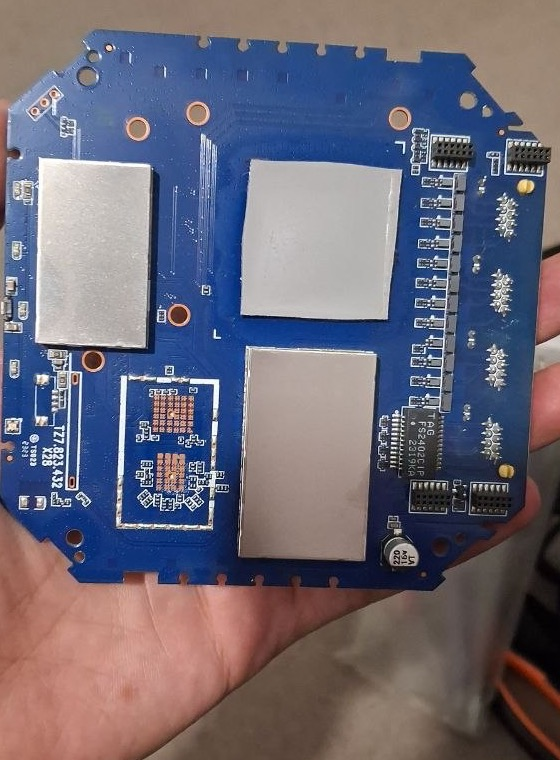
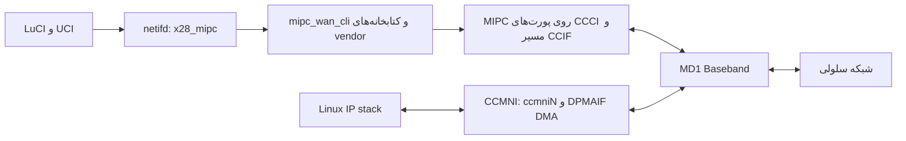

<h1 dir="rtl" align="right">مهندسی معکوس مودم 5G مدل ZLT X28</h1>

<h2 dir="rtl" align="right">قسمت سوم: ساخت و نصب OpenWrt و راه‌اندازی اینترنت 5G</h2>

**نویسنده: علی نادری پریزی**

خب، backup داشتیم و یه مسیر محدود Recovery رو هم واقعاً امتحان کرده بودیم. حالا می‌شد سراغ خود OpenWrt رفت. می‌خواستم یه OpenWrt معمولی داشته باشم، ولی مودم سلولی هم باید کار می‌کرد. برای همین همه‌چیز رو با هم عوض نکردم: userspace نسخه 23.05.5 رو روی Kernel سازنده 4.19.205 گذاشتم و فایل‌های لازم مودم و Wi-Fi رو از backup خود دستگاه نگه داشتم.

در [قسمت دوم](02-firmware-nand-and-bootloader.md) مرز بازیابی و امضا رو دیدیم. اینجا می‌ریم سراغ ساخت تصویر، اولین نصب و وصل‌کردن اینترنت سیم‌کارت. تصویر native روی slot A بوت شده؛ این نتیجه یه دستگاه هست و با وجود پیشرفت ابزارها، نصب‌کننده عمومی و تضمین‌شده برای همه نسخه‌های X28 نداریم. مبنای متن، commit `b9c1a96` از [مخزن پروژه](https://github.com/mralinp/zlt-x28-openwrt) هست.

<h2 dir="rtl" align="right">چرا OpenWrt 23.05.5 و چرا Kernel قدیمی؟</h2>

نسخه 23.05.5 رو انتخاب کردم تا برای بسته‌ها و تست سازگاری یه مبنای مشخص داشته باشم. `userspace.sh` نسخه و SHA-256 ImageBuilder رسمی `armsr/armv8` رو پین می‌کنه؛ خروجی ARM64 روی Cortex-A55 قابل اجراست. این انتخاب به معنی پشتیبانی رسمی target عمومی armsr از برد X28 نیست. از ImageBuilder برای ساخت userspace استفاده می‌شه، نه برای گرفتن یه disk image آماده فلش روی مودم.

Kernel سازنده حامل درایورهای NAND، شبکه داخلی مودم، Wi-Fi و تغییرات اختصاصی Quectel و Tozed هست. source دقیق و قراردادهای همه این بخش‌ها در دسترس نبود. برای همین بوت Linux جدید یه پروژه جدا بود. حفظ Kernel اجازه داد اول مالکیت LAN، DHCP، firewall و WAN رو به OpenWrt بسپارم، بدون اینکه هم‌زمان لازم باشه کل پلتفرم MT6890 رو port کنم.

البته این انتخاب یه دردسر هم داشت: ماژول‌های رسمی feed این OpenWrt برای Kernel سری 5.15 ساخته شدن و با 4.19.205 این دستگاه سازگار نیستن. از طرفی Kernel فعلی `nf_tables` نداره. در نتیجه مسیر firewall این پروژه **fw3 و iptables-legacy** هست؛ صرف جدیدترشدن LuCI، قابلیت nftables یا DSA رو به Kernel اضافه نمی‌کنه.

<h2 dir="rtl" align="right">دو نیمه ساخت و مرز فایل‌های اختصاصی</h2>

*برد هدف، نه سخت‌افزار مرجع عمومی ARM64 — مسیر مخزن: `docs/images/x28-board-back.jpg`.* اینکه CPU همون معماری رو داره، هنوز کافی نیست که برد بوت بشه و peripheralهاش راه بیفتن. در این برد، درایورها و اطلاعات اختصاصی همون واحد حفظ شدن؛ عکس، مدرک اجرای OpenWrt یا شناسایی قطعات پوشیده زیر شیلد نیست.

ساخت به دو قسمت تقسیم شد. نیمه عمومی شامل بسته‌های OpenWrt، سرویس‌های استاندارد و کد `x28-*` هست. نیمه خصوصی، Kernel و ماژول‌ها و برنامه‌های vendor رو از backup مالک می‌گیره. این فایل‌ها وارد Git، CI و artifact عمومی نمی‌شن. به همین دلیل دانلود یه release لزوماً تصویر نهایی مناسب فلش به شما نمی‌ده.

در [فهرست firmware](../../docs/FIRMWARE-INVENTORY.md)، بررسی ELF نشون داد چند کتابخانه قدیمی باید همراه برنامه‌های vendor بمونن: `libubox.so`،‏ `libubus.so.20210603`،‏ `libjson-c.so.2` و `libnl-tiny.so`. کتابخانه جدیدی با نام مشابه لزوماً layout داده یکسان نداره؛ ساختن symlink برای پنهان‌کردن تغییر ABI راه‌حل نبود. چهار کتابخانه سازگاری با نام متفاوت می‌تونن کنار نسخه جدید قرار بگیرن.

بررسی نمادهای ELF فقط مرحله اول بود. ده باینری در آزمایش linker، وابستگی‌هایشان رو روی userspace جدید پیدا کردند. بعد QEMU دوازده بررسی userspace رو گذراند و chroot در RAM خود X28 ده بررسی رو. این مراحل نشون دادند musl، UCI، ubus و اجزای LuCI اجرا می‌شن؛ هنوز ثابت نمی‌کردن switch و modem در بوت native کار خواهند کرد.

<h2 dir="rtl" align="right">مسیر ساخت؛ از tarball تا UBI</h2>

فرمان‌ها از ریشه مخزن اجرا می‌شن. آنچه زیر آمده عملیات میزبان هست و فلش دستگاه نیست. مسیرهای `private/` نمونه ورودی‌های ثبت‌شده پروژه‌اند؛ checkout عمومی اون‌ها رو نداره. خروجی هر مرحله باید تازه باشه و manifest مرحله قبل رو بپذیرد.

<h3 dir="rtl" align="right">۱. userspace عمومی</h3>

روی Linux x86_64 با فایل‌سیستم حساس به بزرگی و کوچکی حروف و پیش‌نیازهای [BUILD](../../docs/BUILD.md)، خروجی رو در مسیر مورد استفاده مراحل بعد می‌ذاریم. این نمونه مسیر یکدست برای گردش کار فعلی هست؛ اسکریپت همون آرگومان پوشه خروجی رو می‌پذیره:

<pre dir="ltr" align="left"><code dir="ltr" class="language-sh">tools/build/userspace.sh private/build/out</code></pre>

اسکریپت ImageBuilder رو بررسی و بسته‌ها رو انتخاب می‌کنه. فهرست فعلی علاوه بر LuCI، netifd و Dropbear، شامل VPN و Passwall2 هست؛ برای همین عدد تاریخی ۱۷۷ بسته و tarball حدود ۴٫۷ MB مربوط به اولین build در ۲۰۲۶-۱۰-۲۳ هست، نه اندازه تضمین‌شده خروجی امروز. در کد فعلی، `sdk_packages.sh` هم بسته‌های سفارشی لازم رو آماده می‌کنه.

روی Mac، محیط کاری build داخل container حساس به حروف نگه داشته شد. این نکته برای firmware واقعی هم مهم بود: `xt_DSCP.ko` و `xt_dscp.ko` دو فایل متفاوت‌اند. استخراج روی فایل‌سیستم معمول case-insensitive می‌تونه یکی رو جای دیگه‌ای بنشاند و تحلیل رو بی‌صدا خراب کنه.

<h3 dir="rtl" align="right">۲. افزودن بخش vendor به archive</h3>

فرمان staging بر پایه نمونه ثبت‌شده BUILD، با نام تازه برای خروجی:

<pre dir="ltr" align="left"><code dir="ltr" class="language-sh">python3 tools/build/stage_native.py \
  --stock private/firmware/20261021/rootfs-b-system.tar.gz \
  --modern private/build/out/openwrt-23.05.5-armsr-armv8-generic-rootfs.tar.gz \
  --ipk private/third-party/openwrt-23.05.5/dl/alsa-lib_1.2.9-1_aarch64_cortex-a53.ipk \
        private/third-party/openwrt-23.05.5/dl/libstdcpp6_12.3.0-4_aarch64_generic.ipk \
  --output private/build/native-stage-NEW</code></pre>

این ابزار archive رو به archive تبدیل می‌کنه، مسیر و symlink نامعتبر رو رد می‌کنه و ۱۴۶ ماژول مطابق Kernel رو جای ماژول‌های 5.15 می‌ذاره. نتیجه هنوز bootable یا flashable اعلام نمی‌شه. marker با نام `NOT-FLASHABLE` عمداً باقی می‌مونه؛ داشتن یه tarball منسجم فقط موفقیت همون مرحله هست.

اسکریپت‌های عمومی ارتقا و مسیر `zmtk_boot_done` از staging حذف می‌شن تا clone خودکار slot دیگه وارد تصویر نشود. بعداً guard مسیر بوت، فایل‌های قابل دسترس از init، preinit، hotplug و سرویس‌ها رو برای writerهای شناخته‌شده بررسی می‌کنه. این بررسی متنی، اثبات نبودن هر نوع نوشتن در ELFهای vendor نیست؛ دامنه‌اش مشخصه.

<h3 dir="rtl" align="right">۳. پیکربندی اولین بوت</h3>

`first_boot.py` کلید عمومی مدیریت، تنظیمات شبکه، سرویس‌ها و بسته‌های X28 رو توی تصویر قرار می‌ده. مسیر فعلی به ماژول‌های خصوصی VPN و بسته‌های ipset هم نیاز داره؛ راهنمای قدیمی بدون اون گزینه‌ها رو نباید دستور کامل فعلی دانست:

<pre dir="ltr" align="left"><code dir="ltr" class="language-sh">python3 tools/build/first_boot.py \
  --stage private/build/native-stage-NEW \
  --public-key ~/.ssh/router.pub \
  --stock private/firmware/20261021/rootfs-b-system.tar.gz \
  --output private/build/native-management-NEW \
  --kmods private/kmods \
  --ipk private/feed-2/x28-ipset-kernel_4.19.205-x28_all.ipk \
        private/feed-2/libipset13_7.17-1-x28-1_aarch64_generic.ipk \
        private/feed-2/ipset_7.17-1-x28-1_aarch64_generic.ipk</code></pre>

این مثال از interface فعلی و [BUILD](../../docs/BUILD.md) پیروی می‌کنه؛ نام stage به خروجی مرحله قبل اشاره داره. در نمونه تاریخی سند، این مسیر `native-stage-76-final` بود. کلید **خصوصی** وارد تصویر نمی‌شه. script کلید عمومی نامعتبر، ورودی تغییرکرده و خروجی موجود رو رد می‌کنه. از نام پوشه `NEW` هم نباید نتیجه گرفت که هر ورودی دلخواه مجاز هست؛ manifest و محتوای واقعی ملاک‌اند.

<h3 dir="rtl" align="right">۴. بسته‌بندی NAND</h3>

در مرحله `package_ubi.py`،‏ SquashFS با XZ، یه overlay تازه UBIFS و container UBI تولید می‌شن. هندسه ثبت‌شده شامل min-I/O برابر 4096،‏ PEB برابر 262144 و LEB برابر 253952 بایت هست. volume صفر `rootfs` با ۱۲۴ LEB رزروشده و volume یه `rootfs_data` با ۱۱۶ LEB ساخته می‌شه. فایل نهایی به ۶۴ MiB و `FF` padding می‌شه.

فرمان زیر الگوی container ثبت‌شده BUILD رو با پوشه مدیریت همین مثال ادامه می‌ده؛ در سند تاریخی mount به `native-management-78-reviewed` اشاره داشت. image ابزار باید اول ساخته بشه و پوشه خروجی نهایی هنوز وجود نداشته باشه:

<pre dir="ltr" align="left"><code dir="ltr" class="language-sh">docker build -t x28-firmware-tools:ubi -f tools/firmware/Dockerfile tools/firmware
docker run --rm --network none --read-only --cap-drop ALL \
  --security-opt no-new-privileges --tmpfs /tmp:rw,exec,size=768m \
  -v "$PWD/tools:/tools:ro" \
  -v "$PWD/private/build/native-management-NEW:/profile:ro" \
  -v "$PWD/private/build:/out" x28-firmware-tools:ubi \
  python3 /tools/build/package_ubi.py --profile /profile --output /out/native-ubi-NEW</code></pre>

ابزار مستقل، CRC هدرهای EC/VID، جدول volumeها، پیوستگی LEBها و payload بازسازی‌شده رو بررسی می‌کنه. خروجی‌های `manifest.json`،‏ `rootfs.squashfs` و `rootfs-a-experimental.bin` هویت همون build رو ثبت می‌کنن. timestamp و UUID اجازه نمی‌دن صرف یکسان‌بودن ورودی، bit-reproducible بودن خروجی رو بدون آزمون ادعا کنم. پیش‌نیازهای دقیق در [بسته‌بندی UBI](../../docs/BUILD.md) آمده هست.

<h2 dir="rtl" align="right">نصب واقعی چه ترتیبی داشت؟</h2>

در اولین نصب، B فریمور فعال کارخانه بود. فقط `rootfs_a` نوشته شد؛ `boot_a`،‏ LK، firmware مودم و گواهی اصلی باقی موندن. اول بازنویسی یکسان و سپس نوشتن candidate، هر کدوم با receipt، UART زنده، کپی backup و readback کامل انجام شدن. انتخاب A مرحله جدا بود. موفقیت RootFS به این معنا نبود که نوشتن `misc` از DA هم کار می‌کنه؛ اون مسیر همان‌طور که در قسمت دوم دیدیم شکست خورد.

برای بررسی آفلاین ورودی‌ها، دستور مستند بدون `--write` این‌جور هست؛ متن داخل `<...>` باید با مسیر واقعی جایگزین بشه:

<pre dir="ltr" align="left"><code dir="ltr" class="language-sh">python3 tools/recovery/slot_entry.py rootfs_a identical \
  --candidate-dir &lt;ubi-dir&gt;</code></pre>

این dry-run فلش نمی‌کنه و مجوز مرحله بعد نیست. در reflashهای بعدی که A از قبل تصویر native داشت، ابزار با `--base-dir` هویت تصویر موجود رو هم می‌بست. در این حالت A فعال می‌مونه و عملیات از نظر ریسک با نصب اولیه روی slot غیرفعال یکسان نیست؛ فقط در محدوده بررسی‌شده پروژه انجام شد.

> **پیش‌نیاز نوشتن:** backup کامل مطابق همون نمونه، کپی دوم بررسی‌شده، UART فعال، DA معتبر، candidate تأییدشده، slot فعلی و شمارنده‌های معلوم، guardهای همسایه و برنامه restore مستقل لازمن. فایل armsr `combined.img`، فایل tar، dump دستگاه دیگه یا خروجی staging رو به LuCI ندهید. مسیر فعلی جای `sysupgrade` عمومی نیست و فرمان‌های write باید از طرح اختصاصی همون عملیات گرفته بشن.

در ۲۰۲۶-۱۰-۲۹، اولین بوت A مدیریت LAN و SSH با کلید و LuCI رو نشون داد. بعد سرویس‌های مودم، DHCP/DNS، NAT و Wi-Fi در image ادغام شدن. در آزمون reboot، hash کلید میزبان، رمز Wi-Fi و رمز root پایدار ماند. این تست آخر خیلی مهم بود. اگه صفحه الان باز بشه ولی با هر reboot رمز و تنظیمات بپره، هنوز کار تموم نشده.

<h2 dir="rtl" align="right">سه مشکلی که تازه روی خود برد پیدا شدن</h2>

اول، بدون `S95done` و `mount_root done`، overlay کامل initialize نمی‌شد و تنظیمات در reboot از دست می‌رفت. دوم، Preloader در هر بوت tries مربوط به A رو زیاد می‌کرد. `x28-bootok` بعد از آماده‌شدن LAN و Dropbear، فقط بایت شمارنده A رو در چهار رکورد `misc` به صفر برمی‌گردونه؛ success و priority رو تغییر نمی‌ده. اگر این کار انجام نشود، بوت سالم هم می‌تونه به مرز تعمیر A از B برسد.

سوم، overlay کوچک داخل `rootfs_a` برای بسته‌ها کافی نبود. تصویر کنونی از volume موجود `data` در `user_data` استفاده می‌کنه و حدود ۲۸۸ MiB فضای قابل استفاده می‌گیره. این فضا با stock مشترک هست و reset معمول `rootfs_data` لزوماً اون رو پاک نمی‌کنه. تصویر جدید با UUID متفاوت overlay رو تازه می‌کنه؛ تصویر بایت‌به‌بایت یکسان ممکنه تنظیمات رو حفظ کنه. فرمان حذف overlay زنده راه‌حل عیب‌یابی نیست.

برای مشاهده وضعیت، نمونه دستورهای خواندنی این‌هاست:

<pre dir="ltr" align="left"><code dir="ltr" class="language-sh">ssh router 'cat /proc/cmdline; cat /proc/mounts; df -h'
ssh router 'ifstatus wan'
ssh router 'iptables -t nat -S POSTROUTING'</code></pre>

در LuCI فعلی، HTTPS با گواهی self-signed و redirect از HTTP فعاله. SSH روی پورت 22 و فقط با کلید هست. root در LuCI اول رمز خالی داره و Wi-Fi تازه طبق `mtwifi.detect` باز ایجاد می‌شه؛ قبل از اتصال کاربران، رمز مدیریت و امنیت هر دو باند رو تنظیم کنید. رمز LuCI، SSH رو به password-auth تبدیل نمی‌کنه. ساعت هم در بوت از تاریخ قدیمی شروع می‌شه و NTP برای اعتبارسنجی HTTPS feedها اهمیت داره.

<h2 dir="rtl" align="right">شبکه سیمی و Wi-Fi رو به صاحب مشخص سپردم</h2>

در بررسی اولیه، draft از `eth1` استفاده می‌کرد، اما لینک متصل روی `eth0.3` بود. اول یه socket مشخص با جدول VLAN واقعی switch اثبات شد؛ سپس پروفایل LAN چهار سوکت شکل گرفت. شماره پورت سخت‌افزاری رو نمی‌شه از ترتیب نام‌های Linux حدس زد. `x28-switch` تنظیمات رو قبل از network اعمال و بازخوانی می‌کنه.

LAN، DHCP و DNS با netifd و dnsmasq اداره می‌شن و fw3 مسئول policy و NAT هست. Wi-Fi هنوز درایور vendor به نام `mt_wifi` داره؛ backend پروژه، UCI و LuCI رو به اون متصل می‌کنه. برای همین وجود MT7915 به معنی استفاده فعلی از `mt76` و mac80211 نیست. radioهای دو باند و استفاده گوشی ثبت شدن، اما آزمون جامع سرعت، roaming و همه حالت‌های Wi-Fi انجام نشده.

<h2 dir="rtl" align="right">فرمان‌های مودم از کجا می‌رن، بسته‌های اینترنت از کجا؟</h2>

برای روشن‌شدن اینترنت باید چهار نقش رو جدا کنیم: Linux میزبان policy شبکه رو اجرا می‌کنه؛ MIPC فرمان‌های userspace رو حمل می‌کنه؛ CCCI/ECCCI زیرساخت ارتباط و چرخه حیات Baseband هست؛ و CCMNI همراه DPMAIF بسته‌های IP رو جابه‌جا می‌کنه. جزئیات حلقه‌های حافظه و DMA از source SDK هم‌خانواده بررسی شدن و نباید اون رو source دقیق Quectel این دستگاه نامید.

این نمودار تألیفی بر پایه [تحلیل معماری](../../docs/research/x28-hardware-architecture.md) هست. USB gadget که `atcid` به اون نیاز داره، مسیر بیرونی دستگاه هست؛ فرمان `AT+CFUN=1` در startup هم وجود داره، ولی کل اتصال به یه مودم USB مبتنی بر AT، QMI یا MBIM تبدیل نمی‌شه.

`x28-modem` اول linkهای پارتیشن و mountهای NV رو فراهم می‌کنه. سپس سرویس‌هایی مانند `nvram_daemon`،‏ `ccci_fsd`،‏ `ccci_mdinit`،‏ `ql_ril_service`،‏ `ql_netd`،‏ `mipc_submonitor` و سرویس‌های AT رو به ترتیب راه می‌اندازه. `mtk_netagent` عمداً اجرا نمی‌شه؛ در ترتیب آزمایش‌شده رادیو رو به CFUN 0/4 می‌بره. این حذف از مشاهده واقعی میاد، نه از فرض زائدبودن همه برنامه‌های vendor.

<h2 dir="rtl" align="right">`x28_mipc` چه چیزی رو اصلاح کرد؟</h2>

handler اصلی در [کد پروتکل](../../package/x28-mipc/files/x28_mipc.sh) قرار داره. پارامترهای APN، MTU و نوع IP رو می‌سنجه، وجود `wan_mgr` رو رد می‌کنه و با lock مانع عملیات هم‌زمان خودش می‌شه. اگر SIM آماده نباشد یا PIN/PUK بخواهد، وضعیت خطا به netifd گزارش می‌شه؛ ارسال PIN در این نسخه پیاده نشده.

بعد از فعال‌سازی bearer، پاسخ JSON شامل CID و نام رابط میاد. کد نام `ccmniN` و آدرس‌ها رو بررسی می‌کنه و اطلاعات رو از راه helperهای netifd می‌فرسته. CID شناسه ارتباط هست؛ teardown فقط همون CID ثبت‌شده برای همون interface رو غیرفعال می‌کنه. کشتن همه پردازش‌های CLI یا قطع ارتباط بر اساس APN می‌تونه به bearer دیگه‌ای صدمه بزند و از handlerهای قدیمی کپی نشد.

توی اولین تست روی دستگاه، فعال‌سازی جواب می‌داد ولی رابط `ccmni` پایین می‌مونه. بررسی `LINK_NOT_READY` اون رو خطا می‌دونست و چرخه activate/deactivate تکرار می‌شد. راه‌حلش کوچیک بود: بعد از اینکه نام رابط رو بررسی کردیم، اول بالا بیاریمش و بعد وضعیت لینک رو چک کنیم. قطعه زیر عین بخش کد هست، نه دستور مستقل برای shell کاربر:

<pre dir="ltr" align="left"><code dir="ltr" class="language-sh">ip link set dev "$ifname" up &gt;/dev/null 2&gt;&amp;1
if [ -z "$(ip link show dev "$ifname" up 2&gt;/dev/null)" ]; then
  x28_mipc_fail_owned "$interface" "$cid" LINK_NOT_READY; return 1
fi</code></pre>

نتیجه ثبت‌شده، بالا آمدن WAN روی `ccmni1` در حدود سه ثانیه با IPv4، route و DNS بود. index رو ثابت نکردم؛ `ccmni1` مشاهده همون اجراست، در حالی که نام واقعی از مودم دریافت می‌شه. بعداً APN خودکار هم به database سیم‌کارت وابسته بود. حذف ناخواسته `apns-conf_8.xml` از تصویر خطای `NO_SIM_APN` و loop ایجاد کرد؛ با انتقال فایل لازم از stock، startup خودکار کامل شد.

<h2 dir="rtl" align="right">IPv6، آدرس link-local و route LAN</h2>

در مسیر IPv6، مودم می‌تونه اول فقط شناسه link-local بدهد و prefix عمومی از Router Advertisement برسد. کد `accept_ra=2` رو برای رابط آماده می‌کنه، link-local رو به netifd می‌شناسونه و منتظر آدرس عمومی می‌مونه. سپس WAN با آدرس `/128` و prefix `/64` برای LAN گزارش می‌شه. باقی‌گذاشتن route متصل `/64` روی WAN باعث شده بود پاسخ مقصدهای LAN دوباره از `ccmni` خارج بشه.

این منطق در پیاده‌سازی موجوده و وضعیت فعلی IPv4، IPv6 و IPv4v6 روی همون SIM ثبت شده. نباید از اون نتیجه گرفت همه اپراتورها همون prefix و رفتار رو می‌دن. PAP/CHAP، SIM PIN، چند WAN سلولی و reconnect طولانی بعد از reset مودم هنوز محدوده‌های باز هستن. CLI بیرونی timeout صریح نداره؛ timeout فرضی نباید در متن به‌عنوان قابلیت ساخته‌شده معرفی بشه.

<h2 dir="rtl" align="right">نتیجه آزمون‌ها و ادامه مسیر</h2>

تا اینجا OpenWrt از NAND بوت می‌شه، WAN به‌شکل interface معمول netifd در LuCI دیده می‌شه و LAN، DHCP/DNS، NAT و IPv6 روی نمونه آزمایش کار می‌کنن. soak به‌جای ۴۸ ساعت برنامه‌ریزی‌شده، در مجموع ۲۶٫۶ ساعت اجرا شد: WAN در همه نمونه‌ها بالا بود و restart توضیح‌نداده ثبت نشد، اما `MemAvailable` کاهش داشت. این نتیجه گواه پایداری نامحدود نیست.

عکس واقعی موجود از LuCI مربوط به Passwall2 هست و در قسمت بعد میاد؛ screenshot مستقلی از اولین WAN، صفحه پروتکل و LAN توی مخزن نیست. نمودار این قسمت جای اون شواهد تصویری رو نمی‌گیره.

در [قسمت چهارم](04-passwall2-vpn-and-benchmarks.md)، همین Kernel حفظ‌شده محدودیت بعدی رو ایجاد می‌کنه: ماژول‌های WireGuard و TPROXY باید با اون کار کنن، نه با Kernel feed عمومی.

<h2 dir="rtl" align="right">منابع و لینک‌های بیشتر</h2>

- [راهنمای ساخت تصویر](../../docs/BUILD.md)
- [راه‌اندازی سلولی با x28_mipc](../../docs/NATIVE-CELLULAR.md)
- [آزمون‌های ۲۳ تا ۳۸](../../docs/TESTING.md)
- [سیاست overlay](../../docs/research/overlay-policy.md)
- [مخزن پروژه و تاریخچه کد](https://github.com/mralinp/zlt-x28-openwrt)

