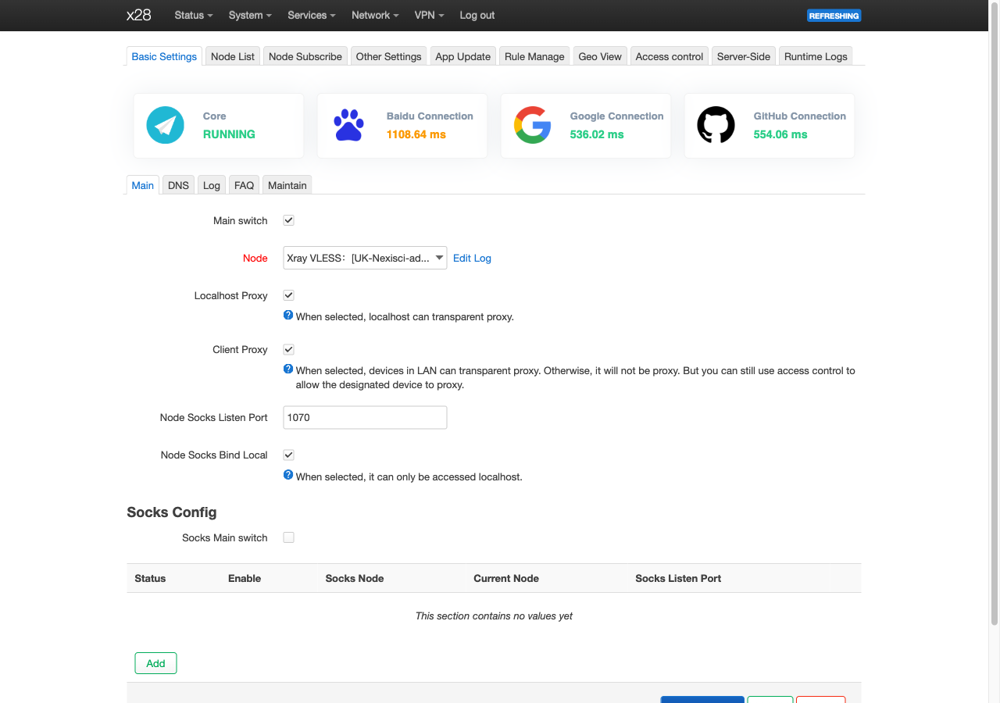

<h1 dir="rtl" align="right">مهندسی معکوس مودم 5G مدل ZLT X28</h1>

<h2 dir="rtl" align="right">قسمت چهارم: راه‌اندازی PassWall2، WireGuard و OpenVPN؛ از ماژول Kernel تا آزمون سرعت</h2>

**نویسنده: علی نادری پاریزی**

اینترنت سیم‌کارت که راه افتاد، نوبت VPN و proxy بود. می‌خواستم این کارها رو خود X28 انجام بده. ولی اینجا هم فقط نصب یه بسته کافی نبود. userspace رو جدید کرده بودم، اما Kernel هنوز همون 4.19.205 سازنده بود؛ ماژول آماده feed رسمی OpenWrt بهش نمی‌خورد و TPROXY هم توی build اصلی نبود.

اینجا ادامه [ساخت و راه‌اندازی 5G](03-openwrt-installation-and-5g.md) رو دنبال می‌کنیم. نتیجه‌هایی که می‌گم از تست روی همون یه دستگاه اومدن. نتیجه، WireGuard و OpenVPN آزمایش‌شده و Passwall2 فعال برای ترافیک LAN هست؛ با محدودیت ABI ماژول‌ها، RAM و دامنه آزمون‌ها. مبنای منابع، commit `b9c1a96` در [مخزن پروژه](https://github.com/mralinp/zlt-x28-openwrt) هست، نه وعده سرعت برای هر سرور یا اپراتور.

<h2 dir="rtl" align="right">بسته نصب شد؛ یعنی کار هم می‌کنه؟</h2>

برای هر قابلیت باید این سه تا رو جدا چک می‌کردم: برنامه userspace اجرا می‌شه؟ Kernel زیرساخت اون رو داره؟ بسته‌مدیر وابستگی رو درست می‌فهمه؟ `wireguard-tools` بدون درایور WireGuard تونل نمی‌سازه. صفحه LuCI هم فقط رابط تنظیمات هست. برای OpenVPN، دستگاه TUN و کتابخانه رمزنگاری لازمن؛ برای Passwall2 مسیر شفاف، targetها و matchهای فایروال هم باید وجود داشته باشن.

Kernel این نمونه `CONFIG_MODVERSIONS` داره. یکسان‌بودن متن vermagic یا شماره نسخه، تضمین سازگاری نیست؛ CRC نمادهای مورد استفاده، قرارداد typeها رو کنترل می‌کنه. در مقایسه TPROXY ساخته‌شده از SDK هم‌خانواده با Kernel اصلی، از ۳۵ نماد لازم، ۱۴ CRC برابر، ۱۹ CRC متفاوت و دو نماد exportنشده بودن. این نتیجه، SDK رو به source دقیق X28 تبدیل نمی‌کنه.

بعداً ماژول‌های بدون CRC نماد ساخته و روی دستگاه بارگذاری شدن؛ `x28_udp_lookup` هم دو export مورد نیاز رو فراهم کرد. مقایسه offsetهای مورد استفاده و عبور واقعی TCP/UDP شواهد مثبتن، اما حذف کنترل نسخه نماد، محافظ Kernel رو کنار می‌ذاره. اون رو به‌عنوان دستور عمومی force-load ماژول ناسازگار پیشنهاد نمی‌کنم. آزمون طولانی و source دقیق هنوز ارزش دارن.

<h2 dir="rtl" align="right">opkg چطور با این Kernel قدیمی کنار اومد؟</h2>

feed رسمی userspace قابل استفاده بود، ولی kmodهای 5.15 نباید نصب می‌شدن. feed امضاشده X28 برای قابلیت‌هایی که Kernel واقعاً داشت، بسته‌های metadata خالی یا stub می‌سازه. اینا درایور تازه نصب نمی‌کنن؛ فقط وابستگی موجود رو به opkg معرفی می‌کنن. برای قابلیتی که واقعاً موجود نیست، نصب باید رد بشه.

در آزمون clean flash شماره ۳۶، نصب `ipset` بدون `--nodeps` کار کرد و `kmod-nft-core` رد شد. ۱۴۶ ماژول اصلی هم باقی موندن. این رفتار از موفق‌شدن صوری نصب مهم‌تر هست: بسته‌مدیر نباید با یه dependency جعلی، نبود قابلیت در Kernel رو پنهان کنه. در مجموع ۱۷۸ stub از میان ۹۷۶ kmod بررسی‌شده فهرست شدن؛ این به معنی پشتیبانی همه اون ۹۷۶ مورد نیست.

ipset هم استثنای مشخصی داشت. aggregate رسمی `kmod-ipt-ipset` همه moduleهای مورد انتظار رو نداره؛ `hash:ip,mac` موجود نیست. بسته‌های vendor-ipset وابستگی رو به subset واقعی می‌بندن. از طرفی `kmod-ipt-extra` به علت نبود `xt_cgroup` stub کامل نداره. اینکه چند match مورد نیاز Passwall2 کار کنن، به معنی کامل‌بودن کل اون aggregate نیست.

برای مشاهده وضعیت بسته‌مدیر روی تصویر آماده، فرمان‌های آزموده‌شده عبارت‌اند از:

<pre dir="ltr" align="left"><code dir="ltr" class="language-sh">opkg update
opkg install ipset</code></pre>

این فرمان‌ها شبکه و overlay رو مصرف می‌کنن و باید بعد از صحت ساعت، کلید feed و فضای آزاد اجرا بشن. اون‌ها روش تبدیل stock firmware به تصویر native نیستن. از `--nodeps` برای دورزدن خطای وابستگی به‌عنوان روال نصب استفاده نکنید؛ در تاریخ آزمایش TPROXY این‌جور نصب دستی‌ای انجام شد، اما build فعلی records لازم رو صریح می‌نویسه.

<h2 dir="rtl" align="right">WireGuard؛ هم ابزار، هم درایور</h2>

Kernel کارخانه WireGuard نداشت. source `wireguard-linux-compat` نسخه `1.0.20220627` در `package/x28-kmods` آمده و patch کوچک پروژه تعریف تکراری `ktime_get_coarse_boottime_ns()` رو حذف می‌کنه؛ vendor tree اون رو از قبل داشت. ساخت به درخت SDK خصوصی داخل volume آماده `x28-kbuild` نیاز داره:

<pre dir="ltr" align="left"><code dir="ltr" class="language-sh">docker run --rm -v x28-kbuild:/k \
  -v "$PWD/package/x28-kmods:/src:ro" \
  -v "$PWD/private/kmods:/out" \
  debian:bookworm bash /src/build.sh</code></pre>

این فرمان میزبان هست و ماژول رو روی دستگاه load نمی‌کنه. volume باید از قبل مطابق [راهنمای kmods](../../package/x28-kmods/README.md) و بررسی ABI آماده شده باشه. فایل‌های `.ko` ساخته‌شده از این محیط خصوصی در Git، CI یا feed منتشر نمی‌شن. انتقال فایل به دستگاه دیگه، حتی با همون نام X28، نتیجه آزمون این نمونه رو همراه خود منتقل نمی‌کنه.

تصویر، `wireguard-tools` و `luci-proto-wireguard` رو هم داره. تنظیم peer، کلید خصوصی، endpoint و Allowed IPها باید از شبکه خود مالک بیاد؛ repository یه پیکربندی provider عمومی یا کلید قابل انتشار نداره. برای همین در این مقاله یه peer فرضی رو به‌عنوان پیکربندی واقعاً استفاده‌شده جا نمی‌زنم. آزمون سرعت با peer آزمایشگاهی بوده و سناریوی دسترسی از بیرون پشت CGNAT اپراتور رو اثبات نمی‌کنه.

<h2 dir="rtl" align="right">چرا load ماژول به انتهای بوت رفت؟</h2>

ماژول‌های افزوده در `/lib/modules/x28` قرار می‌گیرن، نه مسیر عادی `/lib/modules/4.19.205`. اگر در مسیر عادی باشن، اولین قانون TPROXY ممکنه `modprobe` خودکار رو زودتر از محافظ پروژه فعال کنه. این موضوع هنگام بازبینی بعد از آزمون reboot پیدا شد.

`x28-kmods` با START برابر 97 اول صفرشدن tries در هر چهار رکورد A رو بررسی می‌کنه. سپس روی overlay پایدار marker می‌سازه، `sync` می‌کنه و moduleها رو به ترتیب وابستگی load می‌کنه. اگر load باعث crash بشه و marker بمونه، بار بعد خودکار تکرار نمی‌شه. ترتیب نام‌های واقعی در init این‌جور هست:

<pre dir="ltr" align="left"><code dir="ltr" class="language-text">wireguard x28_udp_lookup nf_socket_ipv4 nf_socket_ipv6
nf_tproxy_ipv4 nf_tproxy_ipv6 xt_socket xt_TPROXY</code></pre>

بعد از load، interfaceهای WireGuard بالا آورده می‌شن و در صورت فعال‌بودن Passwall2، سرویس اون دوباره شروع می‌شه. marker بعد از مهلت داخل کد حذف می‌شه. این محافظ، تضمین تحمل هر crash نیست؛ به ماندگاری overlay و marker وابسته‌ست. توضیح قدیمی «۳۰ ثانیه بعد از بوت» هم قرارداد دقیق نسخه فعلی نیست؛ کد منتظر صفرشدن tries می‌مونه.

<h2 dir="rtl" align="right">OpenVPN؛ انتخاب بر اساس جهت ترافیک</h2>

تصویر فعلی `openvpn-openssl` و `luci-app-openvpn` داره. init فعاله، ولی فقط tunnelهایی رو اجرا می‌کنه که مالک در config فعال کرده باشه. فایل client واقعی شامل کلید و credential هست و در مقاله نمیاد. بسته‌های `xl2tpd` و `ppp-mod-pptp` هم توی تصویر هستن، اما L2TP/PPTP در برابر سرور آزمایش نشدن؛ وجود protocol در LuCI کافی نیست.

اول OpenVPN نسخه 2.5.8 با mbed TLS آزمایش شد. سپس همون نسخه با OpenSSL 3.0.18 از RAM اجرا شد تا مقایسه نزدیک‌تری داشته باشیم. OpenSSL در ستون دریافت روتر بهتر بود و برای تصویر انتخاب شد؛ در ارسال، اعداد پایین‌تری داشت. پس «این build سریع‌تر هست» بدون نام‌بردن جهت ترافیک، خلاصه دقیقی نیست.

<h2 dir="rtl" align="right">Passwall2 و Xray کجا قرار می‌گیرن؟</h2>

Passwall2 تنظیم node، DNS و قوانین هدایت رو مدیریت می‌کنه؛ Xray ترافیک proxy رو حمل می‌کنه. TPROXY یا Transparent Proxy، بسته رو به socket شفاف محلی می‌رسونه تا برنامه مقصد اصلی رو بشناسد. target به نام `xt_TPROXY`، تشخیص socket و زیرساخت IPv4/IPv6 لازمن؛ نصب Xray به‌تنهایی اون‌ها رو فراهم نمی‌کنه.

ماژول‌های `nf_socket_ipv4/6`،‏ `nf_tproxy_ipv4/6`،‏ `xt_socket` و `xt_TPROXY` از source نسخه 4.19.205 ساخته شدن. `x28_udp_lookup`، توابع `udp4_lib_lookup` و `udp6_lib_lookup` رو که Kernel اصلی export نکرده بود، با استفاده از زیرساخت exportشده تأمین می‌کنه. بررسی CRC در [گزارش ماژول‌ها](../../docs/research/kernel-module-crc.md) و نتیجه زنده در آزمون ۳۹ آمده هست.

تنظیم‌های مهم تصویر، `prefer_nft=0` و `tcp_proxy_way=tproxy` هستن. `dnsmasq-full` سفارشی با `ipset` و بدون `nftset` ساخته می‌شه تا dependencyهای nftables وارد تصویر نشوند. انتخاب iptables در اینجا ناشی از قابلیت Kernel هست؛ دستورهای nft در آموزش یه روتر جدیدتر رو نباید به این دستگاه منتقل کرد.

*تصویر ۳ — Passwall2 روی دستگاه واقعی در ۲۰۲۶-۱۱-۰۲؛ مسیر مخزن: `docs/images/x28-passwall2-luci.png`.* روشن‌بودن Core و پاسخ بررسی‌های اتصال دیده می‌شه. عکس شاهد وضعیت رابط و همون آزمون‌های لحظه‌ای هست؛ به‌تنهایی سرعت، عبور همه پروتکل‌ها یا نبود نشت رو ثابت نمی‌کنه. نام نمایشی node توی تصویر کلید اتصال نیست، ولی قبل از انتشار عمومی بهتر هست با نظر نویسنده پوشانده بشه.

<h2 dir="rtl" align="right">مسیر نصب فعلی رو با آزمایش دستی اشتباه نگیریم</h2>

ترتیب قابل بازتولید برای build فعلی اینه: ساخت هشت ماژول خصوصی، تهیه بسته‌های ipset از feed امضاشده، ساخت userspace با Passwall2 و Xray، اجرای `first_boot.py --kmods` همراه سه IPK و سپس packaging. فرمان ثبت‌شده دریافت بسته‌ها اینه:

<pre dir="ltr" align="left"><code dir="ltr" class="language-sh">gh release download feed-2 -D private/feed-2 \
  -p 'ipset_*' -p 'libipset13_*' -p 'x28-ipset-kernel_*'</code></pre>

این دانلود روی میزبان انجام می‌شه؛ صحت asset و هویت feed باید مطابق [گزارش feed امضاشده](../../docs/research/signed-package-feed.md) بررسی بشه. مسیر کامل `first_boot.py` در قسمت سوم آمده هست. راهنمای Passwall2 هنوز در بخشی گزینه قدیمی `--tproxy-modules` رو نام می‌بره، اما interface فعلی `--kmods` هست. این اختلاف رو با کد و BUILD حل کردم، نه با کپی فرمان قدیمی.

آزمون دستگاه با نصب دستی packageها و moduleها شروع شد. بعد از صفرشدن tries، ماژول‌ها از RAM load شدن و Passwall2 با node مالک کار کرد. در مرحله LAN،‏ `client_proxy=1` و `ipv6_tproxy=1` فعال شدن. اینا نتیجه زنده‌اند، اما تصویر نهایی‌ای که همه همین اجزا و guardها رو از اول حمل می‌کنه، در مستندات هنوز clean-flash نشده.

مشکل Save & Apply هم عملی بود: تنظیم LuCI ذخیره می‌شد ولی سرویس restart نمی‌شد. علت، فعال‌نبودن `ucitrack` و لینک boot سرویس بود. بعد از اصلاح، toggle به اجرای واقعی رسید. پس اگر config درست هست ولی قواعد قدیمی‌ان، باید trigger سرویس رو بررسی کرد؛ تغییر node لزوماً مشکل رو حل نمی‌کنه.

<h2 dir="rtl" align="right">DNS، IPv6 و محدوده kill switch</h2>

در آزمون ۳۹، DNS از مسیر dnsmasq و Xray Passwall2 عبور کرد. برای router-originated traffic گزینه `localhost_proxy` مطرح هست و برای کاربران LAN،‏ `client_proxy`. این دو دامنه رو باید جدا آزمود. node استفاده‌شده در پروژه به IPv6 نیاز داشت؛ برای endpoint با IPv6 literal، خاموش‌بودن IPv6 WAN با سالم‌بودن IPv4 جبران نمی‌شه.

guard پروژه در حالت فعال‌بودن Passwall2، forwarding مستقیم غیر ICMP روی `ccmni+` رو برای هر دو خانواده محدود می‌کنه. اما **ICMP مستقیم می‌ره** و ترافیک تولیدشده خود روتر بیرون این guard هست. از طرفی مقصدهای Direct در قواعد شنت، node و whitelist می‌تونن مستقیم بروند. این رفتار یه سیاست مشخصه، نه تضمین «همه بسته‌ها فقط در تونل».

خاموش‌کردن Passwall2 در UCI با توقف ساده سرویس فرق داره. وقتی enabled هنوز یه هست، توقف سرویس guard رو نگه می‌داره. فرمان تاریخی خاموش‌کردن، که config و سرویس رو تغییر می‌ده و ارتباط proxy رو قطع می‌کنه، این‌جور ثبت شده:

<pre dir="ltr" align="left"><code dir="ltr" class="language-sh">ssh x28 'uci set passwall2.@global[0].enabled=0; uci commit passwall2; /etc/init.d/passwall2 stop'</code></pre>

alias `x28` مربوط به محیط مالک هست. تغییر اون به یه مقصد ناشناخته مجاز نیست. به‌روزرسانی بسته هم می‌تونه hookهای init رو بازنویسی کنه؛ بعد از اون باید off/on و guard دوباره بررسی بشن. آزمون کامل tunnel-down، clean reboot این guard و همه مسیرهای نشت هنوز ثبت نشده.

<h2 dir="rtl" align="right">بالاخره چقدر سرعت گرفتیم؟</h2>

جدول زیر از آزمون ۳۷ هست: `iperf3` با مدت ۲۰ ثانیه، یه اجرا برای هر پیکربندی، میان **خود روتر** و peer داخل Docker روی لپ‌تاپ پشت روتر دیگه. این آزمون از اینترنت سیم‌کارت استفاده نمی‌کرد و forwarding کاربر LAN از تونل هم نبود.

| حالت | ارسال روتر، Mbit/s | دریافت روتر، Mbit/s | مصرف CPU کل چهار هسته |
| ---: | ---: | ---: | ---: |
| بدون تونل | 856 | 363 | 9% / 36% |
| WireGuard، یه stream | 630 | 268 | حدود 51% |
| WireGuard، چهار stream | 715 | 330 | 55–58% |
| OpenVPN mbed TLS، AES-128-GCM | 102 | 58 | 24–27% |
| OpenVPN mbed TLS، AES-256-GCM | 98 | 59 | 24–27% |
| OpenVPN mbed TLS، ChaCha20-Poly1305 | 77 | 75 | حدود 26% |
| OpenVPN OpenSSL، AES-256-GCM، نشست بعدی | 74 | 84 | 25–27% |
| OpenVPN OpenSSL، AES-128-GCM، نشست بعدی | 75 | 82 | 25–27% |
| OpenVPN OpenSSL، ChaCha20-Poly1305، نشست بعدی | 75 | 82 | 26–27% |

برای اینکه مقایسه نشست دوم معنی داشته باشه، mbed TLS با AES-256-GCM هم ۹۰/۵۲ ثبت کرد. سرعت receive حتی بدون تونل حدود ۳۶۳ بود؛ پس نباید دریافت پایین‌تر WireGuard رو سقف قطعی پردازنده خواند. در OpenVPN، حدود ۲۵٪ کل چهار هسته به یه هسته کامل نزدیک هست و چند stream بهبود بزرگی نداد. محدودیت تک‌هسته‌ای مشاهده با این داده سازگار هست؛ علت دقیق در مسیر TUN profile نشده.

دمای SoC در آزمون VPN بین ۴۵ تا ۴۸ درجه بود و خطای Kernel در UART یا dmesg ثبت نشد. نبود خطا در اجرای کوتاه جای آزمون طولانی رو نمی‌گیره. از طرفی این جدول توان مسیر آزمایشگاهی هست؛ نه وعده ۷۱۵ Mbit/s روی 5G اپراتور یا peer دوردست.

<h3 dir="rtl" align="right">اندازه‌گیری Passwall2 از کاربر LAN</h3>

آزمون ۴۱ واقعاً از LAN بود: Mac با Wi-Fi پشت یه روتر دوم، proxy اون روتر خاموش، X28 با TPROXY و Xray و node از نوع VLESS روی XHTTP/TLS. ابزار Apple با `networkQuality -s` دانلود و سپس آپلود رو سنجید. خروجی از کشور node بود و مصرف CPU هر دو ثانیه نمونه‌برداری شد.

| شاخص | مقدار ثبت‌شده |
| ---: | ---: |
| دانلود | 206 Mbit/s |
| آپلود | 40 Mbit/s |
| بیشینه CPU روتر در دانلود | 56% از مجموع چهار هسته |
| بیشینه مصرف Xray | 1.1 هسته |
| دمای SoC بلافاصله بعد از آزمون | 44.7 °C |

این مسیر شامل Wi-Fi روتر دوم، شبکه سلولی و node هم بود؛ CPU اشباع نشد. در آزمون جداگانه ترافیک خود روتر، هزینه حدود ۰٫۴۵ هسته به‌ازای هر ۱۰۰ Mbit/s و اوج حافظه Xray حدود ۳۹ MB ثبت شد. برآورد ۳۰۰ تا ۴۵۰ Mbit/s برای سقف احتمالی، **تخمین** از همین داده‌هاست و هرگز سرعت اندازه‌گیری‌شده ۴۰۰ معرفی نمی‌شه.

برای تکرار روش LAN، مسیر و node رو ثابت و proxyهای موازی رو خاموش کنید، سپس `networkQuality -s` رو روی Mac اجرا کنید و مصرف CPU روتر رو جدا ثبت کنید. این کار حجم اینترنت مصرف می‌کنه. فرمان دقیق `iperf3` با همه آدرس‌ها و config خصوصی peer توی مخزن عمومی ثبت نشده؛ من هم خط فرمان فرضی رو جای سابقه واقعی قرار نمی‌دم.

<h2 dir="rtl" align="right">جایی که RAM کم آورد</h2>

یه بار با torrent از سمت LAN به محدودیت RAM خوردم.‏ Xray در حدود نیم ساعت ۳۵۹۷ socket UDP و حدود ۲۸۸ MB مصرف حافظه داشت. فقط حدود ۸ MB RAM آزاد ماند و LuCI و SSH گیر کردند. متوقف‌کردن client کافی نبود؛ restart سرویس Passwall2 وضعیت رو برگرداند. timeout بیکار پیش‌فرض sessionهای UDP در گزارش ۳۰۰ ثانیه هست.

این اعداد با اندازه‌گیری ۳۹ MB در آزمون دانلود تناقض ندارن؛ workload متفاوته. هزاران peer و DHT رفتار دیگه‌ای نسبت به چند stream دارن. روی این firmware، عبوردادن BitTorrent از Passwall2 روتر انتخاب مناسبی نیست. تغییر timeout و tuningهای احتمالی توی تصویر اعمال نشدن و نباید به‌عنوان اصلاح آزمایش‌شده پیشنهاد بشن.

کاهش `MemAvailable` در soak هم هنوز علت قطعی نداره. در بررسی سخت‌افزار، مقدار قابل توجهی از حافظه مصرف‌شده به تفکیک برنامه‌ها توضیح داده نشد و درایورهای vendor از نامزدها بودن؛ این فرض رو «memory leak ثابت‌شده Xray» نمی‌نامم. load average حدود سه هم عمدتاً از threadهای خواب غیرقابل‌وقفه vendor می‌اومد، در حالی که CPU بیکار بود.

<h2 dir="rtl" align="right">عیب‌یابی بر اساس لایه‌ای که شکست خورده</h2>

اگر نصب dependency رد شد، اول capability واقعی Kernel و stub رو بررسی کنید. اگر module load نشد، خروجی Kernel و ABI مطرح هست؛ جایگزینی module با فایل هم‌نام اینترنتی راه‌حل نیست. اگر Passwall2 روشن هست ولی ترافیک LAN مستقیم می‌ره، قواعد هر دو خانواده، `client_proxy` و trigger `ucitrack` باید بررسی بشن. اگر فقط endpoint IPv6 خراب هست، قبل از تغییر DNS، WAN و route IPv6 رو ببینید.

اگر بعد از crash marker باقی مانده، حذف اون فقط درخواست تکرار همون load پرریسک هست؛ اول لاگ UART و دلیل شکست رو نگه دارید. اگر SSH قطع شده، rebootهای متوالی هم بی‌اثر نیستن: شمارنده A و رفتار repair در B هنوز بخشی از مسئله‌اند. برای عملیات تغییر‌دهنده، backup تنظیمات و راه مدیریت مستقل لازمه؛ این بخش دستور اجرای خودکار روی تنها اتصال اینترنت نیست.

<h2 dir="rtl" align="right">آینده؛ چه چیزی هنوز upstream نشده؟</h2>

برای رسیدن به mainline باید بیشتر از عوض‌کردن اسم target کار کنیم. clock، pinctrl، power domain، NAND/ECC، Ethernet MAC و قرارداد بوت MT6890 باید روشن بشن. MT7531 و MT7915 گزینه‌های قابل بررسی برای درایورهای upstream دارن، اما اون درایورها به معنی آماده‌بودن کل پلتفرم نیستن. مسیر داخلی CCIF/DPMAIF هم با مودم PCIe پشتیبانی‌شده توسط `mtk_t7xx` یکی نیست.

در [بررسی امکان Kernel جدید](../../docs/research/x28-mainline-kernel-feasibility.md)، هیچ Linux 6.x روی دستگاه ساخته و بوت نشده. recovery slot اختصاصی B،‏ sysupgrade مناسب اون layout، source دقیق vendor و آزمون‌های چند SIM و اپراتور هم کار آینده‌اند. SMS و voice مرحله stock رو نباید قابلیت portشده تصویر native معرفی کرد.

<h2 dir="rtl" align="right">پایان مجموعه</h2>

مسیر این پروژه از تعمیر یه رابط وب به جداکردن policy شبکه از backend سخت‌افزار رسید. حالا شواهد واقعی برای بوت RootFS جدید، اینترنت سلولی، VPN و proxy داریم و در کنار اون می‌دونیم کدوم مرزها هنوز آزمایشی‌ان: ماژول بدون کنترل CRC، تصویر نهایی Passwall2 بعد از clean flash، reconnect طولانی و recovery بعد از خرابی گسترده.

<h2 dir="rtl" align="right">منابع و لینک‌های بیشتر</h2>

- [راهنمای Passwall2](../../docs/PASSWALL2.md)
- [آزمون‌های ۳۶ تا ۴۱](../../docs/TESTING.md)
- [راهنمای ساخت تصویر](../../docs/BUILD.md)
- [ماژول‌های x28-kmods](../../package/x28-kmods/README.md)
- [تحلیل CRC و سازگاری ماژول‌ها](../../docs/research/kernel-module-crc.md)
- [راهنمای Recovery](../../docs/RECOVERY.md)
- [یادداشت‌های تحریریه و موارد نیازمند تأیید](editorial-notes.md)
- [مخزن پروژه و ادامه توسعه](https://github.com/mralinp/zlt-x28-openwrt)

