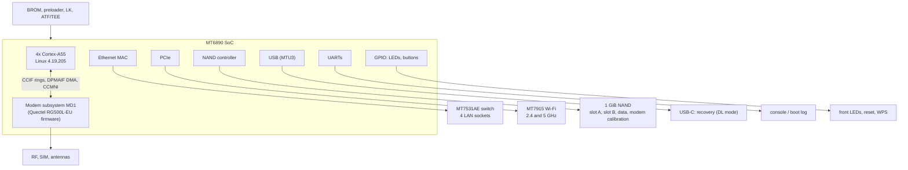

# Hardware specification and modules

What the ZLT X28 (and the X28 PRO) is made of, module by module, and which software of this project drives each one. Start here if
you are new to the board; the measured numbers and the trees are in [HARDWARE](HARDWARE.md), the modem internals in
[x28-hardware-architecture](research/x28-hardware-architecture.md), the boot chain in [BOOT-FLOW](BOOT-FLOW.md).

Evidence labels used below: **observed** = read on a running unit (read-only), **docs** = recorded in this repository, **not recorded** =
nobody has measured or written it down yet (it is left blank on purpose rather than guessed).

## At a glance

| | X28 | X28 PRO |
|---|---|---|
| Board name (`/tmp/sysinfo/board_name`) | `Tozed,X28` (observed). Board marking `TZ7.823.432 X28` on the back of the first unit | not recorded (board `TZ7.823.805A`, stock firmware 8.6.8 of 2024-02-20) |
| SoC | MediaTek MT6890 / T750, 4x Cortex-A55, aarch64, 0.5 to 2.0 GHz (observed) | the same boot chain and kernel image ([flash-other-units](research/flash-other-units.md)) |
| Memory | 1 GiB DRAM, Linux sees about 628 MiB; the rest is reserved for the modem and firmware ([HARDWARE](HARDWARE.md#ram)) | not recorded separately |
| Flash | 1 GiB NAND, 4 KiB pages, 256 KiB erase blocks, 51 partitions, A/B slots ([HARDWARE](HARDWARE.md#flash)) | the same layout |
| Cellular | Quectel RG500L-EU 5G NR + LTE, inside the platform (not a USB or PCIe modem); the RF, SIM and antenna side is not recorded | the same family |
| Wi-Fi | one combined dual-band MT7915D chip on PCIe (`14c3:7915`), the `mt_wifi` vendor driver (observed) | two cards, one MT7915 chip per band (docs) |
| Ethernet | MT6890 MAC (`eth0`, `eth1`) into an MT7531AE switch; four LAN sockets bridged, 1 Gb on the cabled one (docs) | not recorded |
| USB | an MTU3 controller; the USB-C port is the recovery port (preloader and download agent). Host mode is **not established** | the same |
| Console | UART at 921600 8N1, 1.8 V logic, an unpopulated 3-hole footprint on the back ([RECOVERY](RECOVERY.md#uart-debug-console-2-read-side-confirmed)) | not recorded |
| Front panel | LEDs: cellular radio (green), cellular quality (green), system (red) (observed in sysfs); reset and WPS buttons | not recorded |
| Power | 12 V DC; the adapter must supply at least 0.7 A (owner, 2026-11-09) | not recorded |
| SIM | one slot (size not recorded) | not recorded |
| Antennas | 4 for cellular, 4 for Wi-Fi (owner) | 4 for cellular; 4 or 8 for Wi-Fi (owner is not sure which; two chips suggest 8) |
| Case ports | 4 LAN sockets and one USB-C port; no USB-A (owner) | not recorded |
| Cooling | no fan from the factory and **no fan header**; the owner's fan is wired by hand to the 12 V input and runs at full speed ([THERMAL](THERMAL.md)) | not recorded |
| Kernel | vendor Linux 4.19.205 (aarch64, musl userspace), the same image in both slots | the same |
| Not recorded for either | the SIM size, the antenna connector type, the 5G/LTE band list, the labels on the sockets | |

## How the modules fit together

## The modules

### SoC and application processor

MediaTek MT6890 (T750 in the vendor tree), four Cortex-A55 cores sharing one frequency (500 MHz to 2 GHz, `schedutil`). It runs the vendor
kernel 4.19.205: no `nf_tables` (so the firewall is fw3 with iptables-legacy), no namespaces, `CONFIG_MODVERSIONS`. The modem and Wi-Fi
drivers are tied to this kernel, which is why the project stays on it. Detail: [HARDWARE](HARDWARE.md#cpu).

### Memory

1 GiB at `0x40000000`. The bootloader reserves about 390 MiB before Linux starts: 256 MiB for the modem firmware, 109 MiB shared with the
modem, 24 MiB for other firmware. About 286 MiB of the 628 MiB Linux gets is not itemised by the kernel (#299, #301). `/tmp` is RAM.

### Flash and the A/B layout

One NAND chip with 51 partitions ([HARDWARE](HARDWARE.md#flash)). Two full slots (198 MiB each: `rootfs`, `boot`, `lk`, `tee`, modem images and
small firmware), a shared 427.5 MiB `user_data` (the overlay), the modem's calibration and settings (`nvcfg`, `nvdata`, `nvram`, `protect1/2`),
carrier configuration (`mcf`), and the identity partitions (`proinfo`, `productinfo`, `user_config`, `qraw`, `seccfg`). **Identity and
calibration partitions are never written by the flasher or by sysupgrade**; the IMEI, serial number, MACs and Wi-Fi calibration live there.
Software: `x28-storage` attaches `user_data` as the overlay; [`sysupgrade`](research/sysupgrade-design.md) and the flasher write only
`rootfs_a` or `rootfs_b` and, from the running system, the `misc` priority bytes.

### Boot chain and slot selection

BROM, then the **preloader** (picks the slot from the record in `misc`, counts a try per boot, switches slots after 6, opens a one-second
USB window), then **LK** (verifies and loads the kernel and the modem images, builds `bootslot=a|b`), then ATF/TEE, then Linux. Everything about
the record and the signature checks is in [BOOT-FLOW](BOOT-FLOW.md) and [slot-b-reuse](research/slot-b-reuse.md). Software: `x28-bootok`
resets the running slot's tries after a good boot; the flasher and sysupgrade change which slot boots.

### Cellular modem (Quectel RG500L-EU)

A 5G NR + LTE baseband that runs as a subsystem of the SoC (MD1): Linux talks to it through shared memory rings (CCIF), DMA queues (DPMAIF) and
the `ccmni0` to `ccmni20` network interfaces; control messages (MIPC) travel over CCCI character ports. It is not enumerated on USB or PCIe.
Firmware revision `RG500LEUAPR04A01M1G…` (observed). The vendor daemons (`ql_ril_service`, `ql_netd`, `mipc_submonitor`, `atci_service`, …) run
only as the modem backend. Software: `x28-modem` (starts the stack at boot), `x28-mipc` (the netifd protocol: IPv4, IPv6, APN from the SIM; with the helpers `x28-apn`
and `x28-plmn-scan` for the operator scan and selection), `luci-proto-x28-mipc` (the LuCI page and Carrier tab), `x28-nrband` (5G band lock). Detail:
[NATIVE-CELLULAR](NATIVE-CELLULAR.md), [x28-modem-driver-analysis](research/x28-modem-driver-analysis.md). SMS and voice: not ported yet.

### Wi-Fi (MediaTek MT7915)

2.4 GHz (`ra0`) and 5 GHz (`rai0`) on the vendor `mt_wifi` driver, which is not `nl80211`/mac80211, with hardware offload (WED) through
`mtk_warp`. The X28 has one combined MT7915D chip; the X28 PRO has two MT7915 chips (one per band). `l1profile.dat` and two
`mt7915.dbdc.b*.dat` profiles describe them; calibration is in `nvcfg` (`e2p`). Software: the package `x28-wifi` holds a netifd wireless handler named
`mtwifi` (with LuCI options, the region and channel tables), `x28-wifi-l1` (picks the single-card profile on a one-chip board, at S05, before the
driver loads) and `x28-wps` (the WPS button). Not measured: Wi-Fi throughput and client behaviour (#150).

### Ethernet and switch

The SoC's Ethernet MAC (`eth0`, `eth1`) feeds a MediaTek MT7531AE switch (7 ports, VLAN mode); the observed table gives sockets 1, 2, 4 and 0
their own VLANs, bridged into `br-lan`. The code and DT comments also mention a separate 2.5 G PHY and a spare switch port: not verified on a
board. Software: `x28-switch` loads the observed VLAN table at boot with `swconfig`; netifd, `dnsmasq` and fw3 do the rest, with `x28-dhcp` as a
guard for the X28 PRO's slow bridge ([BUILD](BUILD.md#observed-socket-4-switch-profile-86)).

### USB-C and the console UART

The USB-C port is the recovery port: the preloader exposes a USB device for about a second after power-up, and the flasher loads the download
agent through it; it needs a USB-A to USB-C cable (C to C does not work). The port as a USB host for storage is not established. The console is a
1.8 V UART footprint on the back, read-only capture needs a level shifter. Software: [x28-flasher](https://github.com/mralinp/x28-flasher).

### LEDs and buttons

Tozed's `tz_gpio_leds` and `tz_gpio_keys` drivers: three front LEDs in sysfs (cellular radio green, cellular quality green, system red) and a
`/dev/tz_gpio_keys` stream of `[event, key, ms]` records; key 1 is reset, key 2 is WPS. No layer of the boot chain wipes flash on a reset press
([reset-wps-buttons](research/reset-wps-buttons.md)). Software: `x28-leds` (signal colour, radio and WAN state) and the WPS handler in `x28-wifi`; a reset
hold that clears the overlay is planned (#267).

### Thermal and cooling

Seven or more sensors (`soc_max`, `cpu_little0`, `md_4g`, `md_3g`, `soc_dram_ntc`, `nrpa_ntc`, `ltepa_ntc`, `rf_ntc`, PMIC rails). The SoC idles near 40 C
on the native image; kernel trip points are 85, 95 and 115 C, and the vendor `ql_ntc` policy has its own limits. A 12 V fan helps by 16 to 20
degrees. The board has no fan header (owner, 2026-11-09): the fan is wired by hand to the 12 V input, so it cannot be speed-controlled from
software today; smart fan control (#47) would need a modification. [THERMAL](THERMAL.md).

## Software map

| Package | Module it serves |
|---|---|
| `x28-modem`, `x28-mipc` (with `x28-apn`, `x28-plmn-scan`), `luci-proto-x28-mipc`, `x28-nrband` | cellular modem |
| `x28-wifi` (with `x28-wifi-l1`, `x28-wps`) | Wi-Fi |
| `x28-switch`, `x28-dhcp` | Ethernet and LAN |
| `x28-leds` | LEDs |
| `x28-storage` | flash: `user_data` as the overlay |
| `x28-bootok`, `x28-sysupgrade` (`/lib/upgrade/platform.sh`) | boot counter and A/B upgrade |
| `x28-kmods`, `x28-kmod-stubs`, `x28-feed` | kernel modules for the vendor kernel and the signed opkg feed ([PACKAGE-FEED](PACKAGE-FEED.md)) |
| `x28-base` | meta-package that protects all of the above |

## Gaps in this page

Not recorded yet, add them when someone measures or reads the label: the SIM size, the antenna connector type, the supported 5G/LTE bands, the
labels on the sockets, the X28 PRO's board name string, its RAM, CPU and Ethernet details, its Wi-Fi antenna count (4 or 8), and whether the
USB-C port can act as a host. The 2.5 G PHY seen in code comments does not match four LAN sockets: unverified.
