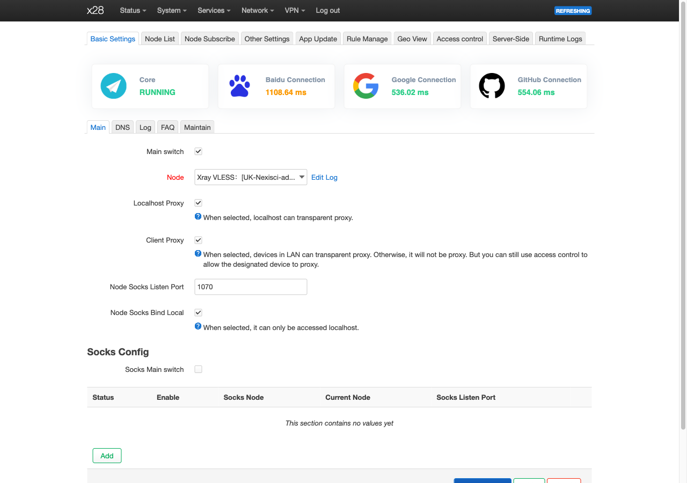

# Passwall2 on the native image

Issue: [#198](https://github.com/mralinp/zlt-x28-openwrt/issues/198). Tested on one unit, 2026-11-01 and 2026-11-02.

**Status: works on the unit for the whole LAN.** With TPROXY and socket modules we build for the vendor kernel,
Passwall2 starts with no warnings and carries the router's own traffic and LAN clients' TCP, UDP and IPv6 through the
node, switched on from LuCI ([TESTING 39](TESTING.md#39-tproxy-and-passwall2-on-the-unit-2026-11-02)). The image
build now ships Passwall2, xray and the modules; that image has not been flashed yet. Installed by hand on the unit, they
came back on their own after a reboot.



*LuCI over HTTPS on the unit, 2026-11-02: Passwall2's core running, its connection checks answered through the node.*

## How it fits this kernel

| Need | How it's met |
|---|---|
| `TPROXY` and `xt_socket` (not in the vendor kernel) | `nf_socket_ipv4/6`, `nf_tproxy_ipv4/6`, `xt_socket`, `xt_TPROXY` built from the SDK tree without symbol versions, like WireGuard ([#227](https://github.com/mralinp/zlt-x28-openwrt/issues/227)); `x28_udp_lookup` supplies `udp4_lib_lookup` and `udp6_lib_lookup`, which the stock kernel never exported. Why this loads despite the CRCs: [kernel-module-crc](research/kernel-module-crc.md) |
| Loading them safely | They live in `/lib/modules/x28`, not `/lib/modules/4.19.205`: there the kernel's `modprobe` would load them by itself for the first TPROXY rule, before the boot tries are reset and past the crash marker. `x28-kmods` (`package/x28-kmods`, S97) loads them after `x28-bootok` resets the boot tries, with a crash marker (a count of unfinished loads; three in a row stop it) so a bad load can't become a boot loop while one reboot inside the 120 s window does not disable the modules, then starts Passwall2 if it is enabled, in case Passwall2's own delayed boot start ran before `xt_TPROXY` was in. Passwall2 keeps its boot link: LuCI's apply only restarts enabled services |
| No nftables | Passwall2's iptables path; the image sets `prefer_nft=0` and `tcp_proxy_way=tproxy` |
| ipset in `dnsmasq` | Our `dnsmasq-full` has `ipset no-nftset` (#203), and the vendor `ip_set` modules are in the image |
| `opkg` dependencies | `kmod-ipt-tproxy` and `kmod-ipt-socket` records at the kernel's version, so `iptables-mod-tproxy` and `-socket` resolve. `iptables-mod-extra` still wants `kmod-ipt-extra`, which has no stub yet |

The sources are in [`package/x28-kmods`](../package/x28-kmods/README.md); the modules are built against the private SDK
tree, so the built files never enter Git or a feed; they are published as packages on the feed release and bundled into every release's
`x28-assembly-*` asset ([BUILD](BUILD.md#vpn-set-and-wireguard-in-the-image-230)). Build them with `package/x28-kmods/build.sh` and pass the directory
to `first_boot.py --tproxy-modules` ([BUILD](BUILD.md#vpn-set-and-wireguard-in-the-image-230)).

Passwall2's `localhost_proxy` sends the router's own traffic through the node, including `opkg` and NTP. Behind a router
that already tunnels to the same node, `client_proxy` would tunnel that router's traffic twice; use Passwall2's access
control to pick clients instead.

## LAN kill switch

Clean native images include `/etc/x28-killswitch.sh` and its enabled-by-default fw3 include
`firewall.x28_killswitch`; no saved settings or manual deployment are needed (#251). `first_boot.py` places both
in the rootfs and hooks Passwall2 start/stop/restart. fw3 reapplies the guard when rebuilding the firewall,
including at boot. Passwall2 itself remains **disabled by default** until the owner configures a node.
While Passwall2 is enabled in UCI, direct forwarded cellular traffic is rejected for both IPv4 and IPv6,
including LAN traffic. ICMP is exempt: ping and path-MTU errors travel **directly**, not through Xray.
Destinations Passwall2 itself sends direct still go direct (#255): shunt rules set to **Direct** (for example an
`IR` rule), the node, and Passwall2's direct whitelist. The script mirrors every destination set Passwall2's
`PSW2` chain returns on, ignoring ports, and the init runs it again after Passwall2 starts, so the exceptions follow
the current rules. Access-control rules that send a whole device direct have no destination set and stay blocked.
Router-originated traffic is outside this forwarding-only guard.

Disabling Passwall2 through LuCI removes the guard when its service restarts. Stopping the service without
turning off its UCI setting keeps the guard. A Passwall2 package upgrade can replace the init hooks; after an
upgrade, recheck toggling or run `/etc/x28-killswitch.sh` after changing the enabled setting.
This is not a full VPN or an all-protocol privacy guarantee; ICMP and router-originated traffic can bypass it.
Live results and the untested clean-flash/reboot boundary: [TESTING 40](TESTING.md#40-passwall2-lan-kill-switch-with-direct-icmp-2026-11-02).

To clear the guard after turning Passwall2 off in UCI, run `/etc/x28-killswitch.sh`; no networking restart is
needed. Disabling only the fw3 include does not opt out: the Passwall2 service hooks still apply it.

## Turning it on for the first time

A flashed image ships Passwall2 **off**, with the stock defaults and no node of yours. Nothing here is changed in the image;
these are the steps and traps seen on the unit (2026-11-04).

1. The image carries no node. Add yours (Passwall2 > Node List), then set **Node** in Basic Settings to it. The stock
   default for **Node** is `rulenode`, the package's split-routing node, whose default node is the placeholder `examplenode`;
   leave it and there is nothing real to proxy through. A `rulenode` group whose rule needs a `geosite` entry missing from the
   image's `geosite.dat` (Sep 2024), such as `IR` (`failed to check code IR from geosite.dat > EOF`), makes xray refuse to
   start while the firewall rules still load. That redirects LAN traffic to a dead TPROXY port and the kill switch blocks the
   direct path, so the LAN is offline until you stop the service. The stock `CN` group is fine.
2. **Save & Apply must restart Passwall2.** Its init is not procd, so LuCI reaches it through `ucitrack`, which registers a
   trigger only where `/etc/init.d/passwall2 enabled` succeeds. That needs both `S99passwall2` and `K15passwall2`
   (`START=99`, `STOP=15`). Images built before #297 had only the S link, so Save & Apply did nothing: run
   `ssh x28 '/etc/init.d/passwall2 restart'` (or `/etc/init.d/passwall2 enable`) and check `pgrep -af bin/xray` and
   `tail /tmp/log/passwall2.log`. After a reflash of a fixed image, confirm the switch starts xray by itself.
3. **IPv6:** `ipv6_tproxy` is off by default (Passwall2 > Other Settings > Forwarding Settings > IPv6 TProxy). While Passwall2 is
   enabled the kill switch rejects direct IPv6 forwarding, so LAN clients have no IPv6 until it is ticked and the service
   restarted. The Linksys-style case of a second router behind the X28 shows it as "IPv4 works, IPv6 does not".
4. If the LAN goes dark after a change, `ssh x28 '/etc/init.d/passwall2 stop'` brings direct traffic back at once.

## State of the test unit

Installed by hand the way the image will have it, not yet from an image:

- The 7 modules and WireGuard in `/lib/modules/x28`, where the kernel's `modprobe` can't load them on demand, loaded by
  `x28-kmods` (S97), which replaced `x28-wireguard`. Not yet rebooted from that directory. `ucitrack` (S80) started and enabled, so LuCI's Save & Apply restarts Passwall2 (its `reload` is a restart).
- `iptables-mod-tproxy`, `-socket` and `-extra` installed with `--nodeps`; `-iprange`, `-conntrack-extra` and the
  `kmod-ipt-nat` stub installed normally. No `kmod-ipt-tproxy`/`-socket` records yet.
- `/etc/config/passwall2`: `enabled=1`, `client_proxy=1`, `localhost_proxy=1`, `tcp_proxy_way=tproxy`, `ipv6_tproxy=1`,
  `prefer_nft=0`, node the owner's UK node (VLESS over XHTTP with TLS, an IPv6 literal, so it needs the WAN's IPv6, #50).
- LuCI over HTTPS with a self-signed certificate (`px5g-mbedtls`, `redirect_https=1`).
- Backups in `/root/backup-lan` (configs and the old loader), `/root/backup-tpx` and `/root/backup-198`.

To turn it off: the switch in LuCI, or `ssh x28 'uci set passwall2.@global[0].enabled=0; uci commit passwall2;
/etc/init.d/passwall2 stop'`. To remove the modules from boot: `ssh x28 '/etc/init.d/x28-kmods disable'` (this also drops
WireGuard, which `x28-kmods` loads too).

## What the device can carry

A speed test through one owner's node mostly measures that node, the carrier and the route, so this page reports what
the X28 itself can do with this firmware: how much CPU the tunnel costs, and where the ceiling is.

**Cost:** xray plus the router's own forwarding used about **0.45 cores per 100 Mbit/s** of tunnelled download (1.73 of
4 cores in an 8-stream run, xray itself 0.82 core). `cpu0` took the network interrupts, with 19% softirq. The SoC stayed
at 42.8 °C and xray peaked at 39 MB of memory.

**Measured from a LAN client:** a Mac behind the X28, with Passwall2 as the only proxy, ran Apple's `networkQuality`
through the tunnel: **206 Mbit/s down and 40 Mbit/s up**. The router's CPU peaked at 56% of 4 cores and xray at 1.1
cores, so the router had headroom left; the link ran out first ([TESTING 41](TESTING.md#41-passwall2-throughput-from-a-lan-client-2026-11-02)).

**Ceiling, estimated:** at 100% CPU, **300–450 Mbit/s, most likely around 400**; for everyday use plan on about
300 Mbit/s (75% load). This assumes LAN forwarding costs about what the router's own `curl` did, and it has not been
reached in a measurement: the links tried so far ran out first.

### Pushing it further

Ideas in order of how cheap they are to try. Only the first is measured here; the rest are untested on this unit.

- **More streams.** One TCP stream does not fill the CPU; parallel downloads (browsers, download managers, several
  clients) use more cores.
- **A lighter transport.** Every layer costs CPU: TLS inside XHTTP inside xray costs more than plain VLESS over TCP with
  TLS or REALITY. Pick the lightest one the network allows.
- **Quiet logs.** Keep Passwall2's node log at `warn` or `error`; debug logging writes per connection.
- **Spread the interrupts.** All Ethernet interrupts land on `cpu0`, which fills first. OpenWrt's packet steering
  (`uci set network.globals.packet_steering=1`) spreads receive work across cores.
- **CPU frequency.** The governor is `schedutil` and the cores reach 2.0 GHz but mostly ran about 1.3 GHz under this
  load; the `performance` governor trades heat for speed.
- **Cooling.** No fan, the SoC idles about 40 °C on this firmware; under sustained load a fan keeps it far from the
  85 °C trip point ([THERMAL](THERMAL.md)).
- **WireGuard where the network allows it.** It runs in the kernel on all four cores and carried 715 Mbit/s at under
  60% CPU ([TESTING 37](TESTING.md#37-vpn-speed-and-cpu-limits-on-the-router-2026-11-02)).

### Torrents fill the RAM

Don't run BitTorrent through Passwall2 on this router. Each tracker, DHT and peer UDP flow becomes its own xray
session, and xray holds each one for its default 300 s idle timeout. On the test unit (2026-11-02), one LAN client's
torrent client left xray with 3,597 UDP sockets and 288 MB within 30 minutes, about 8 MB of RAM was still free, and
LuCI and SSH hung. Stopping the client was not enough: xray was too starved to clean up. `/etc/init.d/passwall2 restart`
recovered it. This is upstream behaviour with a 640 MB router, not a bug, so the image leaves it alone (#257). To find
the device, look in the Passwall2 log (`/tmp/etc/passwall2/acl/acl_default.log`) for one source sending to ports such
as 1337 or 6969. Many VPS providers also suspend accounts over torrent traffic.

### Measure it on your unit

Uses mobile data: up to 400 MB per 8-stream run. Divide the CPU used by the speed to get the cost; the speed alone
mostly reflects your node and carrier.

```sh
ssh x28
umask 077
lua /usr/lib/lua/luci/passwall2/util_xray.lua gen_config \
  '{"flag":"bench","node":"<node id>","local_socks_address":"127.0.0.1","local_socks_port":"10899"}' > /tmp/x28-bench.json
xray run -c /tmp/x28-bench.json >/dev/null 2>&1 &
curl -s -m 15 -o /dev/null -w '%{speed_download}\n' --socks5-hostname 127.0.0.1:10899 http://cachefly.cachefly.net/100mb.test
kill %1; rm -f /tmp/x28-bench.json
```

The generated config holds the node's credentials, so delete it afterwards. For several streams, start the `curl`
line in the background once per stream. For CPU, compare `/proc/stat` before and after.

## Not proven

- Throughput and CPU through the LAN path; the cost above is for the router's own traffic.
- The ceiling itself, the tuning ideas above, and sustained heat under load.
- The modules over hours, and the image that ships them.
