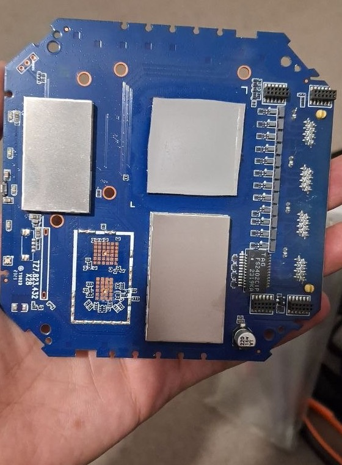
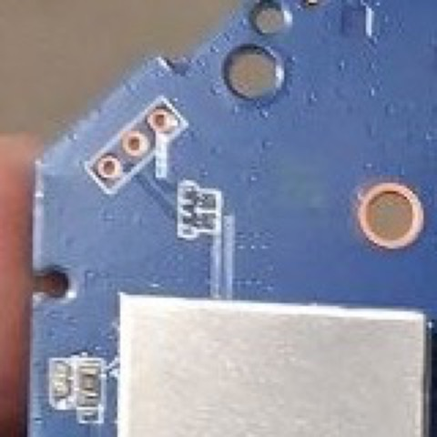

# Recovery: backup and USB flash access

How to back up the X28's NAND and reach it over USB when Linux no longer boots.
Tracks issue #4 (way back to stock); builds on #1 (partition dump).

> **Status, 2026-10-22:** full backup taken and verified, and **flash reads over USB work**:
> `lk_b` read through the preloader matches the backup byte for byte. No write or restore
> has been attempted. Do not flash experimental firmware until a restore has been tested.

| Step | Script | Result |
|---|---|---|
| 1. Back up every partition over SSH | `dump_partitions.py` | ✅ 51 partitions, 1,072,168,960 bytes (2026-10-20) |
| 2. Verify and unpack the backup | `verify_backup.py` | ✅ all sizes and SHA-256 match |
| 3. Find the USB recovery port | `usb_watch.py` | ✅ preloader `0e8d:2000`, needs a USB-A-to-C cable |
| 4. Install the USB tool | `setup_mtkclient.py` | ✅ mtkclient `7cb40e7` plus 3 local fixes |
| 5. Read boot security | `target_config.py` | ✅ secure boot, SLA, DAA all **off** |
| 6. Read a partition over USB, compare hash | `read_verify.py lk_b` | ✅ **MATCH** (`0ad94f06…7007156`) with the Quectel DA |
| 6b. Read every partition over USB, compare | `read_all.py` | ✅ all 51 read: **44 MATCH**, 7 DIFF, all in partitions written at runtime |
| 7. Restore a partition over USB | `write_verify.py` | ⏸️ script ready (dry run only); safety audit says NO-GO on this unit until UART or a spare unit |

## Safety rules

- **Read-only by default.** Every script here only reads from the device. The download agent
  runs in the modem's RAM, which is cleared at power-off.
- After any `mtkclient` command the modem stays in the preloader or download agent and
  **does not boot** (no internet) until its power is cycled. That is expected.
- Never upload the raw partition images through LuCI, concatenate them, or write them blindly.
- Backups contain the unit's identity, calibration and credentials. They live in `private/`
  (git-ignored). Never publish them or use them on another unit. Keep a second copy offline.
- Write or erase work (`risk/brick`) needs a USB read that matches the backup, a tested
  rollback, UART access (#2) and only the inactive A/B slot.

## Hardware setup

| Item | Detail |
|---|---|
| Cable | **USB-A to USB-C**, into a USB-A port (a hub or adapter is fine) |
| Does not work | USB-C to USB-C: the Mac never sees an attach, so the preloader finds no cable and skips USB |
| Host | macOS on Apple Silicon. `usb_watch.py` is macOS-only; the other scripts are portable |
| Router access | `ssh router` (port 2222, key auth) for step 1 |

Why C-to-C fails (inferred, not measured): the Mac logged no USB-C attach and no accessory
event in two power cycles, which fits a modem-side port without CC pull-down resistors.
The preloader confirms it checks for a cable first (`PMIC not dectect usb cable!`).

## Prerequisites

```bash
brew install libusb
```

```bash
/opt/homebrew/bin/python3.14 tools/recovery/setup_mtkclient.py
```

Steps 5–6 also need the vendor download agent at
`private/vendor-da/20261022-mt6890-cpe-recovery-zlt-x28/extracted/DA_BR.bin` (see
[Candidate vendor DA](#candidate-vendor-da-community-package-2026-10-22)); mtkclient's bundled
DA refuses flash reads on this board. Steps 1–3 need only the Python standard library.

## Procedure

Run every command from the repository root.

### 1. Back up all partitions (SSH)

```bash
python3 tools/recovery/dump_partitions.py
```

Writes `private/backups/<date>/` with one gzip per partition, `manifest.json` (size,
SHA-256, ECC notices) and `/proc/mtd`. Uses `nanddump --bb=padbad -q`: main data with ECC
correction, bad blocks padded with `0xFF`, **no OOB**. About 1 GiB of reads; the router
keeps working, but expect extra heat.

### 2. Verify the backup

```bash
python3 tools/recovery/verify_backup.py private/backups/YYYYMMDD
```

Unpacks `images/mtdNN-<name>.bin` and writes `SHA256SUMS`. Any size or hash mismatch stops it.

### 3. Watch for the recovery port

```bash
python3 tools/recovery/usb_watch.py
```

Then cycle the modem's power. Expected:

```
+ 0e8d:2000 MT65xx Preloader <- MediaTek preloader/BROM: recovery port      (~1.1 s)
+ 2c7c:7003 RG500L-EU <- Quectel Linux USB gadget                          (~1.7 s, ~30 s later)
```

### 4. Install mtkclient

See Prerequisites. This installs `bkerler/mtkclient` at commit
`7cb40e727727dfe3faa065eefb29b16ed29bbdf1` (2026-10-12) into `private/mtkclient-7cb40e7/` and
patches the installed copy (the source checkout stays pristine). Tag `v2.1.4.1` loads the DA
but cannot read: it mishandles the DA's log packets. Use `--commit`/`--home` to install another
version, and `X28_MTKCLIENT=<folder>` to point the scripts at it.

| Fix | Why |
|---|---|
| uninstall `fusepy` / `mfusepy` | without libfuse they raise `OSError` at import; mtkclient only handles `ImportError`, so every command crashed |
| `check_sla()` returns "off" on an empty reply | this board's DA returns nothing for `DA.SLA`; mtkclient called `.decode()` on `False` (upstream only guards `None`) |
| empty `page_parity_size` reads as `0` | this DA reports NAND with that field empty; mtkclient never uses it |
| DA extensions skipped when they cannot be built | on the Quectel DA a function lookup returns `None` and `7cb40e7` crashed before any read; the extensions are optional |

Running it again is a no-op.

### 5. Read the boot-security config

**Unplug the modem's power first** (mtkclient refuses a device that is already connected), then:

```bash
python3 tools/recovery/target_config.py
```

Plug the power in when it says it is waiting. Output is logged to `private/usb-probe/<date>/`;
the log contains the chip's ME_ID, which is why it stays private.

### 6. Read a partition over USB and compare

Same power order as step 5:

```bash
python3 tools/recovery/read_verify.py lk_b
```

`lk_b` is a good first target: 2 MiB, static, no identity data, and `lk_a` has the same
hash in the backup. The offset comes from the backup's `/proc/mtd`, the expected hash from
its `SHA256SUMS`. The vendor DA is used by default (`--loader` to override). Add `--debug`
to log the download agent's XML replies. Expected end of output:

```
CMD:READ-FLASH NAND-WHOLE 0x1d800000 0x200000 -> OK
read     0ad94f065ebcfeefd157640d179b1b52779829a85179d07d38dd818b79007156
backup   0ad94f065ebcfeefd157640d179b1b52779829a85179d07d38dd818b79007156
MATCH
```

To read **every** partition in one session (one `READ-FLASH` per partition, each compared as
it lands in `private/usb-probe/<date>/all/`; about 0.6 MB/s, so roughly 30 minutes for 1 GiB):

```bash
python3 tools/recovery/read_all.py
```

A single 1 GiB `READ-FLASH` died with a USB pipe error after 236 MiB, hence the per-partition
reads. After an interruption, resume with `--from <partition>`. Results on 2026-10-22
(backup taken 2026-10-20):

| Result | Partitions |
|---|---|
| **MATCH (44)** | `preloader`, `preloader_backup`, `proinfo`, `misc`, `para`, `expdb`, `nvcfg`, `mcf1/2_a/b`, `seccfg`, `boot_para`, `nvram`, every slot-A partition (`md1img_a` … `rootfs_a`), every slot-B partition except `rootfs_b`, `loader_ext_a/b`, `raw1`, `raw2`, `qraw` |
| **DIFF (7), expected** | `nvdata`, `protect1`, `protect2` (modem NV/calibration), `rootfs_b` (the active slot's UBI container, which holds the writable overlay; inactive `rootfs_a` matches), `user_config`, `productinfo`, `user_data` (writable config and data) |

Every DIFF is scattered pages in a partition that the running firmware writes. None of the
static firmware partitions differ.

A second full read on 2026-10-22 at 23:43 (after more reboots; 25.5 min, about 0.67 MB/s)
gave the same 44 MATCH / 7 DIFF split. `misc` (A/B boot control) and `boot_para` still match the
backup. 4 KiB pages that differ from the 2026-10-20 backup:

| Partition | Run 1 (10-22 03:00) | Run 2 (10-22 23:43) |
|---|---|---|
| `nvdata` | 1114 | 1556 |
| `protect1` / `protect2` | 159 / 164 | 120 / 117 |
| `rootfs_b` (active UBI) | 2378 | 2867 |
| `user_config` | 501 | 348 |
| `productinfo` | 20 | 20 |
| `user_data` | 2899 | 3587 |

These partitions change between boots, so restoring them from an old backup would roll back live
NV and config state. Restores should target static partitions; NV partitions only as a last resort.
Each run now gets its own folder (`all-<timestamp>/`); run 1's per-partition files were overwritten
by run 2 before that change, but both runs' statistics are in their logs.

To read by partition name instead (`READ-PARTITION`, then `READ-PARTITION-TABLE`):

```bash
python3 tools/recovery/read_by_name.py lk_b
```

### 7. Restore one inactive-slot partition (not run yet)

```bash
python3 tools/recovery/write_verify.py lk_a            # dry run: plan, live slot check, guards
python3 tools/recovery/write_verify.py lk_a --write    # writes; modem must be up for the SSH check
```

The only script that writes flash. It accepts only `*_a` partitions (with a denylist), and only
while the router reports `bootslot=b`. The source is always the verified backup image. In one
session it reads the target plus **guard partitions** (its neighbours, its slot-B twin, `misc`,
`boot_para`), which must all match the backup. It then writes and reads everything back. A
changed guard stops it immediately. Afterwards, confirm without the DA:
`ssh router 'cat /proc/cmdline; sha256sum /dev/mtd25'`.

**Safety audit (`router-safety-auditor`, 2026-10-22): NO-GO on the only unit for now.**
- Writing back identical bytes proves the protocol and the address range, **not** that the DA
  erases before programming: re-programming identical data passes the read-back either way.
- The project rules require UART (#2) and a tested way back before `risk/brick` work.
- If slot A were broken and the A/B rollback or a vendor FOTA ever switched to it, the unit
  would need BROM or UART recovery, neither of which is proven.

Plan: on a **spare X28**, first write *different* content to a slot-A partition and restore it
(this proves erase and restore). Only then run the identical-bytes test on this unit, with UART
attached. Units ship different firmware builds, so each unit restores only from its own backup.

## UART (debug console, #2): read side confirmed

### Verified setup (2026-10-28)

Read-only capture works on this unit with: board TX pad (idles at 1.8 V) -> level shifter (1.8 V side to
3.3 V side) -> USB-TTL dongle RX, with a **common GND** between board, shifter and dongle. Baud is
**921600 8N1** (the kernel command line says so; the unit decoded 100% printable text at that rate). Another X28
was reported to use 115200; do not assume it, check `console=` in the boot log or the kernel command line.

Symptoms of a wrong setup, all seen while getting here:
- **Missing or broken GND:** random bytes at every baud, or a line stuck at `0xFF`. The RX LED still blinks.
- **3.3 V adapter reading the 1.8 V pad directly:** noise, no decodable text (a CP210x needs about 2 V for a high).
- **Wrong tool, not wrong wiring:** on macOS `stty -f DEV 921600; cat DEV` captures at **9600**, because the
  port settings reset when `stty` exits. Open the port once and set the speed on that descriptor
  (Python `termios` plus `fcntl.ioctl(fd, 0x80045402, array('i', [baud]))`, or `screen DEV 921600`).
- **Loopback check:** short dongle TX to RX (or run it through the shifter) and send a test string. It tests the
  dongle and shifter only, not the board.

Not yet recorded: which pad of the 3-hole footprint is TX, and the shifter part used.

**2026-10-26: the console was read at 921600 8N1 during a power-cycle** (preloader, LK and kernel are all visible); see
[research/uart-boot-log.md](research/uart-boot-log.md). The write side (typing to the console) is not wired yet.
The notes below are the earlier search for the pads and the level rules, kept for the next unit.

The kernel console is on `ttyS0` at **921600 8N1** (`console=ttyS0,921600n1` in the boot
command line). No labelled header was found. Board silkscreen: **`TZ7.823.432 X28`**.

| Back of the board | Candidate footprint (top-left corner) |
|---|---|
|  |  |

- **Candidate:** an unpopulated **3-hole footprint** with a white outline in the top-left corner
  of the back side. A trace runs from it to a small 3–4-pad part next to it (likely series
  resistors or ESD protection), which is typical of a debug UART.
- **Measured (2026-10-23):** none of the three holes has continuity to ground. A header can be
  TX/RX/VCC with GND taken elsewhere, so it is still a candidate. Not confirmed.
- **The other features are not UART:** the outlined copper-pad grid (bottom left) is the
  underside of a chip on the other side, the long outline next to the silkscreen is a mounting
  slot, and the parts on the right are connectors and Ethernet magnetics.
- **Logic level unknown.** The [mt6890-cpe-recovery](https://github.com/mt6890-cpe-recovery/mt6890-cpe-recovery)
  project reports **1.8 V** with its `J28` photo, but that photo appears to be a different board
  (silkscreen "ETON ET866").

Next measurement, with the X28 powered and the multimeter's black probe on a shield or the
power jack's outer ring, on each hole during the first ~20 s of boot and again when idle:

| Reading | Means |
|---|---|
| idles at 1.8 or 3.3 V and **flickers while booting** | **TX** (its idle level is the UART voltage) |
| steady at the same level | **RX** (pulled up), or a supply |
| rock-steady and continuous with a regulator or large copper | **VCC**: never connect it to an adapter |

Adapter on hand: an Adafruit **CP2102** (3.3 V logic). **Do not wire it straight to a 1.8 V
UART.** Its TX would drive 3.3 V into a 1.8 V pin (above the ~2.1 V maximum), and its RX may not
read 1.8 V highs (it needs about 2.0–2.3 V).
- If TX idles at 3.3 V: connect GND, adapter RX ← board TX, adapter TX → board RX. Never
  connect the adapter's 5 V or 3.3 V pins.
- If it idles at 1.8 V: start read-only (GND plus board TX → adapter RX; it cannot damage
  anything, though the CP2102 may not decode it). For writing, put a divider on the adapter's
  TX (1 kΩ series, then 1.2 kΩ to GND, ≈1.8 V; keep the values low at 921600 baud). For reading,
  use a 1.8 V-capable adapter or level shifter (a CH343 with a 1.8 V setting, a TXB0104, or a
  CP2104/CP2102N with its VIO pin fed from the board's 1.8 V).

## Device facts

| | |
|---|---|
| SoC | MediaTek MT6890 (T750), mtkclient hw code `0x992`, subcode `0x8a00`, hw ver `0xca01`, sw ver `0x1` |
| Modem module | Quectel RG500L-EU (USB `2c7c:7003`) |
| Boot security (target config `0x0`) | SBC, SLA, DAA, root cert, memory read/write auth: **all off** |
| NAND | 4096-byte pages, 64-byte OOB, 256 KiB erase blocks; the 51 partitions span `0x3fe80000` (1 GiB minus 1.5 MiB) |
| Firmware | OpenWrt 19.07-derived "usr" build: `adbd` is not started; USB is unbound shortly after boot |
| Active slot at capture | `bootslot=b`, root `ubi.mtd=42` |
| Kernel (both slots) | `4.19.205 (release@vm-mtk5g-96) … #0 SMP Fri Dec 22 12:10:12 UTC 2023`, OpenWrt GCC 7.5.0 `r0-f6109fc5`; Android boot header v2, page 2048, load `0x40080000`, no ramdisk |

X28 units ship different firmware builds. The slot-B dump published with
[gaglians/zlt-x28-openwrt2305](https://github.com/gaglians/zlt-x28-openwrt2305) (release
`oem-dump-slotB`) has the same boot-header layout, but an older kernel:
`#0 SMP Mon May 8 08:34:03 UTC 2023`, built on `release@ubt1804` with toolchain `r0-d348ed1`.
Images and kernel modules from another unit are therefore not interchangeable with this one.

Partition offsets assume the `/proc/mtd` partitions sit back to back from 0. A matching USB read
(step 6) is what will prove this.

| Partition | mtd | Offset | Size |
|---|---|---|---|
| preloader | 0 | `0x00000000` | 4 MiB |
| preloader_backup | 1 | `0x00400000` | 2 MiB |
| lk_a | 25 | `0x11200000` | 2 MiB |
| boot_a / rootfs_a | 27 / 29 | `0x11500000` / `0x13600000` | 32 / 64 MiB |
| lk_b | 38 | `0x1d800000` | 2 MiB |
| boot_b / rootfs_b | 40 / 42 | `0x1db00000` / `0x1fc00000` | 32 / 64 MiB |
| user_data | 50 | `0x25300000` | 427.5 MiB |

### Bootloader observations (string scan of the backup, not decompiled)

- The preloader has MediaTek USB download, a key-triggered path (`download keys are pressed`)
  and an emergency download mode.
- It carries Quectel A/B boot control (`ab_bootcheck.c`: `tries_remaining`, `rollback_slot`,
  `no valid slot`). So a slot that keeps failing should roll back to the other slot. When
  exactly this triggers is not yet established.
- `misc` holds four copies of an `\0AB0` record. Its bytes look like slot A priority 14 and
  slot B priority 15, both marked successful; that field layout is a guess.
- The LK device tree names a `fusb304` USB-C controller, and the router lists `usb_type_c` on I2C
  with no driver bound. Whether the chip is fitted is unknown.

### Download agent (step 6) so far

mtkclient picks the `0x992` entry in `MTK_DA_V6.bin` (XML protocol, built 2021 for
`hw ver 0xca00`). Source paths embedded in it (`fm350-openwrt/.../mt6880/...`) show it was
built for the **Fibocom FM350 (MT6880)** module, not this board. Observed on 2026-10-22:

1. Stage 1 and stage 2 upload and run (≈1.1 MB/s).
2. `DA.SLA` property query: empty reply, about 2 minutes of USB timeouts, then treated as SLA off.
3. Hardware info: storage type **NAND**.
4. With every XML command logged next to the DA's first reply:

   | Command (as sent by mtkclient) | DA reply |
   |---|---|
   | `SET-…`, `HOST-…` (stage 1 setup) | `ERR!UNSUPPORTED` |
   | `NOTIFY-INIT-HW`, `SET-…`, `BOOT-TO` | `OK` |
   | `HOST-…`, `CAN-HIGHER-USB-SPEED`, `GET-SYS-PROPERTY` (`DA.SLA`) | `ERR!UNSUPPORTED` |
   | `GET-HW-INFO`, `EMMC-CONTROL` | `OK` |
   | **`READ-FLASH`** (`NAND-WHOLE`, `0x1d800000`, `0x200000`) | **`ERR!UNSUPPORTED`, "Unsupported command."** |

   mtkclient treats that XML-wrapped rejection as a non-empty (truthy) reply, which is why it
   printed an empty error rather than "Read flash isn't supported".

So this DA speaks a smaller, older XML command set and does not take `READ-FLASH`. Its strings
include `READ-PARTITION`, `READ-PARTITION-TABLE`, `NAND-WHOLE`, `NAND-AREA0` and `NAND-BMT`.

`read_by_name.py` then tried the other two read commands directly (mtkclient's by-name path is
broken for non-GPT storage):

| Command | DA reply |
|---|---|
| `READ-PARTITION lk_b`, first command of a fresh session | `ERR!UNSUPPORTED`, "Unsupported command." |
| `READ-PARTITION-TABLE` | `ERR!UNSUPPORTED` |

After a refused command this DA stops answering, so each command needs its own power cycle to
be tested fairly.

**Conclusion:** the download agent mtkclient bundles for `0x992` refuses every flash read
command on this board (`READ-FLASH`, `READ-PARTITION`, `READ-PARTITION-TABLE`). USB reads need
a different DA, most likely the vendor's own from a ZLT or Quectel RG500L firmware package,
or another route such as UART (#2).

### Candidate vendor DA (community package, 2026-10-22)

No official ZLT or Quectel package is public (Quectel supplies RG500L firmware through support).
The community project [mt6890-cpe-recovery](https://github.com/mt6890-cpe-recovery/mt6890-cpe-recovery)
publishes a pre-release SP Flash Tool package for the X28, `spft-x28-nand-unlocked.zip`
(63,755,310 bytes, sha256 `67a4fbc312a0166d572879e2d0961055df6269ed8f8c5831c26a60a791892b18`,
verified on download). Only the DA, the scatter file and `MD5SUMS.txt` were extracted, into
`private/`. Its rootfs is modified (known root password, telnet), so **never flash its images**.

| Check | Result |
|---|---|
| Package images vs. this unit's backup | `lk`, `boot`, `tee`, `md1img`, `md1dsp`, `sspm`, `mcupm`, `medmcu`, `dpm`, `spmfw`, `pi_img`, `mcf1/2`, `rootfs_sig` are **byte-identical to both A/B slots** (rest of each partition `0xFF`): same firmware build |
| Expected differences | `ubi-rootfs.ubi` (modified), the flashable preloader `.bin` (NAND copy has a different header), `loader_ext.img` (first 594 bytes match; unexplained) |
| `DA_BR.bin` | `MTK_DA_v6_2023-06-28`, one entry: hw `0x992`, sub `0x8a00`, hw ver `0xca00`. Build paths `/home/quectel/workspace/Scm_MTK_T750/...`: **Quectel's own T750 DA**, not the FM350 one |
| `DA_BR.bin` vs. the package's `MD5SUMS.txt` | **Mismatch** (listed `2eec3723…`, actual `54500f76…`). The package also has `DA_BR_unsign.bin`: same length, 509 bytes differ at `0x2f5cc`–`0x5d2db`, matches neither. Provenance of the shipped DA is unclear |

**Result (2026-10-22):** `read_verify.py lk_b --loader …/DA_BR.bin` loads the Quectel DA
(stage 2 is `0x2DB10` bytes vs. `0x2C560` for the FM350 one), and it behaves **exactly like the
bundled DA**: the same setup commands are refused, `GET-HW-INFO` works, and `READ-FLASH` returns
`ERR!UNSUPPORTED`. Nothing was read or written.

Two different DAs refusing the same commands point at the session, not the DA:

- mtkclient's DA2 patching is not the cause: none of its "Patched …" lines appear, only two
  "not patched" warnings, so stage 2 runs unmodified.
- NAND init is not the cause. The raw `GET-HW-INFO` reply from the Quectel DA reports
  `storage NAND`, block `0x40000`, page `0x1000`, spare `0x40`, total `0x3ff00000`, RAM
  `0x40000000`. That matches the geometry Linux reports and covers the whole partition span.
- Remaining suspect: the session itself. Several `SET-…` and `HOST-…` setup commands are
  refused before any read, and we connect through the **preloader**, while the package's
  instructions put the device into **BROM** mode for SP Flash Tool. The DA may restrict
  commands depending on how it was loaded, or need a setup step SP Flash Tool sends and
  mtkclient does not.

Ways to settle it:
- run SP Flash Tool's readback with this DA on a Windows or x86 Linux PC (this Mac cannot run it);
- enter BROM mode (key combination or test point) and retry;
- UART (#2) for a console that does not depend on the DA at all.

### BROM mode and the mtkclient version (research, 2026-10-22)

- **No documented BROM entry for the X28.** The X28 package's instructions say only "able to
  enter BROM/preloader mode". The Zyxel notes in the same project use the preloader window with
  the tool armed first. Generic MediaTek methods (keys held at power-on, a `KPCOL0`-style test
  point) are unverified here. Our preloader contains a key-triggered download path
  (`download keys are pressed`), but which key it reads is not yet decoded.
- **BROM is probably not what is missing.** [mtkclient#302](https://github.com/bkerler/mtkclient/issues/302)
  covers the same chip with identical IDs (`0x992`, `0x8a00`, `0xca01`, all security off). There,
  `DA_BR` did not work through mtkclient but **did** read and write partitions through SP Flash
  Tool on Windows (some protected partitions answered "security deny").
- **Upstream mtkclient changed exactly this path** after `v2.1.4.1` (72 commits; head
  `7cb40e7`, 2026-10-12): `xread()` now handles the DA's unsolicited `DT_MESSAGE` log packets,
  which `v2.1.4.1` treats as empty replies. That would explain the long timeout stalls and replies
  arriving out of step. `SET-RUNTIME-PARAMETER` now sends `version 1.1`, `battery_exist`,
  `initialize_dram` and a log channel. The non-GPT by-name crash is fixed. Not yet tested here.

**Result:** upstream `7cb40e7` with the Quectel DA reads `lk_b` through the **preloader**
(no BROM needed), and it matches the backup. Upstream also needed one more local fix: its
optional DA extensions crash on this DA, so `setup_mtkclient.py` now skips them. In this
session `SET-HOST-INFO` returns `OK`, while `SET-RUNTIME-PARAMETER`, `HOST-SUPPORTED-COMMANDS`,
`CAN-HIGHER-USB-SPEED` and `DA.SLA` are still refused without breaking the read. This also
confirms the computed partition offsets (`lk_b` at `0x1d800000`).

Next: plan a tested restore of one non-critical partition on the inactive slot (needs a write
plan and your OK). Every partition already reads back correctly over USB (`read_all.py`, above).

## Open questions

- A working USB read (step 6), then a write and restore tested on recoverable hardware.
- Entering BROM if the preloader itself is damaged (key combination or test point).
- How OOB/YAFFS2 metadata and bad blocks must be handled on restore (the backup has no OOB).
- UART access (#2): confirm the candidate footprint and its logic level (see [UART](#uart-debug-console-2-in-progress)),
  and the A/B rollback rules (#3).
