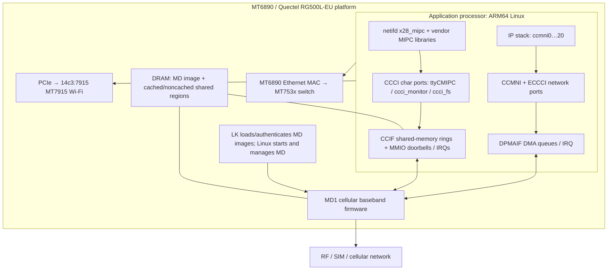

# X28 hardware architecture

Investigation: 2026-11-01. Documentation only; no firmware, DT, service, network,
boot setting or flash changes were made. No reboot, modem command, commit or push.

Evidence labels: **Observed** = read from this running X28; **Artifact** = stored
X28 DT/config/backup analysis; **SDK** = inspected Fibocom FG360 sibling source,
not the exact Quectel/Tozed build; **Assessment** = engineering inference.
SDK files are local, ignored dependencies and may not exist in a public checkout.
Line references refer to the files inspected, not a promise that later SDK versions match.

## Result and confidence

**Observed + Artifact:** Linux runs on the MT6890 application processor and talks
to its modem subsystem through memory-mapped CCIF plus shared-memory control
rings, and DPMAIF DMA for cellular packets. The active link is internal to the
platform. It is not an enumerated USB or PCIe modem attached to a separate router
CPU. CCCI/ECCCI is the vendor communication/lifecycle software; CCMNI is its Linux
network interface layer; MIPC carries userspace control messages over CCCI ports.

The exact physical module marking/package boundaries were not established by
opening the shield or a schematic. Firmware identifies **Quectel RG500L-EU**,
revision `RG500LEUAPR04A01M1G_OCPU_BETA20231220_20.200.20.200`, branch
`MCU_R04_CPE_TZ_MP` (read `/etc/quectel-project-version`). This is stronger than a
generic RG500L family guess, but does not prove every X28 revision uses it.
The board compatible is `Tozed,X28`, `mediatek,evb6890v1_64_cpe_nand`,
`mediatek,mt6890` ([DTS lines 6–7](../firmware/x28-device-tree.dts#L6)).
MT6890/T750 and four Cortex-A55 cores are recorded in [HARDWARE lines 8–13](../HARDWARE.md#L8).



The internal path and active drivers are observed; the detailed ring/DMA flow is
traced through matching-compatible SDK implementations in [driver analysis](x28-modem-driver-analysis.md).
RF wiring and physical silicon markings remain outside this audit's proof.
Live `swconfig list` identifies `switch0 - MT7531AE`, consistent with the
older board audit; the generic MT753x DT compatible alone would not identify it.

## Fresh read-only hardware evidence

Successful SSH reads on 2026-11-01 gave:

```text
uname: Linux x28 4.19.205 #0 SMP Fri Dec 22 12:10:12 UTC 2023 aarch64 GNU/Linux
cmdline subset: console=ttyS0,921600n1 ubi.mtd=29 bootslot=a
/sys/bus/platform/devices/10209000.mddriver/driver -> .../drivers/driver_modem
/sys/bus/platform/devices/10014000.dpmaif/driver -> .../drivers/ccci_hif_dpmaif
1004a000.cldma_sys_ap exists, but has no driver symlink
/proc/interrupts: GICv3 241 Level DPMAIF_AP       CPU0 count 58889
/proc/interrupts: GICv3 226 Level CCIF_AP_DATA    CPU0 count 175968
/proc/interrupts: GICv3 227 Level CCIF0_AP        CPU0 count 0
/sys/kernel/ccci/lk_md: LK Load MD:[Enabled](0x00000001)
                       LK load MD success!
/sys/kernel/ccci/version: 6
ccmni0 through ccmni20 exist; ccmni1 is UP,LOWER_UP, MTU 1500, NOARP
PCI 0000:00:00.0 = 14c3:4d75
PCI 0000:01:00.0 = 14c3:7915, driver mt_drv
```

Counts are a snapshot, not a benchmark. The GIC hardware IRQ numbers are SPI+32:
DPMAIF DT SPI 209 → 241; mddriver SPI 194 → 226, SPI 195 → 227.
Do not equate `/ap_ccif0`'s separate SPI 258 with the mddriver's IRQ list.
Dmesg contained CCMNI RX/TX counters and `dpmaif_rx_push` messages. Its early
boot entries had rolled out; LK boot loading is confirmed instead by `lk_md`
and the previously captured UART trace ([uart-boot-log lines 87–92](uart-boot-log.md#L87)).
There was no CLDMA interrupt in the filtered snapshot. Wi-Fi's `ccif_wo_isr`
is a separate offload interrupt, not proof of cellular CCIF transport.

## Memory and boot handoff

The saved FDT contains modem reservations at:

| Region | Physical start | Size | Evidence |
|---|---:|---:|---|
| MD image/working RAM `md1rom` | `0x6e000000` | `0x10000000` (256 MiB) | DTS 297–300 |
| cached MD shared RAM | `0x66000000` | `0x067a0000` (103.625 MiB) | DTS 287–291 |
| noncached MD shared RAM | `0x7e000000` | `0x00500000` (5 MiB) | DTS 292–296 |
| CCCI LK tag memory | `0x7fd20000` | `0x00010000` | DTS 301–304 |

The cached/noncached regions have `no-map`; `md1rom` and tag memory do not in
this stored tree. No `memory-region` phandle is present on mddriver or DPMAIF.
Vendor reserved-memory handling and LK tags carry this information; adding a
standard remoteproc node alone would not reproduce it.

**Memory-map cross-check:** there are two memory nodes in both the saved tree
and live OF view: `/memory` declares 1 GiB at `0x40000000` (DTS 227–230),
while `/memory@40000000` declares only 488 MiB at the same base (3969–3972).
The 488 MiB node alone is not the full memory map. Fresh `hexdump` reads
confirmed both values and the three stored MD reservations above.
Live `/proc/iomem` contains additional System RAM ranges, including
`0x6d329000–0x7dffffff` with `0x6de00000–0x7dffffff` reserved. That effective
reservation starts 2 MiB below the DT's `md1rom` address; the responsible
fixup/consumer was not established. Reconcile duplicate RAM nodes, memreserve
entries, reserved-memory callbacks and LK tags before building a boot DT.
[HARDWARE lines 26–35](../HARDWARE.md#L26) is a capacity summary, not an upstream
boot contract. Never reclaim MD, ATF, SSPM, MCUPM, MEDMCU, crash-log or
Wi-Fi-offload reservations by guesswork.

## DT bindings and dependencies

The appendix below records the requested properties directly from the stored
sanitized tree. An absent `status` normally means available; it does not prove
that a driver probed or that hardware is wired. `—` means absent, not zero.
All `reg` cells are literal DT values (root uses two address and two size cells).
Interrupt tuples are literal cells, not Linux virtual IRQ numbers.

- mddriver: `driver_modem`, SDK `eccci/modem_sys1.c:1629–1669`;
  DPMAIF: `ccci_hif_dpmaif`, `eccci/hif/ccci_hif_dpmaif.c:5326–5382`.
- CCIF register-only nodes have no individual live driver binding; ECCCI maps
  its resources and shared memory. `mdhif_type=<2>` means bit 1, CCIF, using
  `eccci/inc/ccci_hif.h:14–39`; DPMAIF registers separately. It does not mean
  “HIF enum value 2” or that DPMAIF is disabled.
- Clock phandle `0xe` is `syscon@10001000`, `mediatek,mt6890-infracfg_ao`
  (DTS 522–528); power phandle `0xf` is `power-controller@10006000`,
  `mediatek,mt6890-scpsys` (DTS 535–542). Modem domain index is 7.
  There is no `resets` property on mddriver/DPMAIF; SDK secure calls and
  platform power code handle startup/reset, not a generic reset phandle.
- `mhccif` is disabled; it must not be confused with active internal CCIF.
  GCE mailbox and auxiliary processor nodes do not establish an upstream
  remoteproc/rpmsg modem path. `CONFIG_REMOTEPROC` is off (config line 4767).
- USB `mediatek,mtu3` is the platform controller. The current init code creates
  a Quectel USB **gadget**, including `ttyGS0` for atcid
  ([x28-modem.init lines 52–67](../../package/x28-modem/files/x28-modem.init#L52)).
  This exports a host-facing interface; it is not AP-to-baseband USB.
- PCIe root controllers enable the external MT7915; their DT presence and the
  disabled PCIe endpoint do not make `mtk_t7xx` usable on this internal link.

## Read-only reproduction

These commands inspect state only. Do not run init scripts, vendor binaries
with guessed flags, or read unknown writable debug attributes. Capture output
on the host and redact identifiers before publishing it.

```sh
ssh -o BatchMode=yes router 'uname -a; cat /proc/cmdline; cat /proc/mtd'
ssh -o BatchMode=yes router 'cat /etc/quectel-project-version; lsmod'
ssh -o BatchMode=yes router 'readlink /sys/bus/platform/devices/10209000.mddriver/driver; readlink /sys/bus/platform/devices/10014000.dpmaif/driver'
ssh -o BatchMode=yes router 'grep -iE "ccif|dpmaif|cldma|ccci" /proc/interrupts; ip -d link show'
ssh -o BatchMode=yes router 'cat /sys/kernel/ccci/lk_md; cat /proc/iomem'
ssh -o BatchMode=yes router 'find /proc/device-tree -iname "*modem*" -o -iname "*ccci*" -o -iname "*ccif*" -o -iname "*dpmaif*"'
ssh -o BatchMode=yes router 'zcat /proc/config.gz' > /tmp/x28-running.config
ssh -o BatchMode=yes router 'cat /sys/firmware/fdt' > /tmp/x28-running.dtb
# Host dtc, if installed; keep this unsanitized output private.
dtc -I dtb -O dts -o /tmp/x28-running.dts /tmp/x28-running.dtb
ssh -o BatchMode=yes router 'hexdump -C /proc/device-tree/mddriver/mediatek,mdhif_type'
```

SSH first failed under the local network sandbox, then succeeded with network
access approved by the tool. A later attempt to use router `od` failed because
it is not installed; `hexdump` successfully read `00 00 00 02`. No successful
DT property dump is claimed for that failed `od` command.

## Stored DT property inventory

### `/memory` (DTS line 227)

| Property | Literal value |
|---|---|
| `compatible` | `—` |
| `reg` | `<0x0 0x40000000 0x0 0x40000000>` |
| `interrupts` | `—` |
| `memory-region` | `—` |
| `clocks` | `—` |
| `resets` | `—` |
| `power-domains` | `—` |
| `status` | `—` |

### `/ap2woccif@151A9000` (DTS line 253)

| Property | Literal value |
|---|---|
| `compatible` | `"mediatek,ap2woccif"` |
| `reg` | `<0x0 0x151a9000 0x0 0x1000 0x0 0x151ab000 0x0 0x1000>` |
| `interrupts` | `<0x0 0x19e 0x4 0x0 0x19f 0x4>` |
| `memory-region` | `—` |
| `clocks` | `—` |
| `resets` | `—` |
| `power-domains` | `—` |
| `status` | `—` |

### `/reserved-memory/mblock-18-md_smem_cache` (DTS line 287)

| Property | Literal value |
|---|---|
| `compatible` | `"mediatek,md_smem_cache"` |
| `reg` | `<0x0 0x66000000 0x0 0x67a0000>` |
| `interrupts` | `—` |
| `memory-region` | `—` |
| `clocks` | `—` |
| `resets` | `—` |
| `power-domains` | `—` |
| `status` | `—` |

### `/reserved-memory/mblock-17-md_smem_ncache` (DTS line 292)

| Property | Literal value |
|---|---|
| `compatible` | `"mediatek,md_smem_ncache"` |
| `reg` | `<0x0 0x7e000000 0x0 0x500000>` |
| `interrupts` | `—` |
| `memory-region` | `—` |
| `clocks` | `—` |
| `resets` | `—` |
| `power-domains` | `—` |
| `status` | `—` |

### `/reserved-memory/mblock-16-md1rom` (DTS line 297)

| Property | Literal value |
|---|---|
| `compatible` | `"mediatek,md1rom"` |
| `reg` | `<0x0 0x6e000000 0x0 0x10000000>` |
| `interrupts` | `—` |
| `memory-region` | `—` |
| `clocks` | `—` |
| `resets` | `—` |
| `power-domains` | `—` |
| `status` | `—` |

### `/reserved-memory/mblock-15-ccci_tag_mem` (DTS line 301)

| Property | Literal value |
|---|---|
| `compatible` | `"mediatek,ccci_tag_mem"` |
| `reg` | `<0x0 0x7fd20000 0x0 0x10000>` |
| `interrupts` | `—` |
| `memory-region` | `—` |
| `clocks` | `—` |
| `resets` | `—` |
| `power-domains` | `—` |
| `status` | `—` |

### `/interrupt-controller` (DTS line 431)

| Property | Literal value |
|---|---|
| `compatible` | `"arm,gic-v3"` |
| `reg` | `<0x0 0xc000000 0x0 0x40000 0x0 0xc040000 0x0 0x200000>` |
| `interrupts` | `<0x1 0x9 0x4>` |
| `memory-region` | `—` |
| `clocks` | `—` |
| `resets` | `—` |
| `power-domains` | `—` |
| `status` | `—` |

### `/syscon@10001000` (DTS line 523)

| Property | Literal value |
|---|---|
| `compatible` | `"mediatek,mt6890-infracfg_ao", "syscon"` |
| `reg` | `<0x0 0x10001000 0x0 0x1000>` |
| `interrupts` | `—` |
| `memory-region` | `—` |
| `clocks` | `—` |
| `resets` | `—` |
| `power-domains` | `—` |
| `status` | `—` |

### `/power-controller@10006000` (DTS line 534)

| Property | Literal value |
|---|---|
| `compatible` | `"mediatek,mt6890-scpsys", "syscon"` |
| `reg` | `<0x0 0x10006000 0x0 0x1000>` |
| `interrupts` | `—` |
| `memory-region` | `—` |
| `clocks` | `<0x10 0xa7 0x10 0xa9 0x10 0xcf 0x10 0xd0 0x10 0xd1 0x10 0xd2 0x10 0xce 0xe 0x35 0x11 0x11>` |
| `resets` | `—` |
| `power-domains` | `—` |
| `status` | `—` |

### `/sleep@10006000` (DTS line 1446)

| Property | Literal value |
|---|---|
| `compatible` | `"mediatek,sleep", "syscon"` |
| `reg` | `<0x0 0x10006000 0x0 0x1000>` |
| `interrupts` | `—` |
| `memory-region` | `—` |
| `clocks` | `—` |
| `resets` | `—` |
| `power-domains` | `—` |
| `status` | `—` |

### `/dpmaif_ao@10014000` (DTS line 1639)

| Property | Literal value |
|---|---|
| `compatible` | `"mediatek,dpmaif_ao"` |
| `reg` | `<0x0 0x10014000 0x0 0x1000>` |
| `interrupts` | `—` |
| `memory-region` | `—` |
| `clocks` | `—` |
| `resets` | `—` |
| `power-domains` | `—` |
| `status` | `—` |

### `/modem_temp_share@10018000` (DTS line 1659)

| Property | Literal value |
|---|---|
| `compatible` | `"mediatek,modem_temp_share"` |
| `reg` | `<0x0 0x10018000 0x0 0x1000>` |
| `interrupts` | `—` |
| `memory-region` | `—` |
| `clocks` | `—` |
| `resets` | `—` |
| `power-domains` | `—` |
| `status` | `—` |

### `/mhccif@10024000` (DTS line 1687)

| Property | Literal value |
|---|---|
| `compatible` | `"mediatek,mt6880-mhccif"` |
| `reg` | `<0x0 0x10024000 0x0 0x1000 0x0 0x10025000 0x0 0x1000>` |
| `interrupts` | `<0x0 0x13d 0x4>` |
| `memory-region` | `—` |
| `clocks` | `—` |
| `resets` | `—` |
| `power-domains` | `—` |
| `status` | `"disabled"` |

### `/ap_ccif0@10209000` (DTS line 2216)

| Property | Literal value |
|---|---|
| `compatible` | `"mediatek,ap_ccif0"` |
| `reg` | `<0x0 0x10209000 0x0 0x1000>` |
| `interrupts` | `<0x0 0x102 0x4>` |
| `memory-region` | `—` |
| `clocks` | `—` |
| `resets` | `—` |
| `power-domains` | `—` |
| `status` | `—` |

### `/md_ccif0@1020a000` (DTS line 2221)

| Property | Literal value |
|---|---|
| `compatible` | `"mediatek,md_ccif0"` |
| `reg` | `<0x0 0x1020a000 0x0 0x1000>` |
| `interrupts` | `—` |
| `memory-region` | `—` |
| `clocks` | `—` |
| `resets` | `—` |
| `power-domains` | `—` |
| `status` | `—` |

### `/ap_ccif1@1020b000` (DTS line 2225)

| Property | Literal value |
|---|---|
| `compatible` | `"mediatek,ap_ccif1"` |
| `reg` | `<0x0 0x1020b000 0x0 0x1000>` |
| `interrupts` | `<0x0 0x104 0x4>` |
| `memory-region` | `—` |
| `clocks` | `—` |
| `resets` | `—` |
| `power-domains` | `—` |
| `status` | `—` |

### `/md_ccif1@1020c000` (DTS line 2230)

| Property | Literal value |
|---|---|
| `compatible` | `"mediatek,md_ccif1"` |
| `reg` | `<0x0 0x1020c000 0x0 0x1000>` |
| `interrupts` | `—` |
| `memory-region` | `—` |
| `clocks` | `—` |
| `resets` | `—` |
| `power-domains` | `—` |
| `status` | `—` |

### `/md2md_md2_ccif0@10213000` (DTS line 2256)

| Property | Literal value |
|---|---|
| `compatible` | `"mediatek,md2md_md2_ccif0"` |
| `reg` | `<0x0 0x10213000 0x0 0x1000>` |
| `interrupts` | `—` |
| `memory-region` | `—` |
| `clocks` | `—` |
| `resets` | `—` |
| `power-domains` | `—` |
| `status` | `—` |

### `/cldma_sys_ap` (DTS line 2311)

| Property | Literal value |
|---|---|
| `compatible` | `"mediatek,cldma_sys_ap"` |
| `reg` | `<0x0 0x1004a000 0x0 0x1000 0x0 0x1021e000 0x0 0x1000>` |
| `interrupts` | `<0x0 0x11d 0x4>` |
| `memory-region` | `—` |
| `clocks` | `<0xe 0x6c>` |
| `resets` | `—` |
| `power-domains` | `—` |
| `status` | `—` |

### `/dpmaif@10014000` (DTS line 2328)

| Property | Literal value |
|---|---|
| `compatible` | `"mediatek,dpmaif"` |
| `reg` | `<0x0 0x10014000 0x0 0x1000 0x0 0x1022d000 0x0 0x1000 0x0 0x1022c000 0x0 0x1000 0x0 0x1022e000 0x0 0x1000 0x0 0x15b14000 0x0 0x1000 0x0 0x15b38000 0x0 0x1000>` |
| `interrupts` | `<0x0 0xd1 0x4>` |
| `memory-region` | `—` |
| `clocks` | `<0xe 0x61 0xe 0x34>` |
| `resets` | `—` |
| `power-domains` | `—` |
| `status` | `—` |

### `/mddriver` (DTS line 2336)

| Property | Literal value |
|---|---|
| `compatible` | `"mediatek,mddriver"` |
| `reg` | `<0x0 0x10209000 0x0 0x1000 0x0 0x1020a000 0x0 0x1000>` |
| `interrupts` | `<0x0 0x4e 0x1 0x0 0xc2 0x4 0x0 0xc3 0x4>` |
| `memory-region` | `—` |
| `clocks` | `<0xe 0x2c 0xe 0x2f 0xe 0x24 0xe 0x25 0xe 0x57 0xe 0x58 0xe 0x64>` |
| `resets` | `—` |
| `power-domains` | `<0xf 0x7>` |
| `status` | `—` |

### `/gce_mbox@10228000` (DTS line 2349)

| Property | Literal value |
|---|---|
| `compatible` | `"mediatek,mailbox-gce"` |
| `reg` | `<0x0 0x10228000 0x0 0x4000>` |
| `interrupts` | `<0x0 0xcb 0x4>` |
| `memory-region` | `—` |
| `clocks` | `<0xe 0x9 0xe 0x1b>` |
| `resets` | `—` |
| `power-domains` | `—` |
| `status` | `—` |

### `/infra_dpmaif@1022c000` (DTS line 2370)

| Property | Literal value |
|---|---|
| `compatible` | `"mediatek,infra_dpmaif"` |
| `reg` | `<0x0 0x1022c000 0x0 0x10>` |
| `interrupts` | `—` |
| `memory-region` | `—` |
| `clocks` | `—` |
| `resets` | `—` |
| `power-domains` | `—` |
| `status` | `—` |

### `/ap_ccif2@1023c000` (DTS line 2443)

| Property | Literal value |
|---|---|
| `compatible` | `"mediatek,ap_ccif2"` |
| `reg` | `<0x0 0x1023c000 0x0 0x1000>` |
| `interrupts` | `<0x0 0x106 0x4>` |
| `memory-region` | `—` |
| `clocks` | `—` |
| `resets` | `—` |
| `power-domains` | `—` |
| `status` | `—` |

### `/md_ccif2@1023d000` (DTS line 2448)

| Property | Literal value |
|---|---|
| `compatible` | `"mediatek,md_ccif2"` |
| `reg` | `<0x0 0x1023d000 0x0 0x1000>` |
| `interrupts` | `—` |
| `memory-region` | `—` |
| `clocks` | `—` |
| `resets` | `—` |
| `power-domains` | `—` |
| `status` | `—` |

### `/ap_ccif3@1023e000` (DTS line 2452)

| Property | Literal value |
|---|---|
| `compatible` | `"mediatek,ap_ccif3"` |
| `reg` | `<0x0 0x1023e000 0x0 0x1000>` |
| `interrupts` | `<0x0 0x107 0x4>` |
| `memory-region` | `—` |
| `clocks` | `—` |
| `resets` | `—` |
| `power-domains` | `—` |
| `status` | `—` |

### `/md_ccif3@1023f000` (DTS line 2457)

| Property | Literal value |
|---|---|
| `compatible` | `"mediatek,md_ccif3"` |
| `reg` | `<0x0 0x1023f000 0x0 0x1000>` |
| `interrupts` | `—` |
| `memory-region` | `—` |
| `clocks` | `—` |
| `resets` | `—` |
| `power-domains` | `—` |
| `status` | `—` |

### `/usb@11201000` (DTS line 2730)

| Property | Literal value |
|---|---|
| `compatible` | `"mediatek,mtu3"` |
| `reg` | `<0x0 0x11201000 0x0 0x2e00 0x0 0x11203e00 0x0 0x100>` |
| `interrupts` | `<0x0 0x60 0x4>` |
| `memory-region` | `—` |
| `clocks` | `<0xe 0x84 0xe 0x49>` |
| `resets` | `—` |
| `power-domains` | `<0xf 0xb>` |
| `status` | `—` |

### `/nfi@11005000` (DTS line 2860)

| Property | Literal value |
|---|---|
| `compatible` | `"mediatek,mt6880-nfc"` |
| `reg` | `<0x0 0x11005000 0x0 0x1000 0x0 0x11006000 0x0 0x1000>` |
| `interrupts` | `<0x0 0xc4 0x4 0x0 0xc5 0x4>` |
| `memory-region` | `—` |
| `clocks` | `<0x10 0x54 0x10 0x21 0x10 0x14 0x10 0x10 0x10 0x26 0x10 0x7 0x10 0x1d 0x10 0xf 0x10 0xc8 0xe 0x78 0xe 0x76>` |
| `resets` | `—` |
| `power-domains` | `—` |
| `status` | `"okay"` |

### `/ap_ccif4@1024c000` (DTS line 3026)

| Property | Literal value |
|---|---|
| `compatible` | `"mediatek,ap_ccif4"` |
| `reg` | `<0x0 0x1024c000 0x0 0x1000>` |
| `interrupts` | `—` |
| `memory-region` | `—` |
| `clocks` | `—` |
| `resets` | `—` |
| `power-domains` | `—` |
| `status` | `—` |

### `/md_ccif4@1024d000` (DTS line 3030)

| Property | Literal value |
|---|---|
| `compatible` | `"mediatek,md_ccif4"` |
| `reg` | `<0x0 0x1024d000 0x0 0x1000>` |
| `interrupts` | `—` |
| `memory-region` | `—` |
| `clocks` | `—` |
| `resets` | `—` |
| `power-domains` | `—` |
| `status` | `—` |

### `/md_ccif4@1024e000` (DTS line 3034)

| Property | Literal value |
|---|---|
| `compatible` | `"mediatek,md_ccif4"` |
| `reg` | `<0x0 0x1024e000 0x0 0x1000>` |
| `interrupts` | `—` |
| `memory-region` | `—` |
| `clocks` | `—` |
| `resets` | `—` |
| `power-domains` | `—` |
| `status` | `—` |

### `/ap_ccif5@1025c000` (DTS line 3066)

| Property | Literal value |
|---|---|
| `compatible` | `"mediatek,ap_ccif5"` |
| `reg` | `<0x0 0x1025c000 0x0 0x1000>` |
| `interrupts` | `—` |
| `memory-region` | `—` |
| `clocks` | `—` |
| `resets` | `—` |
| `power-domains` | `—` |
| `status` | `—` |

### `/md_ccif5@1025d000` (DTS line 3070)

| Property | Literal value |
|---|---|
| `compatible` | `"mediatek,md_ccif5"` |
| `reg` | `<0x0 0x1025d000 0x0 0x1000>` |
| `interrupts` | `—` |
| `memory-region` | `—` |
| `clocks` | `—` |
| `resets` | `—` |
| `power-domains` | `—` |
| `status` | `—` |

### `/sspm@10400000` (DTS line 3166)

| Property | Literal value |
|---|---|
| `compatible` | `"mediatek,sspm"` |
| `reg` | `<0x0 0x10400000 0x0 0x28000 0x0 0x10440000 0x0 0x10000 0x0 0x10450000 0x0 0x100 0x0 0x10451000 0x0 0x4 0x0 0x10451004 0x0 0x4 0x0 0x10460000 0x0 0x100 0x0 0x10461000 0x0 0x4 0x0 0x10461004 0x0 0x4 0x0 0x10470000 0x0 0x100 0x0 0x10471000 0x0 0x4 0x0 0x10471004 0x0 0x4 0x0 0x10480000 0x0 0x100 0x0 0x10481000 0x0 0x4 0x0 0x10481004 0x0 0x4 0x0 0x10490000 0x0 0x100 0x0 0x10491000 0x0 0x4 0x0 0x10491004 0x0 0x4>` |
| `interrupts` | `<0x0 0xf1 0x4 0x0 0xf4 0x4 0x0 0xf5 0x4 0x0 0xf6 0x4 0x0 0xf7 0x4 0x0 0xf8 0x4>` |
| `memory-region` | `—` |
| `clocks` | `—` |
| `resets` | `—` |
| `power-domains` | `—` |
| `status` | `—` |

### `/pcie@11280000` (DTS line 3304)

| Property | Literal value |
|---|---|
| `compatible` | `"mediatek,mt6880-pcie"` |
| `reg` | `<0x0 0x11280000 0x0 0x2000>` |
| `interrupts` | `<0x0 0x145 0x4>` |
| `memory-region` | `—` |
| `clocks` | `<0xe 0x27 0xe 0x29 0xe 0x62 0xe 0x56 0xe 0x71>` |
| `resets` | `—` |
| `power-domains` | `<0xf 0x1>` |
| `status` | `"okay"` |

### `/pcie@11288000` (DTS line 3331)

| Property | Literal value |
|---|---|
| `compatible` | `"mediatek,mt6880-pcie"` |
| `reg` | `<0x0 0x11288000 0x0 0x2000>` |
| `interrupts` | `<0x0 0x69 0x4>` |
| `memory-region` | `—` |
| `clocks` | `<0xe 0x27 0xe 0x29 0xe 0x62 0xe 0x72 0xe 0x7d>` |
| `resets` | `—` |
| `power-domains` | `<0xf 0x2>` |
| `status` | `"okay"` |

### `/pcie@11290000` (DTS line 3358)

| Property | Literal value |
|---|---|
| `compatible` | `"mediatek,mt6880-pcie"` |
| `reg` | `<0x0 0x11290000 0x0 0x2000>` |
| `interrupts` | `<0x0 0x6a 0x4>` |
| `memory-region` | `—` |
| `clocks` | `<0xe 0x27 0xe 0x29 0xe 0x62 0xe 0x73 0xe 0x7e>` |
| `resets` | `—` |
| `power-domains` | `<0xf 0x3>` |
| `status` | `"okay"` |

### `/pcie@11298000` (DTS line 3385)

| Property | Literal value |
|---|---|
| `compatible` | `"mediatek,mt6880-pcie"` |
| `reg` | `<0x0 0x11298000 0x0 0x2000>` |
| `interrupts` | `<0x0 0x6b 0x4>` |
| `memory-region` | `—` |
| `clocks` | `<0xe 0x27 0xe 0x29 0xe 0x62 0xe 0x74 0xe 0x7f>` |
| `resets` | `—` |
| `power-domains` | `<0xf 0x3>` |
| `status` | `"okay"` |

### `/medmcu@15f00000` (DTS line 3813)

| Property | Literal value |
|---|---|
| `compatible` | `"mediatek,medmcu"` |
| `reg` | `<0x0 0x15d00000 0x0 0x20000 0x0 0x15f24000 0x0 0x1000 0x0 0x15f21000 0x0 0x1000 0x0 0x15f30000 0x0 0x1000 0x0 0x15f40000 0x0 0x1000 0x0 0x15f52000 0x0 0x1000 0x0 0x15f60000 0x0 0x40000 0x0 0x15fa5000 0x0 0x4 0x0 0x15ffb000 0x0 0x100 0x0 0x15ffb100 0x0 0x4 0x0 0x15ffb10c 0x0 0x4 0x0 0x15fa5020 0x0 0x4 0x0 0x15ffc000 0x0 0x100 0x0 0x15ffc100 0x0 0x4 0x0 0x15ffc10c 0x0 0x4 0x0 0x15fa5024 0x0 0x4 0x0 0x15ffd000 0x0 0x100 0x0 0x15ffd100 0x0 0x4 0x0 0x15ffd10c 0x0 0x4 0x0 0x15fa5028 0x0 0x4 0x0 0x15ffe000 0x0 0x100 0x0 0x15ffe100 0x0 0x4 0x0 0x15ffe10c 0x0 0x4 0x0 0x15fa502c 0x0 0x4 0x0 0x15fff000 0x0 0x100 0x0 0x15fff100 0x0 0x4 0x0 0x15fff10c 0x0 0x4 0x0 0x15fa5030 0x0 0x4>` |
| `interrupts` | `<0x0 0x1a4 0x4 0x0 0x1a5 0x4 0x0 0x1a6 0x4 0x0 0x1a7 0x4 0x0 0x1a8 0x4>` |
| `memory-region` | `—` |
| `clocks` | `—` |
| `resets` | `—` |
| `power-domains` | `—` |
| `status` | `"okay"` |

### `/memory@40000000` (DTS line 3969)

| Property | Literal value |
|---|---|
| `compatible` | `—` |
| `reg` | `<0x0 0x40000000 0x0 0x1e800000>` |
| `interrupts` | `—` |
| `memory-region` | `—` |
| `clocks` | `—` |
| `resets` | `—` |
| `power-domains` | `—` |
| `status` | `—` |

