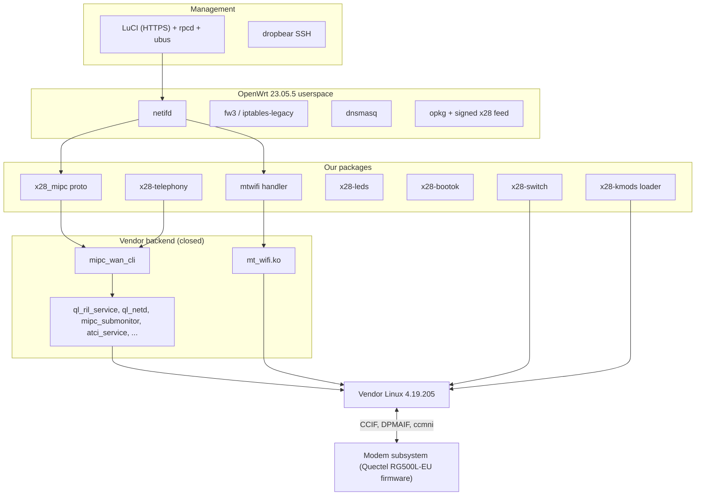

# Architecture

## The idea

Stay on the vendor kernel and blobs (modem, Wi-Fi, TEE), rebuild only the userspace as a modern OpenWrt. Standard OpenWrt
services own all networking; the vendor daemons run only as the modem backend. There is no copy of the vendor web UI and no
UCI-to-vendor adapter.

Why not a new kernel: the modem and Wi-Fi drivers are tied to 4.19.205, and the vendor never released its GPL source.

## The image has two halves

| Half | Contents | Built |
|---|---|---|
| Open userspace | OpenWrt 23.05.5 (`armsr/armv8` packages): procd, netifd, **fw3 + iptables-legacy**, dnsmasq, dropbear, LuCI, plus our `x28-*` packages | in CI (`userspace.yml`), from the official ImageBuilder with a pinned hash |
| Vendor half | the 4.19.205 kernel and its 146 modules, modem/cellular/Wi-Fi binaries, four 19.07 compatibility libraries | from a stock rootfs: privately in CI for releases, or from your own backup in a local build |

Vendor files never enter the public repository, its caches or artifacts.

## Layers on a running unit

## What each part owns

| Function | Owner |
|---|---|
| 5G WAN | netifd protocol `x28_mipc` drives `mipc_wan_cli`; the bearer is a `ccmniN` device |
| Modem start | `x28-modem` starts the vendor daemons in a verified order, mounts, the USB gadget for the AT daemon, radio on, `ifup wan` |
| Wi-Fi | netifd wireless handler `mtwifi` writes the vendor profile and brings up `ra0` (2.4 GHz) and `rai0` (5 GHz) |
| LAN | `x28-switch` loads the MT7531AE VLAN table with `swconfig`; netifd bridges; `dnsmasq` serves DHCP/DNS |
| Firewall | fw3 with iptables-legacy (the kernel has no `nf_tables`) |
| Storage | squashfs root in the slot; the overlay is `user_data` (about 278 MB), attached by `x28-storage` at preinit |
| Boot health | `x28-bootok` resets the running slot's boot tries after a good boot |
| Extra kernel modules | built for this kernel, kept in `/lib/modules/x28`, loaded late by `x28-kmods` |

Deliberately **not started**: `mtk_netagent` (it forces the radio off in this start order; the protocol handles IPv6 instead),
and the vendor network managers `wan_mgr`, `lan_mgr`, `firewalltools` (the protocol refuses to run while `wan_mgr` is up).

## Limits that come from the kernel

- No `nf_tables`: fw3, not firewall4.
- No namespaces: no `ujail`.
- `CONFIG_MODVERSIONS`: official 5.15 `kmod-*` packages can never load. Userspace packages run as they are.
- `sit` is missing: 6in4/6rd do not work. PPPoE and DS-Lite do.

How we work around the module problem: [Package feed](Package-Feed.md).

## Legacy: the stock-firmware overlay

Before the native image, `router/` held an overlay for the stock firmware: `vendorbridge.lua` logged into the vendor CGI and
proxied JSON commands, `vendorsync` mapped UCI to them, `voicectl` drove calls. It worked but was not the goal. It is kept as
history and is not part of the native image ([Experiments](Experiments-and-Research.md#stage-1-the-stock-firmware-overlay)).

Full documents: [BUILD](https://github.com/mralinp/zlt-x28-openwrt/blob/main/docs/BUILD.md),
[MODULES](https://github.com/mralinp/zlt-x28-openwrt/blob/main/docs/MODULES.md),
[PROJECT-PLAN](https://github.com/mralinp/zlt-x28-openwrt/blob/main/docs/PROJECT-PLAN.md).
