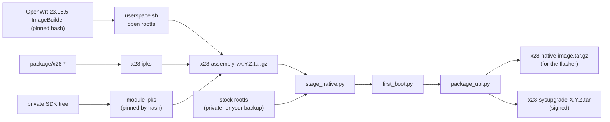

# Build and release

## Pipeline

| Step | Where | Does |
|---|---|---|
| `tools/build/userspace.sh` | this repo, CI | assembles the open rootfs from prebuilt packages; fails if `firewall4` or `nftables` appear |
| `stage_native.py` | x28-flasher | merges the open rootfs with the stock kernel modules and vendor binaries |
| `first_boot.py` | x28-flasher | installs the `x28-*` ipks and the first-boot profile |
| `package_ubi.py` | x28-flasher | makes the UBI slot image; `ab_guard` refuses boot paths that write flash |
| `image_sign.sh` | this repo | signs the sysupgrade tarball |

The image assembly tools moved to x28-flasher in v0.54. Install images through the flasher's **Build** entry: it downloads the
release image and checks it against `SHA256SUMS`, or builds locally from your own backup.

### Building the userspace locally

Linux x86_64 on a case-sensitive filesystem: `tools/build/userspace.sh out`. On an Apple Silicon Mac, run it in an emulated
x86_64 container with the work directory inside the container (APFS is case-insensitive); the command is in
[BUILD](https://github.com/mralinp/zlt-x28-openwrt/blob/main/docs/BUILD.md#locally).

## CI workflows

| Workflow | Runs on | Does |
|---|---|---|
| `ci.yml` | every PR | shell, Lua and Python tests, self-checks, the PR-title check |
| `userspace.yml` | PRs touching `tools/build/`, manual | builds the open rootfs, boot-tests it in QEMU |
| `release.yml` | pushes to `develop` and `main` that touch release inputs | computes the version, tags, publishes the assembly bundle |
| `image.yml` | called by Release | builds the full image from the assembly and the private stock rootfs |
| `sign-image.yml` | manual, owner-approved | signs the sysupgrade image and attaches it; for a stable tag it then starts `pages.yml` |
| `pages.yml` | pushes to `develop` under `site/`, nightly, manual, after a stable release is signed | builds and deploys the website and the feed mirror |

## Release model

| Branch | Tag | Kind |
|---|---|---|
| `develop` | `vX.Y.Z-rc.N` | pre-release, for test units |
| `main` | `vX.Y.Z` | stable (since 1.0.0), marked latest |

- The version comes from Conventional Commits since the last tag: `feat` → minor, `type!` or `BREAKING CHANGE` → major, anything
  else → patch. `Release-As: X.Y.Z` in a commit body sets it.
- PRs into `develop` are squash-merged, so **the PR title decides the bump**. CI rejects titles that are not Conventional Commits.
- `develop` → `main` is a PR merged with a **merge commit**, never a squash. Otherwise the next version on `develop` is computed
  from the wrong base. The same goes for syncing a `main` hotfix back into `develop`.
- Docs-only and CI-only merges release nothing.
- Routers are only offered stable-form `vX.Y.Z` images.

## What a release carries

| Asset | For |
|---|---|
| `x28-assembly-vX.Y.Z.tar.gz` | the flasher's local build: userspace, package files, kernel modules, extra packages |
| `x28-native-image.tar.gz` | the flasher's download path |
| `x28-sysupgrade-X.Y.Z.tar` + `.sha256` | `x28-upgrade` and `sysupgrade` on a running unit |
| `SHA256SUMS` | all of the above |

The package feed is a separate release, `feed-3` ([Package feed](Package-Feed.md)).

## Secrets and keys

| Key | Lives | Signs |
|---|---|---|
| Feed key | offline, never in GitHub | the package index; certifies the image signer |
| Image-signer key | CI secret in the `release-signing` environment | sysupgrade images |
| `X28_INPUTS_TOKEN` | CI secret | read access to the private stock rootfs |

## Changelog

`CHANGELOG.md` has hand-written milestones on top and a generated per-release list at the bottom. Refresh with
`python3 scripts/changelog.py`; `--check` fails if it is stale.

Full documents: [BUILD](https://github.com/mralinp/zlt-x28-openwrt/blob/main/docs/BUILD.md),
[WORKFLOW](https://github.com/mralinp/zlt-x28-openwrt/blob/main/docs/WORKFLOW.md),
[FIRMWARE-INVENTORY](https://github.com/mralinp/zlt-x28-openwrt/blob/main/docs/FIRMWARE-INVENTORY.md).
